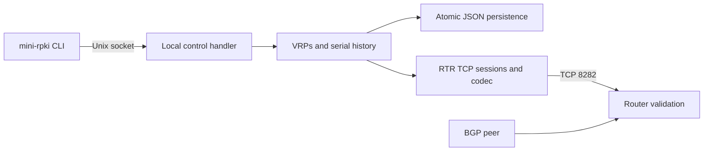

# MiniRPKI

## Start here

For the supported user workflow, read the short
[Quick Installation with Containerlab](GETTING_STARTED.md). It starts with installation,
uses only Containerlab, and manages MiniRPKI from an attached shell.

A lightweight, offline RTR cache for testing RPKI origin validation on laboratory routers. Add one prefix/origin record with one command:

```sh
mini-rpki add 192.0.2.0/24 --asn 65001
```

The maximum length defaults to the prefix length. Records take effect without restarting the server. MiniRPKI serves operator-defined VRPs over RTR; your router computes the validation state of BGP routes received from a separate peer.

**Lab use only. Never connect this cache to production routers.** MiniRPKI does not retrieve repositories, validate real ROAs, or establish a cryptographic chain of trust. A full RPKI validator performs those tasks. MiniRPKI is for engineers who need small, controlled test inputs. MIT licensed, Go standard library only.

## Commands

Inside the MiniRPKI container:

```sh
mini-rpki add 192.0.2.0/24 --asn 65001
mini-rpki add 2001:db8:100::/48 --asn 65001
mini-rpki list
mini-rpki remove 192.0.2.0/24 --asn 65001
mini-rpki status
mini-rpki interface
mini-rpki clear
mini-rpki --help
```

Use `--maxlen` only when you want to permit more-specific routes:

```sh
mini-rpki add 192.0.2.0/24 --asn 65001 --maxlen 25
mini-rpki remove 192.0.2.0/24 --asn 65001 --maxlen 25
```

Removal requires the exact prefix, maximum length, and ASN. Adding an existing record leaves it unchanged. Prefixes must be canonical IPv4/IPv6 networks; ASN values are decimal 0..4294967295. Maximum length must be between the prefix length and its address-family limit.

`interface` shows the running RTR listener, IP addresses, TCP port, and interfaces in the server container. It does not infer Docker host port mappings or remote routes. `list` prints an aligned prefix table. `status` shows the session ID, serial, timers, and connected clients. Add/remove print a short record acknowledgement. Append `--json` for scripts, for example `mini-rpki list --json`.

## RTR versions and RFC compatibility

Dataset changes are saved atomically before advancing the serial. Connected routers obtain withdrawals and announcements through Serial Queries. The cache retains 128 transitions. A matching Session ID with unavailable history receives Cache Reset, followed by full synchronization. A mismatched Session ID receives Error Report code 0 and the RTR connection closes, as required by RFC 8210. Each process start generates a new random 16-bit session ID. Its finite field size has an inherent collision probability.

Refresh defaults to five seconds in both the cache and prepared FRR lab. Serial Notify remains limited to one per minute per connection under [RFC 8210](https://www.rfc-editor.org/rfc/rfc8210.html). Update timing depends on the router; server-side commits do not guarantee immediate router-side validation.

```sh
mini-rpki serve --listen :8282 --data /data/vrps.json --socket /run/minirpki/control.sock --refresh 5 --rtr-version 0
```

RTR v0 (RFC 6810) is the default for older router interoperability. Select RTR v1 (RFC 8210) deliberately with `--rtr-version 1` or `MINIRPKI_RTR_VERSION=1`. The selected version applies to every RTR client for that server process; changing it requires a restart. Version 0 End of Data PDUs do not contain timing parameters, while version 1 carries the configured refresh/retry/expire values.

Environment equivalents: `MINIRPKI_LISTEN`, `MINIRPKI_DATA`, `MINIRPKI_SOCKET`, `MINIRPKI_REFRESH`, and `MINIRPKI_RTR_VERSION`. The container image sets `MINIRPKI_SOCKET=/run/minirpki/control.sock`, keeping the runtime socket out of the persistent `/data` volume. Refresh supports 1..599 seconds; retry/expire stay 10/600 seconds. CLI processes use `MINIRPKI_SOCKET` to find the running server. Modify records with the CLI rather than editing JSON during operation.

Logs record changes, serial advancement, queries, notifications, and End of Data. No runtime code downloads RPKI data or initiates Internet requests.

## Architecture



## Limitations, security, and troubleshooting

- RTR v0 (default) and RTR v1 IPv4/IPv6 prefix records. Experimental mutual TLS is available with either RTR version; no Router Keys, SSH, repository downloads, or cryptographic ROA validation. TLS router interoperability has not yet been claimed for a public release.
- Trust lab clients only. Input PDUs are capped at 4096 bytes; writes time out after ten seconds and idle RTR reads after two hours. No connection-count quota is implemented.
- The persistent `/data` bind mount, including generated TLS private keys, is host-readable by design. Use MiniRPKI only on a trusted lab host.
- No cache session: check port reachability and the router's RPKI configuration. A TCP connection alone does not prove synchronization.
- Failed JSON reads prevent startup; failed persistence rejects updates without changing served state. Use one process per data directory. Power-loss durability depends on filesystem behavior.
- The image uses an ephemeral runtime socket. In Containerlab mode it removes a stale runtime socket before starting its sole server; JSON VRPs remain in `/data`.
- FRR 10.3 interoperability was tested with RTR v1. Nokia SR OS was tested with RTR v0. IOS XR and Junos have not been tested.

## Development and license

Go 1.24 or later, no third-party Go dependencies. The Docker build uses Go 1.26.1.

```sh
go test ./...
go test -race ./...
go vet ./...
go build -o mini-rpki ./cmd/mini-rpki
```

Protocol tests cover golden wire formats, partial I/O, malformed input, full/incremental synchronization, withdrawals, serial wrap, restart, version handling, concurrent clients, persistence, and validation semantics. The containerlab test exercises real BGP routes. See the verification report for executed platforms and limitations.

MiniRPKI uses the [MIT license](LICENSE). Alpine packages and the separate FRR lab image retain their upstream licenses.

Next priorities are validating the Quick Installation guide with external
Containerlab users, recording router-vendor interoperability results, and
adding an atomic VRP replacement command. MiniRPKI will remain a small
laboratory cache rather than a full RPKI validator.

For vulnerability reporting and security boundaries, see the [Security Policy](SECURITY.md).
