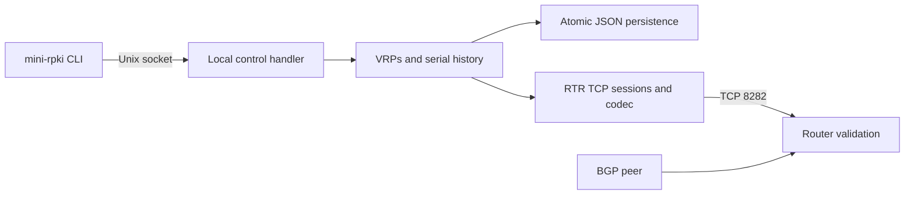

# MiniRPKI

## Deployment and contributor guides

- [Containerlab user guide](CONTAINERLAB_GUIDE.md): deploy on WSL, open FRR, inspect validation, and change records.
- [Existing Containerlab example](examples/containerlab/README.md): add MiniRPKI to your own topology with a dedicated configurable RTR link.
- [Release guide](docs/RELEASING.md): publish the single Docker/Containerlab image to GitHub Container Registry.
- [Security policy](SECURITY.md): boundaries and private-reporting guidance.
- [AI knowledge base](docs/AI_KNOWLEDGE_BASE.md): project decisions, environment, architecture, and verification history.
- [Contributor instructions](AGENTS.md): entry point for future AI work.


A lightweight, offline RTR cache for testing RPKI origin validation on laboratory routers. Add one prefix/origin record with one command:

```sh
mini-rpki add 192.0.2.0/24 --asn 65001
```

The maximum length defaults to the prefix length. Records take effect without restarting the server. MiniRPKI serves operator-defined VRPs over RTR; your router computes the validation state of BGP routes received from a separate peer.

**Lab use only. Never connect this cache to production routers.** MiniRPKI does not retrieve repositories, validate real ROAs, or establish a cryptographic chain of trust. A full RPKI validator performs those tasks. MiniRPKI is for engineers who need small, controlled test inputs. MIT licensed, Go standard library only.

## Docker quick start

```sh
docker build -t mini-rpki .
docker run -d --name mini-rpki -p 8282:8282 -v mini-rpki-data:/data mini-rpki
docker exec mini-rpki mini-rpki list
docker exec mini-rpki mini-rpki add 198.51.100.0/24 --asn 65002
docker exec mini-rpki mini-rpki status
```

The published port binds all host interfaces. Restrict it to a trusted lab interface or with a firewall. Plain RTR has no authentication or encryption. Management uses a local mode-0600 Unix socket; there is no management network port.

A new data volume starts with two documentation records: `192.0.2.0/24 maxlen 24 AS65001` and `2001:db8:100::/48 maxlen 48 AS65001`. Existing saved records, including an empty dataset, survive restart. Bind-mounted directories must be writable by UID/GID 10001.

### Containerlab users

Use this same image in your existing Containerlab topology. Set only the
dedicated RTR-link address and TCP port; do not use the management IP as the
RTR endpoint:

```yaml
image: ghcr.io/emrggul/mini-rpki:v0.2.0
env:
  MINIRPKI_ADDRESS: 192.0.2.1/30
  MINIRPKI_PORT: "8282"
```

When `MINIRPKI_ADDRESS` is set, the image waits for Containerlab's `eth1`,
assigns that address, and binds RTR only there. Without it, the image retains
normal Docker behavior. See the [existing Containerlab example](examples/containerlab/README.md).

## Commands

Inside the MiniRPKI container:

```sh
mini-rpki add 192.0.2.0/24 --asn 65001
mini-rpki add 2001:db8:100::/48 --asn 65001
mini-rpki list
mini-rpki remove 192.0.2.0/24 --asn 65001
mini-rpki status
mini-rpki interface
mini-rpki clear
mini-rpki --help
```

Use `--maxlen` only when you want to permit more-specific routes:

```sh
mini-rpki add 192.0.2.0/24 --asn 65001 --maxlen 25
mini-rpki remove 192.0.2.0/24 --asn 65001 --maxlen 25
```

Removal requires the exact prefix, maximum length, and ASN. Adding an existing record leaves it unchanged. Prefixes must be canonical IPv4/IPv6 networks; ASN values are decimal 0..4294967295. Maximum length must be between the prefix length and its address-family limit.

`interface` shows the running RTR listener, IP addresses, TCP port, and interfaces in the server container. It does not infer Docker host port mappings or remote routes. `list` prints an aligned prefix table. `status` shows the session ID, serial, timers, and connected clients. Add/remove print a short record acknowledgement. Append `--json` for scripts, for example `mini-rpki list --json`.

There are no scenario menus or named datasets to select. You control the records directly. The earlier `mini-rpki vrp ?` spelling remains accepted for existing scripts, but the short commands above are the documented interface.

## Containerlab on WSL

The prepared project is `/home/emre/src/MiniRPKI` in Ubuntu-22.04. The active lab runs MiniRPKI, an FRR router, and an FRR BGP peer with dedicated data links:

```text
MiniRPKI ?? RTR ?? FRR AS65000 ?? BGP ?? FRR AS65001
```

From PowerShell, run `wsl -d Ubuntu-22.04`, then:

```sh
cd ~/src/MiniRPKI
./lab/containerlab/lab status
./lab/containerlab/lab router
```

Inside the router's FRR CLI:

```text
show interface brief
show rpki cache-connection
show rpki prefix-table
show bgp summary
show bgp ipv4 unicast
show bgp ipv6 unicast
```

In the Containerlab UI, select the `mini-rpki` node and choose **Attach
Shell**. This is the normal operator path into MiniRPKI's Linux shell.

Inside this shell, plain `help` opens MiniRPKI help. Commands use the `mini-rpki` prefix, for example `mini-rpki list`. Then create and inspect a record:

```sh
mini-rpki add 198.51.100.0/24 --asn 65001
mini-rpki list
```

The peer already advertises that prefix from AS65001, so FRR should change from Not Found to Valid after synchronization. Remove the same record to return to Not Found.

For terminal automation, the lab helper provides the same operations without
opening a shell: `./lab/containerlab/lab add ...`, `list`, `remove`, and
`status`. It is not a separate management protocol.

See [the containerlab walkthrough](docs/containerlab.md) for lifecycle, addresses, timers, and manual experiments. From a new checkout with Docker and containerlab installed:

```sh
chmod +x lab/containerlab/lab
./lab/containerlab/lab build
./lab/containerlab/lab up
./lab/containerlab/lab test
```

The test asserts actual IPv4/IPv6 FRR validation fields and live updates without a cache restart. It configures the two demonstration records and leaves them served. Stop with `./lab/containerlab/lab down`; JSON records persist.

The alternative [Docker Compose lab](lab/compose.yaml) is started with `docker compose -f lab/compose.yaml up -d --build`; run `sh lab/test.sh` to test it. Windows has an equivalent `lab/test.ps1` driver. FRR's image installs `frr-rpki-rtrlib` and starts bgpd with `-M rpki`, as required by the [FRR documentation](https://docs.frrouting.org/en/latest/bgp.html#enabling-rpki). Builds need Internet access for base images and packages; built application containers run without external RPKI infrastructure.

## Understanding the router's result

Following [RFC 6811](https://www.rfc-editor.org/rfc/rfc6811.html):

| Router state | Meaning |
| --- | --- |
| Valid | At least one covering record authorizes the route's origin and length. |
| Invalid | Covering records exist, but none authorizes both origin and length. |
| Not Found | No record covers the route. |

With the two demonstration records, the lab peer's `192.0.2.0/24` is Valid, `192.0.2.0/25` is Invalid because maxlen is 24, `198.51.100.0/24` is Not Found, and `2001:db8:100::/48` is Valid. These are measured in FRR, not assigned by MiniRPKI. Validation does not automatically reject routes; router policy decides that.

## Updates and configuration

Dataset changes are saved atomically before advancing the serial. Connected routers obtain withdrawals and announcements through Serial Queries. The cache retains 128 transitions. A matching Session ID with unavailable history receives Cache Reset, followed by full synchronization. A mismatched Session ID receives Error Report code 0 and the RTR connection closes, as required by RFC 8210. Each process start generates a new random 16-bit session ID. Its finite field size has an inherent collision probability.

Refresh defaults to five seconds in both the cache and prepared FRR lab. Serial Notify remains limited to one per minute per connection under [RFC 8210](https://www.rfc-editor.org/rfc/rfc8210.html). Update timing depends on the router; server-side commits do not guarantee immediate router-side validation.

```sh
mini-rpki serve --listen :8282 --data /data/vrps.json --socket /run/minirpki/control.sock --refresh 5
```

Environment equivalents: `MINIRPKI_LISTEN`, `MINIRPKI_DATA`, `MINIRPKI_SOCKET`, and `MINIRPKI_REFRESH`. The container image sets `MINIRPKI_SOCKET=/run/minirpki/control.sock`, keeping the runtime socket out of the persistent `/data` volume. Refresh supports 1..599 seconds; retry/expire stay 10/600 seconds. CLI processes use `MINIRPKI_SOCKET` to find the running server. Modify records with the CLI rather than editing JSON during operation.

Logs record changes, serial advancement, queries, notifications, and End of Data. No runtime code downloads RPKI data or initiates Internet requests.

## Architecture



See [architecture](docs/architecture.md), [development notes](docs/development.md), and [verification](docs/verification.md).

## Limitations, security, and troubleshooting

- RTR v1 IPv4/IPv6 prefix records only. No v0, Router Keys, TLS, SSH, repository downloads, or cryptographic ROA validation.
- Trust lab clients only. Input PDUs are capped at 4096 bytes; writes time out after ten seconds and idle RTR reads after two hours. No connection-count quota is implemented.
- No cache session: check port reachability and FRR's loaded RPKI module. A TCP connection alone does not prove synchronization; check `show rpki prefix-table` and route detail.
- Unexpected Not Found: inspect the address family, covering prefixes, and the router's current table. For Invalid, check origin and maximum length. Keep inbound soft reconfiguration enabled for FRR's live reevaluation.
- Failed JSON reads prevent startup; failed persistence rejects updates without changing served state. Use one process per data directory. Power-loss durability depends on filesystem behavior.
- The image uses an ephemeral runtime socket. In Containerlab mode it removes a stale runtime socket before starting its sole server; JSON VRPs remain in `/data`.
- FRR 10.3 interoperability was tested. Nokia, IOS XR, and Junos have not been tested.

## Development and license

Go 1.24 or later, no third-party Go dependencies. The Docker build uses Go 1.26.1.

```sh
go test ./...
go test -race ./...
go vet ./...
go build -o mini-rpki ./cmd/mini-rpki
```

Protocol tests cover golden wire formats, partial I/O, malformed input, full/incremental synchronization, withdrawals, serial wrap, restart, version handling, concurrent clients, persistence, and validation semantics. The containerlab test exercises real BGP routes. See the verification report for executed platforms and limitations.

MiniRPKI uses the [MIT license](LICENSE). Alpine packages and the separate FRR lab image retain their upstream licenses.

The next priorities are vendor-specific verification recipes, a direct record replacement command for changing an origin/maxlen atomically, and a prefix explanation command showing how a proposed route matches the served records.
