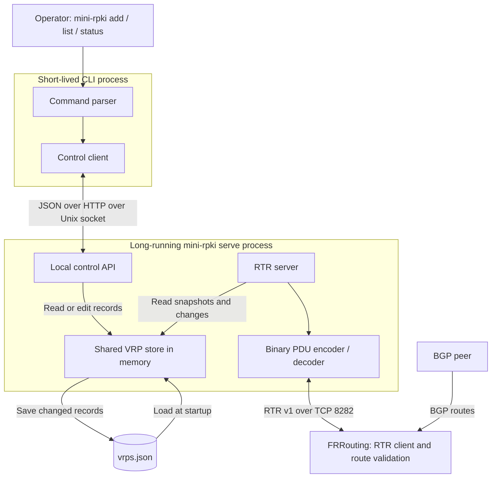

# Lesson 1: MiniRPKI Architecture Overview

This lesson describes the repository implementation inspected on 2026-10-20. It is a source walkthrough, not a claim that tests were executed for this lesson.

MiniRPKI is **one Go executable with two roles**: a long-running RTR server and a short-lived command-line client.

Its purpose is to serve **operator-defined VRPs to routers**. It does not download ROAs, verify signatures, or participate in BGP. FRRouting receives VRPs over RTR and calculates route validation states itself.

## 1. The architecture



The two connections have different purposes:

- **Management:** your CLI talks to MiniRPKI through a local Unix socket.
- **RTR:** FRR talks to MiniRPKI through a TCP socket.

This resembles a network appliance with separate management and protocol interfaces. They access the same internal state but use different protocols.

## 2. Language and libraries

MiniRPKI is written in **Go**. Its [go.mod](../go.mod) declares Go **1.24** as the language version. The Docker build uses a **Go 1.26.1** builder image.

The Go application has **no third-party library dependencies**. Its imports use Go's standard library and packages from this repository.

| Library | What MiniRPKI uses it for |
| --- | --- |
| `net`, `net/netip` | TCP and Unix sockets, IP addresses and prefixes |
| `net/http`, `encoding/json` | Local management requests and saved records |
| `encoding/binary` | RTR fields in network byte order |
| `sync` | Protecting shared state and coordinating concurrent work |
| `context`, `os/signal` | Coordinating shutdown |
| `os`, `path/filepath` | Reading and writing persistent data |
| `flag`, `strconv` | Command options and numeric conversion |

FRR, Docker, and Containerlab are external software used by the lab. They are not Go libraries embedded into MiniRPKI.

## 3. The main components

### A. Entry point and process assembly

Start with [cmd/mini-rpki/main.go](../cmd/mini-rpki/main.go).

`main()` calls:

```go
run(os.Args[1:])
```

`run()` decides which role this invocation performs:

- `mini-rpki serve` starts the server.
- `mini-rpki add ...`, `list`, `status`, and other management commands contact an existing server.
- Help prints locally.

**Running `mini-rpki add` does not start another RTR server.** It starts a client process that sends one request and exits.

Think of running `vtysh` to manage an already-running routing daemon.

### B. Command parser and output

[cmd/mini-rpki/commands.go](../cmd/mini-rpki/commands.go) contains `parseRequest()`.

It converts a command such as:

```sh
mini-rpki add 192.0.2.0/24 --asn 65001
```

into a `control.Request` containing:

- Action: `add`
- Prefix: `192.0.2.0/24`
- Maximum length: `24`
- ASN: `65001`

Maximum length defaults to the prefix length. The parser checks the arguments and calls `Record.Validate()`.

[cmd/mini-rpki/output.go](../cmd/mini-rpki/output.go) contains `renderResponse()`, which formats the server's response as readable output or JSON.

### C. Local control interface

[internal/control/control.go](../internal/control/control.go) implements both ends:

| Function | Responsibility |
| --- | --- |
| `Listen()` | Creates the Unix socket and gives it mode `0600` |
| `Call()` | Sends a JSON request using HTTP over that socket |
| `API.ServeHTTP()` | Decodes the request and invokes the appropriate operation |

The HTTP client uses the URL `http://localhost/control`, but its custom connection function dials a **Unix socket**, not TCP localhost. There is no management TCP listener.

In the Containerlab image, that socket is:

```text
/run/minirpki/control.sock
```

Consequently, `docker exec ... mini-rpki list` runs the client inside the container, where it can reach that socket.

The public `interface` command is mapped to the internal control action `address` in `run()`. [internal/control/address.go](../internal/control/address.go) implements `API.address()` and `describeAddress()` to report listener and interface information.

### D. The VRP store

[internal/vrp/store.go](../internal/vrp/store.go) defines `Store`, the shared state used by both the control API and RTR server.

It holds:

- Current VRP records.
- Current session ID and serial number.
- Recent record snapshots for incremental RTR responses.
- The persistence filename.
- A mutex protecting concurrent access.

| Function | Responsibility |
| --- | --- |
| `Open()` | Loads saved records or uses supplied defaults |
| `State()` | Returns the session, serial, and a copy of current records |
| `Edit()` | Adds or removes an exact record |
| `Replace()` / `replace()` | Applies a replacement set, saves changes, advances the serial |
| `Delta()` | Finds announcements and withdrawals relative to a retained snapshot |

A useful analogy is a routing daemon's in-memory table plus a saved configuration file. The server serves records from **memory**; it does not reread JSON for each router query.

The normal persistence path is:

```text
/data/vrps.json
```

In this Containerlab topology, `/data` is a bind mount of:

```text
lab/containerlab/data/
```

Only records are saved there. Session IDs, serial history, client connections, and mutexes are runtime state.

### E. RTR server and binary codec

Two files divide protocol responsibilities:

- [internal/rtr/server.go](../internal/rtr/server.go): `Server.Serve()` accepts TCP clients; `Server.handle()` processes each connection.
- [internal/rtr/codec.go](../internal/rtr/codec.go): `Read()`, `Write()`, `PDU.Bytes()`, `New()`, `Prefix()`, and `Error()` decode or construct protocol messages.

The **codec understands bytes and fields**. The **server understands the RTR conversation**.

These files, together with the store's session, serial, and delta handling, implement the RTR v1 behavior associated with RFC 8210. Detailed message flow and compliance limits belong in Lesson 2; this overview is not a claim of complete RFC compliance.

## 4. What happens at startup?

For:

```sh
mini-rpki serve
```

`run()` performs these steps in order:

1. **Reads options and environment variables.** Defaults include TCP `:8282`, data file `/data/vrps.json`, and a five-second refresh interval. The application's default control socket is `/data/control.sock`; the Containerlab image overrides it to `/run/minirpki/control.sock`.
2. **Opens the VRP store.** `vrp.Open()` generates a random 16-bit session ID, starts the serial at `1`, and loads the saved records. If the file is missing, it uses `vrp.DemoRecords()` from [internal/vrp/defaults.go](../internal/vrp/defaults.go). A saved empty dataset stays empty. Malformed saved data causes startup to fail. Loading defaults does not itself write the file; a subsequent record change triggers persistence.
3. **Creates the management socket.** `control.Listen()` creates the Unix listener.
4. **Creates the RTR TCP listener.** `net.Listen("tcp", ...)` asks the operating system to bind the address and port.
5. **Sets up shutdown handling.** `signal.NotifyContext()` responds to interrupt and termination signals.
6. **Connects the components.** The control API and `rtr.Server` both receive a pointer to the **same `Store`**. They communicate with it through Go method calls, not through another network API.
7. **Starts concurrent serving.** The HTTP control server runs in a goroutine. `Server.Serve()` runs the RTR accept loop and starts a handler goroutine per connection.

There is no direct "CLI tells RTR server to send" call. The control API changes the store; RTR handlers read that shared store. A per-connection timer also checks for serial changes to decide whether a notification is due.

## 5. How Docker fits around it

The root [Dockerfile](../Dockerfile) has two stages:

1. A builder runs `go test` and compiles the source into an executable.
2. A smaller Alpine image receives the executable and runs it as UID/GID `10001`.

Its default invocation is:

```sh
mini-rpki serve
```

`EXPOSE 8282` describes the RTR port; it does **not** publish that port on the host.

Containerlab adds a wrapper through [lab/containerlab/cache/Dockerfile](../lab/containerlab/cache/Dockerfile). Its [start.sh](../lab/containerlab/cache/start.sh):

1. Waits for Containerlab to attach `eth1`.
2. Assigns `10.82.0.1/30`.
3. Prepares directory permissions and removes the previous control socket.
4. Drops privileges.
5. Executes MiniRPKI bound to `10.82.0.1:8282`.

That wrapper is deployment code, separate from the Go application. This separation explains the recent failures: a missing interface can stop the wrapper **before the Go server starts**.

The links and mounted directories are defined in [lab/containerlab/minirpki.clab.yml](../lab/containerlab/minirpki.clab.yml). FRR's RTR cache address is configured in [lab/containerlab/router.conf](../lab/containerlab/router.conf).

## 6. What MiniRPKI does versus its surroundings

| Component | Responsibility |
| --- | --- |
| MiniRPKI code | Record rules, persistence decisions, RTR message construction, query handling |
| Go libraries/runtime | HTTP parsing, JSON conversion, socket APIs, scheduling goroutines |
| Linux kernel | TCP transport, packet delivery, interfaces, Unix sockets, filesystem operations |
| Docker/Containerlab | Container lifecycle, namespaces, mounts, lab links |
| FRR | BGP, RTR client behavior, route-origin validation |

The repository contains `vrp.ValidateRoute()` and `internal/scenario`, but their current use is in tests. They do not make the running server evaluate FRR's BGP routes. No scenario menu is exposed by the current CLI.

Implemented features include operator-managed IPv4/IPv6 VRPs, local management commands, JSON persistence, and RTR v1 query/update handling. Repository downloading, ROA signature validation, RTR v0, Router Key distribution, and RTR TLS/SSH transport are not implemented. Their absence does not imply that they are planned.

## 7. Your source-reading map

Read these in this order:

1. [main.go](../cmd/mini-rpki/main.go) — how everything is assembled.
2. [commands.go](../cmd/mini-rpki/commands.go) — how commands become requests.
3. [control.go](../internal/control/control.go) — how requests reach the store.
4. [store.go](../internal/vrp/store.go) — records, persistence, serials, and history.
5. [server.go](../internal/rtr/server.go) — RTR connection behavior.
6. [codec.go](../internal/rtr/codec.go) — RTR wire format.

## 8. Five questions to check your understanding

1. When you run `mini-rpki add`, which process owns and changes the authoritative in-memory records?
2. What transports carry CLI management requests and RTR messages?
3. Why do both the control API and RTR server receive the same `Store` pointer?
4. After a server restart, which state is loaded from disk, and which state is created again?
5. Who decides whether a BGP route is Valid, Invalid, or Not Found—and what information does MiniRPKI supply?

Continue to Lesson 2 only when you are ready to examine the RTR message flow.
