# MiniRPKI Code Walkthrough

> A source-level guide for a network engineer learning software development

This handbook describes the Go source present in this repository on 2026-10-31. It explains every `.go` file and every logical code block in those files. A logical block is a group of lines with one purpose, such as parsing a command, saving records, accepting a TCP connection, or encoding an RTR PDU.

For a deeper execution trace that combines the file-by-file guide with one VRP from CLI to FRR, see [MiniRPKI Deep Execution Guide](MINIRPKI_DEEP_EXECUTION_GUIDE.md).

The repository currently contains 24 Go files: 10 runtime/support files and 14 test files. Dockerfiles, shell scripts, FRR configuration, and Containerlab YAML are shown where they affect the architecture, but their own line-by-line walkthrough belongs in a separate deployment guide.

The source remains authoritative. Tests described in this handbook show what the test code is intended to check; this document does not claim that those tests were executed while the handbook was written.

## How to read this handbook

Read Parts 1 through 5 first. They show the complete system before examining implementation details. Then use Part 6 as a reference while reading each source file in VS Code.

For every important block, ask five questions:

1. What enters this block?
2. What result leaves it?
3. What shared state does it read or change?
4. What can fail?
5. Which component calls it next?

You do not need to memorize Go syntax. Concentrate first on data flow, ownership, and protocol messages.

## Contents

1. [What MiniRPKI is](#part-1--what-minirpki-is)
2. [The most important runtime flows](#part-2--the-most-important-runtime-flows)
3. [Essential Go concepts](#part-3--essential-go-concepts-used-here)
4. [RTR wire format](#part-4--rtr-wire-format)
5. [Source file index](#part-5--source-file-index)
6. [File-by-file code guide](#part-6--file-by-file-code-guide)
7. [Every test file explained](#part-7--every-test-file-explained)
8. [One complete example](#part-8--one-complete-example-end-to-end)
9. [What each layer does](#part-9--what-each-layer-does)
10. [Limitations and review notes](#part-10--confirmed-limitations-and-review-notes)
11. [How to study and maintain the code](#part-11--how-to-study-and-maintain-the-code)
12. [Viewing and exporting](#part-12--viewing-and-exporting-this-handbook)

---

# Part 1 — What MiniRPKI is

MiniRPKI is a laboratory **RPKI-to-Router (RTR) cache**. An operator enters VRPs, MiniRPKI stores them, and routers retrieve them using RTR version 1.

MiniRPKI does:

- accept operator-defined IPv4 and IPv6 VRPs;
- persist those records as JSON;
- serve full and incremental datasets over RTR version 1;
- notify connected routers that a newer serial exists;
- expose local commands through a Unix domain socket.

MiniRPKI does not:

- fetch RPKI repositories;
- validate certificates, manifests, CRLs, or ROA signatures;
- originate or receive BGP routes;
- assign validation states to live BGP routes;
- implement RTR version 0, Router Key PDUs, TLS, or SSH transport.

FRRouting compares BGP routes with the VRPs and calculates **Valid**, **Invalid**, or **Not Found**. MiniRPKI supplies VRP data only.

## 1.1 Complete architecture

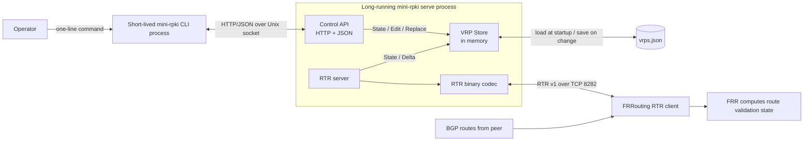

There are two separate communication paths:

| Path | Endpoints | Transport | Purpose |
| --- | --- | --- | --- |
| Local control | CLI process ↔ server process | HTTP/JSON over Unix socket | Add, remove, list, clear, status, interface |
| RTR | FRR ↔ MiniRPKI server | RTR v1 over TCP | Transfer VRP datasets and changes |

The Unix socket is a management endpoint. FRR never uses it. TCP port 8282 is an RTR endpoint. The operator CLI never uses it.

## 1.2 Package map

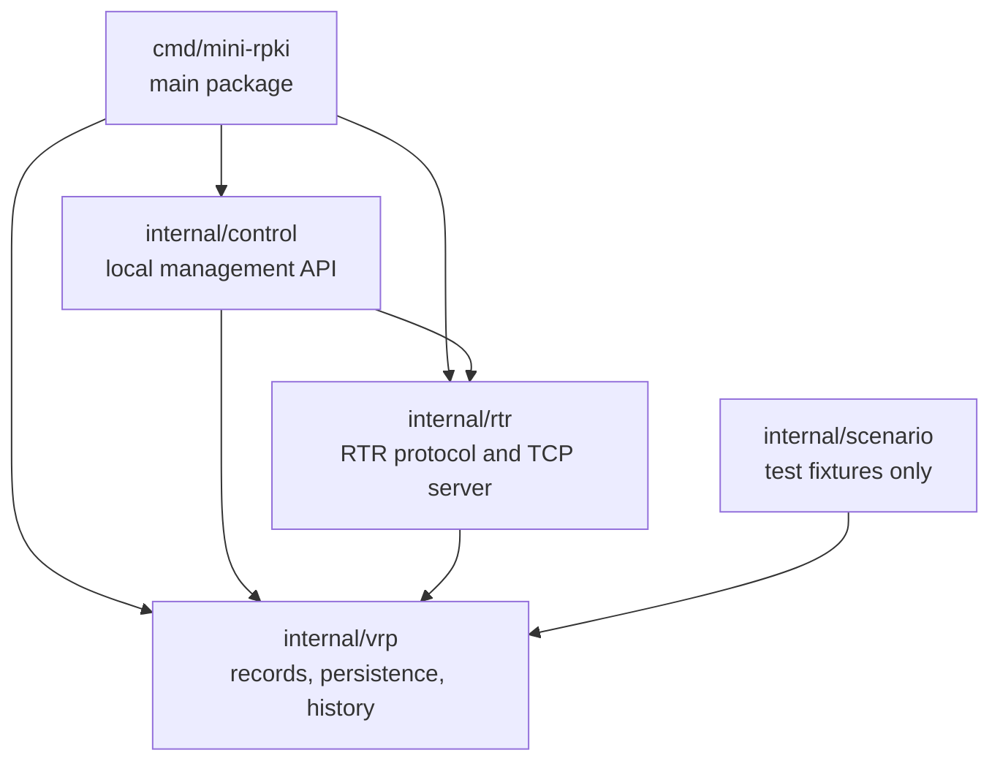

`internal` is a Go rule: packages below that directory may be imported by code inside this module, but they are not intended as a public library API for unrelated programs.

## 1.3 One executable, two process roles

The same compiled file behaves differently according to its arguments:

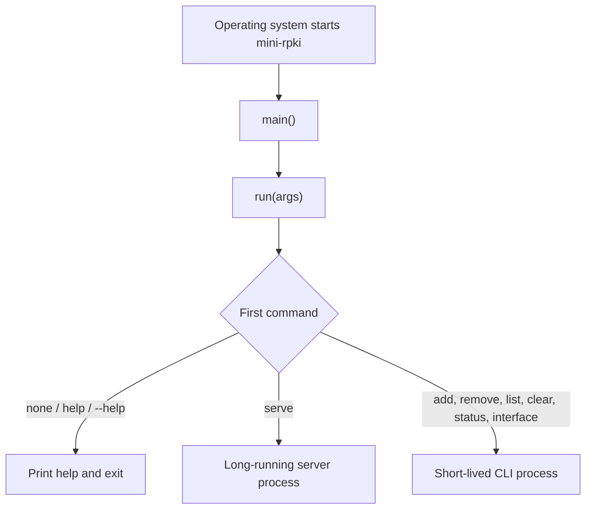

Examples:

```text
mini-rpki serve     → starts the daemon and normally keeps running
mini-rpki list      → contacts the daemon, prints one response, exits
```

This resembles FRR daemons plus `vtysh`: the long-running process owns state; the short-lived management client asks it to perform work.

---

# Part 2 — The most important runtime flows

## 2.1 Server startup

The main startup path is implemented by `run()` in [`cmd/mini-rpki/main.go`](../cmd/mini-rpki/main.go).

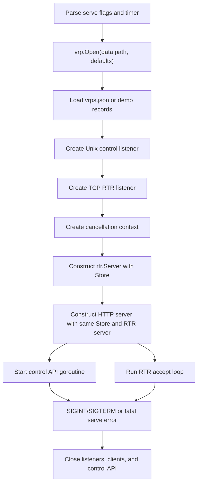

The key architectural decision is that the control API and RTR server receive pointers to the same `vrp.Store`. A CLI edit changes that shared object; the RTR server observes its new serial and records without an internal database connection or message bus.

## 2.2 Adding one VRP

Example command:

```sh
mini-rpki add 192.0.2.0/24 --asn 65001
```

```mermaid
sequenceDiagram
    participant O as Operator
    participant C as CLI process
    participant U as Unix socket / HTTP API
    participant S as VRP Store
    participant D as vrps.json
    participant R as RTR connection handler
    participant F as FRR

    O->>C: add 192.0.2.0/24 --asn 65001
    C->>C: parseRequest creates Request + Record
    C->>U: POST JSON over Unix socket
    U->>S: Edit(record, add=true)
    S->>S: validate, copy, find duplicate, normalize
    S->>D: write temp file, sync, close, rename
    S->>S: increment serial and save snapshot
    U-->>C: JSON result with serial and record
    C-->>O: human-readable confirmation
    R->>S: periodic serial check
    R-->>F: Serial Notify when due
    F->>R: Serial Query with old session + serial
    R->>S: Delta(old session, old serial)
    R-->>F: Cache Response, Prefix announcement, End of Data
    F->>F: reevaluate matching BGP routes
```

The CLI does not directly send an RTR PDU. It changes the Store through the control API. The router then learns the change through its independent RTR session.

## 2.3 Opening the Store

Implemented by `vrp.Open()` in [`internal/vrp/store.go`](../internal/vrp/store.go).

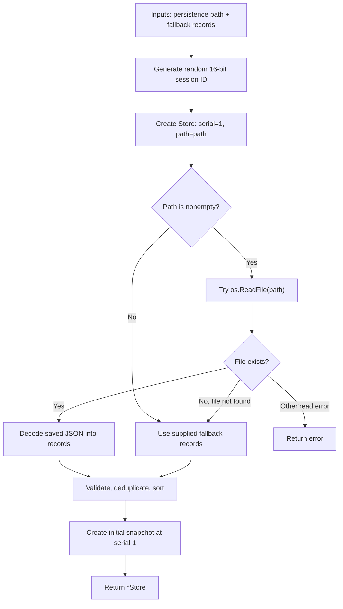

Only the records survive restart. A restart creates a new session ID, resets the serial to 1, and creates new in-memory history.

## 2.4 Safely persisting a dataset change

Implemented by `Store.replace()`.

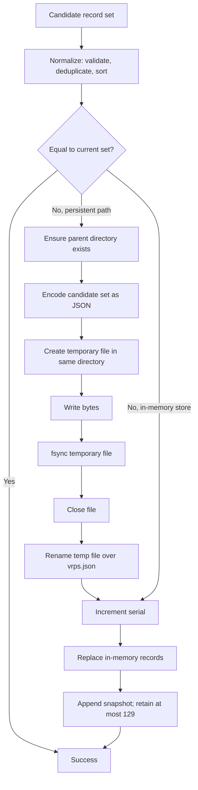

Persistence happens before the in-memory serial and records change. If saving fails, the running cache keeps its previous state. Renaming a completed temporary file avoids exposing a partially written JSON file during a normal update.

## 2.5 RTR Reset Query flow

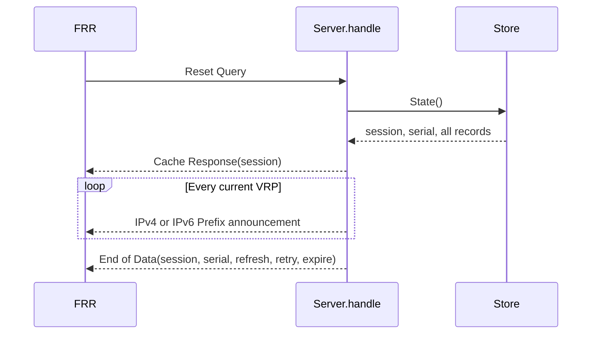

A Reset Query asks for a complete current dataset.

## 2.6 RTR Serial Query flow

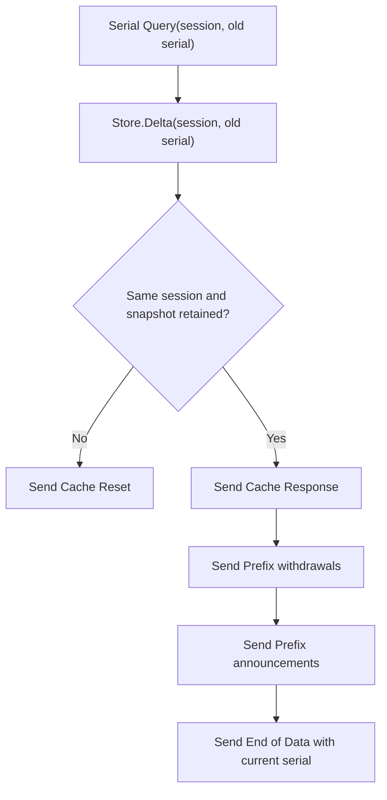

`Cache Reset` here means the router must issue a Reset Query because MiniRPKI cannot provide the requested incremental transition. It does not mean the server deletes its VRPs.

## 2.7 Concurrency model

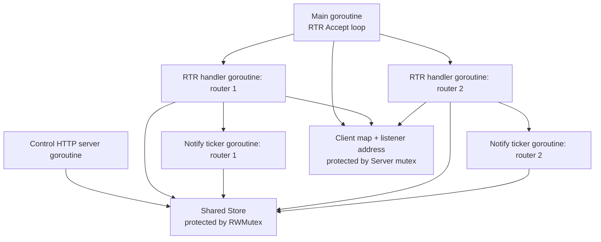

Each router has one query-processing goroutine and one notification ticker goroutine. A per-connection `writeMu` ensures those two writers cannot interleave bytes on the same TCP stream. The Store mutex protects the shared VRP dataset, serial, session, and history.

## 2.8 Graceful shutdown

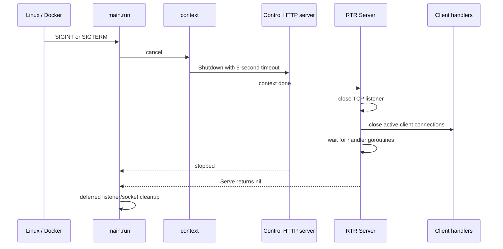

---

# Part 3 — Essential Go concepts used here

This is the minimum Go vocabulary needed to read MiniRPKI.

| Concept | Meaning in this project | Networking analogy |
| --- | --- | --- |
| Package | A namespace and unit of code organization | A protocol subsystem or daemon module |
| Struct | A named group of related fields | A route entry or protocol control block |
| Function | Code called by name | A processing stage |
| Method | Function attached to a type, such as `Store.Edit` | An operation supported by a subsystem |
| Pointer `*T` | Reference to one existing value of type `T` | A reference to the same RIB rather than a copied RIB |
| Slice `[]T` | Variable-length view/list of values | A table or a view into a packet buffer |
| Map `map[K]V` | Key/value lookup table | A route/neighbor lookup table |
| Interface | A required set of methods; `io.Reader` supplies `Read` | A behavioral contract between modules |
| Goroutine | Concurrent function managed by Go | Separate protocol worker/task |
| Channel | Typed coordination path between goroutines | Internal signaling queue |
| Mutex | Lock protecting shared state | Exclusive control-plane transaction |
| Context | Cancellation/deadline signal passed through calls | Session-wide shutdown notification |
| `defer` | Run cleanup when the current function returns | Prearranged teardown action |
| `error` | Ordinary returned value describing failure | Operation status/cause code |
| `nil` | No pointer, slice, map, interface value, or error | No object/no failure, depending on type |
| JSON tag | Controls external JSON field name | Field name in a management schema |
| Big endian | Most-significant byte first | Network byte order |

## 3.1 Arrays and slices

```go
var seed [2]byte
rand.Read(seed[:])
```

`seed` is an exact two-byte array. `seed[:]` is a slice view covering both bytes so `rand.Read`, whose API accepts `[]byte`, can fill them. The view refers to the original array; it does not make a second seed.

## 3.2 Pointers and shared state

```text
control.API.Store ──┐
                    ├──► one vrp.Store object
rtr.Server.Store ───┘
```

Both components hold `*vrp.Store`. If each held a copied Store, CLI edits and RTR reads could diverge, and copying a mutex would itself be unsafe.

## 3.3 Errors

Go commonly returns a result and an error:

```go
refresh, err := strconv.ParseUint(text, 10, 32)
```

On success, `err == nil`. On failure, the caller returns or handles the error explicitly. This visible error path is deliberate.

## 3.4 Interfaces used by the codec

`Read(r io.Reader)` can read from a TCP connection, byte buffer, or test reader because all provide a compatible `Read` method. `Write(w io.Writer, p PDU)` works the same way for destinations. This makes protocol code testable without opening a real network connection.

---

# Part 4 — RTR wire format

The protocol reference for this section is [RFC 8210](https://www.rfc-editor.org/rfc/rfc8210.html). The file-by-file descriptions explain the repository implementation; the review notes identify places where that implementation deserves closer comparison with the RFC.

## 4.1 Common eight-byte header

Every PDU handled by this codec begins with:

```text
Byte offset   Size   Meaning
0             1      Protocol version
1             1      PDU type
2             2      Session ID or error code (depends on PDU type)
4             4      Total PDU length, including this header
8             ...    PDU-specific body
```

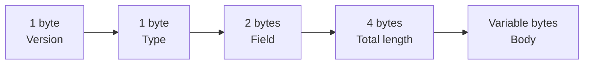

The diagram shows field order; the text table gives the exact offsets implemented by `PDU.Bytes()`.

## 4.2 Prefix PDU body

For IPv4, the body has 12 bytes; for IPv6, 24 bytes:

```text
Body offset   Size       Meaning
0             1          Flags: 1 announce, 0 withdraw
1             1          Prefix length
2             1          Maximum length
3             1          Zero/reserved
4             4 or 16    IPv4 or IPv6 prefix bytes
8 or 20       4          Origin ASN
```

`Prefix()` selects PDU type 4 for IPv4 or type 6 for IPv6 and fills these fields in network byte order.

## 4.3 PDU types implemented

| Type | Name | Direction in this implementation |
| ---: | --- | --- |
| 0 | Serial Notify | MiniRPKI → router |
| 1 | Serial Query | router → MiniRPKI |
| 2 | Reset Query | router → MiniRPKI |
| 3 | Cache Response | MiniRPKI → router |
| 4 | IPv4 Prefix | MiniRPKI → router |
| 6 | IPv6 Prefix | MiniRPKI → router |
| 7 | End of Data | MiniRPKI → router |
| 8 | Cache Reset | MiniRPKI → router |
| 10 | Error Report | either direction; server closes after receiving one |

---

# Part 5 — Source file index

## Runtime code

| File | Main responsibility |
| --- | --- |
| [`cmd/mini-rpki/main.go`](../cmd/mini-rpki/main.go) | Process entry, mode selection, server assembly, CLI call |
| [`cmd/mini-rpki/commands.go`](../cmd/mini-rpki/commands.go) | Convert CLI text into a typed control request |
| [`cmd/mini-rpki/output.go`](../cmd/mini-rpki/output.go) | Render control responses for humans or scripts |
| [`internal/control/control.go`](../internal/control/control.go) | HTTP/JSON management API over a Unix socket |
| [`internal/control/address.go`](../internal/control/address.go) | Describe the active RTR listener and matching interfaces |
| [`internal/vrp/defaults.go`](../internal/vrp/defaults.go) | First-start demonstration records |
| [`internal/vrp/store.go`](../internal/vrp/store.go) | Validation, persistence, serials, snapshots, deltas |
| [`internal/rtr/codec.go`](../internal/rtr/codec.go) | Encode and decode RTR PDUs |
| [`internal/rtr/server.go`](../internal/rtr/server.go) | Accept routers and run RTR conversations |
| [`internal/scenario/scenario.go`](../internal/scenario/scenario.go) | Private test fixtures; not a supported CLI feature |

## Test code

| File | Area exercised by the test source |
| --- | --- |
| `cmd/mini-rpki/main_test.go` | Rejected CLI inputs and refresh values |
| `cmd/mini-rpki/commands_test.go` | Command parsing and removed commands |
| `cmd/mini-rpki/output_test.go` | Human and JSON rendering |
| `internal/control/control_test.go` | API action dispatch |
| `internal/control/socket_test.go` | Real HTTP exchange over a temporary Unix socket |
| `internal/control/address_test.go` | Listener/interface reporting |
| `internal/vrp/store_test.go` | Store editing, history, validation, concurrency, failure atomicity |
| `internal/vrp/edge_test.go` | Serial wrap and saved empty dataset |
| `internal/rtr/codec_test.go` | Wire bytes, partial I/O, malformed input, errors |
| `internal/rtr/error_test.go` | Exact malformed-PDU encapsulation |
| `internal/rtr/server_test.go` | RTR exchanges, versions, clients, restart behavior |
| `internal/rtr/timers_test.go` | Custom and invalid timer values |
| `internal/rtr/updates_test.go` | notification rules, bad queries, live announcement |
| `internal/scenario/scenario_test.go` | Validation examples in the private fixture package |

---

# Part 6 — File-by-file code guide

## 6.1 `cmd/mini-rpki/main.go`

### Purpose

This is the composition root: it decides which role the executable performs and connects the Store, control API, listeners, and RTR server. Detailed command parsing and output formatting live in neighboring files.

### Imports (lines 3–19)

The imports reveal the file's responsibilities:

- `flag`, `strconv`: parse server options;
- `os`, `os/signal`, `syscall`: process arguments, environment, and termination signals;
- `net`, `net/http`: TCP and local HTTP services;
- `context`, `time`: cancellation and shutdown deadlines;
- project packages `control`, `rtr`, and `vrp`: assemble the application.

### `env` (lines 21–26)

**Purpose:** choose an environment value or a fallback.

```text
Input:  environment key, default string
Output: nonempty environment value, otherwise default string
State:  reads the process environment; changes nothing
```

An empty environment value is treated like an unset value.

### `main` (lines 27–32)

**Purpose:** required Go entry point and final error boundary.

It removes the executable name with `os.Args[1:]`, calls `run`, logs any returned error, and exits with status 1. Successful execution returns normally with status 0.

### `run`: global output option (lines 33–44)

**Purpose:** find `--json` anywhere in the arguments and remove it before command-specific parsing.

```text
Input:    ["list", "--json"]
Filtered: ["list"]
Flag:     jsonOutput=true
```

`make([]string, 0, len(args))` creates an empty slice with enough reserved capacity for the original arguments. `append` adds every argument except `--json`.

### `run`: help path (lines 45–59)

**Purpose:** print supported commands when no command, `help`, or `--help` is supplied.

The `||` operations short-circuit. If `len(args) == 0`, Go does not evaluate `args[0]`, avoiding an out-of-range access. `return nil` reports successful help display.

### `run`: define and parse `serve` options (lines 60–75)

**Purpose:** register server-only flags, parse their values, reject leftover positional arguments, and validate the refresh timer.

```text
--listen   RTR TCP bind address
--data     persistent JSON path
--socket   local Unix control socket path
--refresh  advertised refresh interval, 1..599 seconds
```

`flag.NewFlagSet` creates a parser. Each `f.String` registers a string flag and returns `*string`, a pointer to the value that `f.Parse` will update. `f.NArg()` counts leftover non-flag arguments, not registered flags.

`strconv.ParseUint(..., 10, 32)` converts decimal text into an unsigned integer limited to 32 bits. The additional bounds check enforces a refresh value below the 600-second expiry interval.

### `run`: open the Store (lines 76–79)

**Purpose:** construct the authoritative in-memory VRP state.

`vrp.Open(*data, vrp.DemoRecords())` loads saved JSON if present; otherwise it uses demonstration records. Errors stop startup before any listener accepts clients.

### `run`: create the Unix listener (lines 80–88)

**Purpose:** prepare the management endpoint.

`MkdirAll` ensures the socket's parent directory exists with restrictive requested permissions. `control.Listen` asks Linux for a Unix domain listener. Deferred calls remove the socket pathname and close the listener when `run` returns.

The error text deliberately warns against deleting an apparently stale socket without first confirming no server owns it.

### `run`: create the TCP listener (lines 89–93)

**Purpose:** bind the RTR address and port through `net.Listen("tcp", *addr)`.

The operating system handles TCP handshakes, retransmission, ordering, and stream delivery. MiniRPKI handles the RTR messages inside that byte stream.

### `run`: cancellation and component assembly (lines 94–97)

**Purpose:** create the shared shutdown signal and wire components together.

`signal.NotifyContext` cancels `ctx` on Ctrl+C (`os.Interrupt`) or SIGTERM. `rtr.Server` and `control.API` share the same `s` Store pointer. The HTTP server has header, read, write, idle, and header-size limits for the local control interface.

### `run`: control goroutines and RTR foreground service (lines 98–111)

**Purpose:** run both services concurrently and coordinate shutdown.

- First goroutine runs HTTP over the Unix listener. An unexpected HTTP serve failure logs the problem and cancels the shared context.
- Second goroutine waits for cancellation and gives the HTTP server up to five seconds to shut down.
- The current goroutine runs `server.Serve(ctx, l)`. Its return value becomes `run`'s return value.

Running the RTR accept loop in the foreground gives the process one principal lifetime to wait on.

### `run`: short-lived CLI path (lines 113–125)

**Purpose:** handle every command other than help and `serve`.

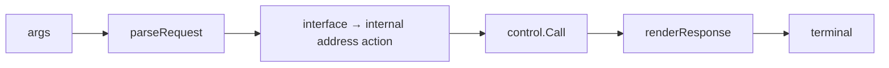

The public name `interface` maps to the internal action `address`. `control.Call` returns raw JSON bytes; `renderResponse` chooses readable or JSON output.

## 6.2 `cmd/mini-rpki/commands.go`

### Purpose

Convert untrusted command-line strings into a typed `control.Request`. This is the CLI's validation boundary before it contacts the server.

### `parseRequest`: compatibility prefix (lines 13–17)

If the first word is the old hidden `vrp` prefix, the parser removes it. This preserves old scripts such as `mini-rpki vrp add ...` without advertising that form in help.

### Initialize and select action (lines 18–23)

An empty `control.Request` is created. Empty arguments return a usage error. Otherwise the first argument becomes `q.Action`, and a `switch` selects the command grammar.

### Argument-free commands (lines 24–27)

`status`, `list`, `clear`, and `interface` must contain exactly one word. Extra values are rejected instead of being silently ignored.

### Add/remove: prefix and flags (lines 28–44)

The parser requires a prefix, calls `netip.ParsePrefix`, then registers:

- required `--asn` as text initially;
- optional `--maxlen`, defaulting to `prefix.Bits()`.

Flags are parsed only from `args[2:]` because indexes 0 and 1 are the action and prefix. Any remaining positional argument is rejected.

### Add/remove: numeric conversion and record validation (lines 45–56)

ASN is parsed as decimal `uint32`; maximum length is parsed as decimal `uint8`. The typed values form a `vrp.Record`, then `Record.Validate()` checks canonical network form and prefix-length rules.

The ASN range 0 through 4294967295 follows from `ParseUint(..., 32)`. AS0 is syntactically accepted by the record model.

### Unknown command and success (lines 57–60)

Unknown actions return an error. A valid path returns the populated request and `nil` error.

## 6.3 `cmd/mini-rpki/output.go`

### Purpose

Translate JSON responses from the control API into human-readable terminal output, while allowing scripts to request formatted JSON.

### `printRecords` (lines 15–27)

Prints the number of records, a special empty message, or a tab-aligned table. It accepts `io.Writer`, so production can use stdout while tests can use an in-memory buffer.

### `renderResponse`: JSON mode (lines 29–37)

When `jsonOutput` is true, `json.Indent` validates and pretty-prints the original JSON structure. It does not reinterpret the action-specific response.

### `renderResponse`: interface action (lines 38–56)

Decodes `control.AddressInfo`, prints the actual listener and a table of matching addresses/interfaces, and warns that container addresses do not imply external routing or port forwarding.

### `renderResponse`: list action (lines 57–62)

Decodes a slice of `vrp.Record` and delegates presentation to `printRecords`.

### `renderResponse`: status action (lines 63–78)

Decodes `control.Status` and prints session, serial, record count, router count, timers, and notification limit. Connected client timestamps are converted to UTC RFC3339 text.

### `renderResponse`: mutating actions (lines 79–98)

The default branch handles `add`, `remove`, and `clear` results. It decodes only the fields it needs (`serial` and `record`), selects a verb, and reminds the operator that routers update after a successful RTR query.

### Failure behavior

Malformed JSON produces an error rather than misleading output. Writer errors are returned where captured. `table.Flush()` errors are not checked in the current implementation.

## 6.4 `internal/control/control.go`

### Purpose

Implement a small local management API. The message format is HTTP containing JSON, but the transport is a Unix domain socket rather than TCP.

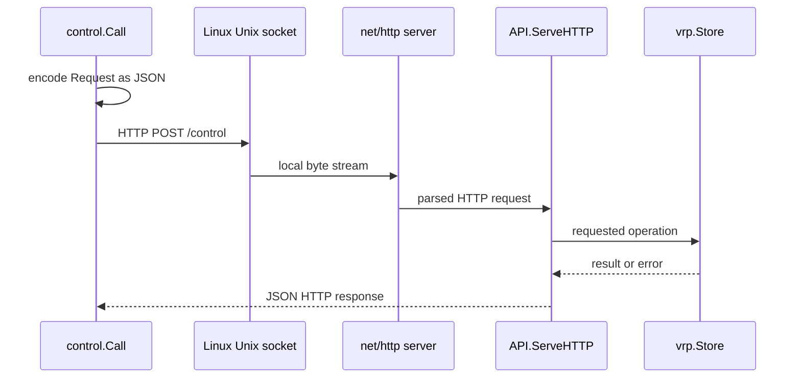

### Data types (lines 17–33)

`Request` is the control message sent by the CLI. It always has an action and can carry one `vrp.Record`. For actions that do not use a record, its fields have zero values.

`Status` is the JSON response model for operational state: RTR session, serial, record count, connected clients, and timers.

`API` holds pointers to the Store and RTR server. It needs both because some commands concern data (`list`, `add`) while others concern live server state (`status`, `address`).

JSON tags such as ``json:"refreshSeconds"`` define external field names independently from Go field capitalization.

### `API.ServeHTTP`: method and size checks (lines 35–40)

The method always announces JSON content. Only HTTP POST is accepted; other methods receive status 405. Although the socket is local, the code still treats requests as untrusted input.

### `API.ServeHTTP`: strict JSON decoding (lines 41–52)

The body is limited to 4096 bytes. Unknown JSON fields are rejected. The second decode must return `io.EOF`, proving there was exactly one JSON value and no second request object hidden in the body.

### `API.ServeHTTP`: action dispatch (lines 53–74)

```text
address → ask RTR server for its listener, map to interfaces
status  → combine Store state and RTR server state
list    → return current records
add     → Store.Edit(record, true)
remove  → Store.Edit(record, false)
clear   → Store.Replace(empty set)
```

The API itself does not implement VRP mutation rules. It delegates those rules to the Store, which keeps one source of truth.

### `API.ServeHTTP`: errors and mutation responses (lines 75–87)

Store or action errors become HTTP 400 responses. Read operations already assigned a result. Successful mutations have `result == nil`, so the API reads the new serial and records and constructs a response map. Add/remove responses also echo the requested record.

Finally, `json.NewEncoder(w).Encode(result)` writes the response. Its returned encoding/write error is currently ignored because `ServeHTTP` has no returned error channel.

### `Listen` (lines 88–98)

`net.Listen("unix", path)` creates the local endpoint. `os.Chmod(path, 0600)` permits only the owning user to read/write the socket pathname under normal Unix permission rules. If permission setup fails, the listener is closed and startup fails.

The `.sock` entry is an address managed through the filesystem namespace; it is not a file containing VRPs or queued commands.

### `Call`: custom HTTP transport (lines 99–103)

The HTTP transport overrides `DialContext`. Regardless of the request URL's host, the dialer connects to `"unix", path`.

```text
HTTP = application message framing
Unix socket = local transport carrying those bytes
```

### `Call`: encode and send request (lines 104–115)

The request struct is JSON-encoded into a buffer. `http.NewRequestWithContext` creates a POST request to the conventional URL `http://localhost/control`; the custom transport prevents a TCP lookup. The HTTP client has a ten-second overall timeout.

### `Call`: read response (lines 116–121)

The body is closed with `defer`. Reading is capped at 16 MiB to avoid unbounded allocation. Any non-200 response becomes a Go error containing the server's text. Successful raw JSON bytes return to `renderResponse`.

## 6.5 `internal/control/address.go`

### Purpose

Turn the RTR listener address into operator-friendly endpoint information from the server's current network namespace.

### Data types (lines 10–18)

`Endpoint` contains an IP, TCP port, and interface name. `AddressInfo` contains the literal listener plus zero or more usable endpoint descriptions.

### `describeAddress`: split and parse listener (lines 22–31)

`net.SplitHostPort` separates host and service. `netip.ParseAddr` converts the host to a typed IP address. Errors are returned because later comparisons require a valid address.

### `describeAddress`: enumerate interfaces (lines 32–58)

The function asks Linux for interfaces, skips interfaces that are down, then examines each assigned address. Addresses that cannot be parsed as prefixes are skipped.

For a specific binding such as `10.82.0.1:8282`, only that address matches. For wildcard bindings:

- `0.0.0.0:8282` selects usable non-loopback, non-link-local IPv4 addresses;
- `[::]:8282` can select usable IPv4 or IPv6 addresses after normalization.

The function reports local namespace facts only. It cannot infer Docker port publication, host NAT, firewall rules, or remote routing.

### `describeAddress`: fallback and sorting (lines 59–63)

If a specific bound address is not found on an enumerated interface, it is still returned without an interface name. Endpoints are sorted by IP text for stable display.

### `API.address` (lines 65–71)

Reads `RTR.ListenerAddress()`. An empty string means the RTR server has not published a running listener yet. Otherwise it delegates to `describeAddress`.

## 6.6 `internal/vrp/defaults.go`

### Purpose

Return the two documentation/test records used only when the configured persistence file does not exist:

```text
192.0.2.0/24       maxLength 24  AS65001
2001:db8:100::/48  maxLength 48  AS65001
```

`netip.MustParsePrefix` is appropriate for source-code constants: a typo would panic immediately during development/startup rather than return an error that callers must handle. Existing saved data, including a saved empty array, overrides these defaults.

## 6.7 `internal/vrp/store.go`

### Purpose

Own the authoritative VRP dataset and the RTR versioning state. It validates records, serializes concurrent access, persists mutations, retains recent snapshots, and calculates incremental differences.

### `Record` (lines 16–20)

One VRP consists of:

| Field | Go type | Meaning |
| --- | --- | --- |
| `Prefix` | `netip.Prefix` | Authorized address prefix |
| `MaxLen` | `uint8` | Longest authorized route prefix length |
| `ASN` | `uint32` | Authorized origin AS |

The types match the RTR prefix PDU fields. JSON tags produce `prefix`, `maxLength`, and `asn` in persistence/control data.

### `Record.Validate` (lines 22–30)

The first condition rejects:

- invalid/uninitialized prefixes;
- IPv4 represented as IPv4-mapped IPv6;
- host bits set outside the network mask, such as `192.0.2.1/24`.

The second condition requires:

```text
prefix length ≤ maxLength ≤ address-family width
```

Examples:

```text
192.0.2.0/24 maxLength 24 → valid
192.0.2.0/24 maxLength 23 → invalid
192.0.2.0/24 maxLength 33 → invalid
```

ASN validation is supplied earlier by typed `uint32` parsing; all uint32 values, including 0, fit the Record type.

### `Normalize` (lines 31–54)

**Purpose:** convert an arbitrary record slice into a deterministic set representation.

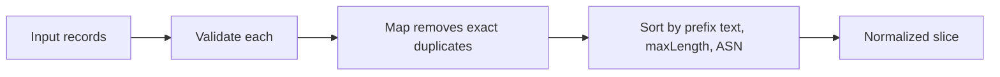

`map[Record]bool` works because every `Record` field is comparable. Stable ordering makes persistence, equality comparison, output, and snapshots predictable.

### `Snapshot` and `Store` (lines 56–67)

`Snapshot` binds one serial number to a complete record set.

`Store` owns:

```text
mu       RWMutex protecting all fields below
session  16-bit cache session identity
serial   32-bit dataset version
records  current normalized dataset
history  recent complete snapshots
path     JSON persistence path
```

An `RWMutex` allows multiple readers simultaneously but gives a writer exclusive access.

### `Open`: session and initial fields (lines 69–75)

Two cryptographically secure random bytes become a big-endian uint16 session ID. A new Store starts at serial 1 and remembers the persistence path. `seed[:]` is a slice view of the complete two-byte array, matching `rand.Read`'s `[]byte` API.

The random ID is an RTR session identity, not a security secret. A 16-bit random space has a finite collision possibility.

### `Open`: load file or defaults (lines 75–85)

The fallback slice starts as `defaults`. For a nonempty path, `os.ReadFile` is attempted:

- success: JSON replaces the fallback slice;
- file not found: keep defaults;
- any other read error: fail startup;
- malformed JSON: fail startup.

This distinguishes “first start” from “saved empty dataset.” A file containing `[]` decodes successfully and remains empty.

### `Open`: normalize and seed history (lines 86–93)

Records are validated/deduplicated/sorted. The first snapshot stores a copy of current records at serial 1. `append([]Record(nil), records...)` creates a new backing slice so later mutations cannot alter the snapshot accidentally.

### `State` (lines 94–98)

Takes a read lock and returns session, serial, and a copy of records. Returning a copy prevents callers from changing Store-owned slice elements without the lock.

### `Replace` (line 99)

Takes the exclusive write lock and calls private `replace`. The compact one-line form has the same behavior as a multi-line function. Keeping locking in the public method lets `replace` assume the caller already owns the lock.

### `Edit`: validation, lock, and working copy (lines 100–113)

Validates the incoming record before locking. It then takes the write lock, copies current records, and searches for exact equality across prefix, maxLength, and ASN.

`found == -1` means no exact record was found.

### `Edit`: add/remove decision (lines 114–126)

- Adding an existing exact record is a successful no-op.
- Adding a new record appends it to the working copy.
- Removing a missing record returns `exact VRP not found`.
- Removing an existing record joins the slice before and after its index.

The candidate set then enters `replace`, still under the same write lock.

### `replace`: normalize and detect no-op (lines 127–143)

The candidate set is normalized. Length and element-by-element comparison determine whether it equals the current normalized set. Equal replacement returns without writing, incrementing the serial, or adding history.

### `replace`: persistence transaction (lines 144–168)

For a nonempty path, the function creates the directory, formats JSON, creates a temporary file in that same directory, writes, syncs, closes, and renames it to the target path.

Important ordering:

```text
disk commit succeeds
        ↓
in-memory serial/state changes
```

`defer os.Remove(name)` cleans an unused temporary file on both success and failure. After a successful rename the old temporary pathname no longer exists, so removal is harmless.

`json.MarshalIndent`'s error is ignored here because the current Record fields are known to be JSON-encodable. That assumption would need review if Record gains custom/problematic fields later.

### `replace`: log changes and commit memory (lines 169–194)

Maps of old and next records identify added/removed entries for logs. The serial increments with uint32 arithmetic, naturally wrapping from 4294967295 to 0. Then current records are replaced and a copied snapshot is appended.

At most 129 snapshots are retained: current state plus up to 128 earlier transitions. Older serial queries receive Cache Reset because `Delta` cannot reconstruct them.

### `Delta` (lines 197–228)

**Purpose:** calculate the net difference between one retained serial and the current state.

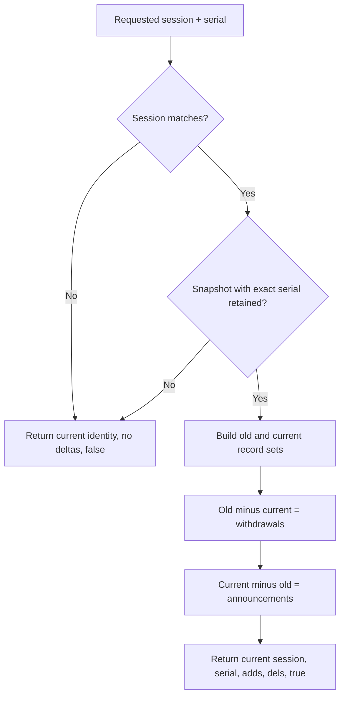

It compares complete snapshots rather than replaying each edit. If a record was added and later removed between the requested serial and now, it appears in neither net set and no redundant PDU is emitted.

### `ValidateRoute` (lines 229–240)

This function models route-origin validation for tests/fixtures; the running MiniRPKI server does not receive BGP routes and does not call it.

It starts with `Not Found`. A covering same-family VRP changes the candidate result to `Invalid`. A covering VRP with nonzero matching ASN and permitted route length returns `Valid`. If no matching authorization exists but coverage did, it returns `Invalid`.

FRR performs the equivalent operational decision for live BGP routes.

## 6.8 `internal/scenario/scenario.go`

### Purpose and status

This package contains private, deterministic validation examples used by tests. Scenario commands were removed from the product interface. Nothing in `cmd/mini-rpki` imports this package.

### `Scenario` struct (lines 8–15)

Groups a name, VRP set, example BGP route/origin, expected state, and explanation. It is test data rather than running protocol state.

### `record` helper (lines 17–19)

Shortens fixture construction. `MustParsePrefix` is appropriate because these are source-code constants.

### `All` (lines 20–28)

Returns examples for valid, wrong ASN, excessive length, no covering VRP, and multiple authorized origins. Each call creates a new slice.

### `Find` (lines 29–36)

Linearly searches `All()` by name. It returns `(Scenario, true)` when found or a zero-value Scenario plus `false` otherwise. The Boolean lets a caller distinguish “found” from an empty result.

## 6.9 `internal/rtr/codec.go`

### Purpose

Translate between typed Go `PDU` values and the exact RTR bytes carried by TCP. The codec knows field layout; `server.go` decides which messages are allowed and when to send them.

### PDU constants (lines 10–21)

The constants give readable names to RTR type numbers and set a local maximum input PDU size of 4096 bytes. The codec implements the PDU types listed in Part 4. Router Key type 9 is absent.

### Byte order alias (line 23)

`be` refers to `binary.BigEndian`, the network-byte-order encoder/decoder used for every multi-byte integer.

### `PDU` struct (lines 25–30)

```text
Version  uint8   first header byte
Type     uint8   second header byte
Field    uint16  session ID or error code
Body     []byte  decoded bytes after the common header
raw      []byte  exact malformed bytes, private to package
```

`raw` is populated only when decoding fails after some bytes were received. Error Reports must encapsulate the offending bytes rather than a reconstructed approximation.

### `PDU.Bytes` (lines 32–40)

**Purpose:** encode one PDU into a new byte slice.

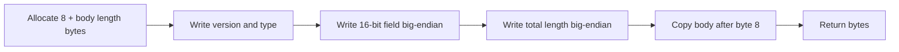

The total length includes the eight-byte common header.

### `Read` (lines 41–60)

**Purpose:** read exactly one bounded PDU from any `io.Reader`.

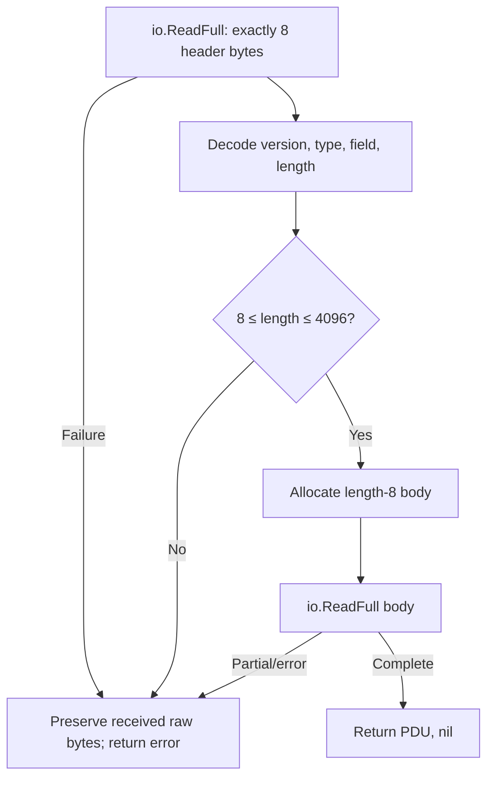

TCP is a byte stream and may return fewer bytes than requested even when more are coming. `io.ReadFull` hides that fragmentation by repeatedly reading until the requested field is complete or an error occurs.

For an invalid declared length, only the received header is available for `raw`. For a truncated body, the header and actually received body bytes are preserved.

### `Write` (lines 61–74)

**Purpose:** write the entire encoded PDU to any `io.Writer`.

A single `Write` call is not guaranteed to accept the whole buffer. The loop advances `b = b[n:]` until no bytes remain. A zero-byte write with no error becomes `io.ErrShortWrite` to prevent an infinite loop.

### `New` (lines 75–81)

**Purpose:** construct fixed-shape RTR PDUs whose body is a sequence of uint32 values.

It always emits version 1, assigns type and 16-bit field, allocates four bytes per variadic value, and encodes each value big-endian.

Examples:

```text
New(ResetQuery, 0)                       → header only
New(SerialQuery, session, serial)        → 4-byte serial body
New(EndOfData, session, serial, 5,10,600)→ 16-byte body
```

The `values ...uint32` syntax allows zero or more trailing values.

### `Prefix` (lines 82–96)

**Purpose:** convert one `vrp.Record` into an IPv4 or IPv6 Prefix PDU.

It selects address width and PDU type, allocates the body, sets flag 1 for announcement or leaves zero for withdrawal, writes prefix length and max length, copies address bytes, and writes the ASN.

The reserved byte at body offset 3 remains zero because Go initializes newly allocated bytes to zero.

### `Error` (lines 97–108)

**Purpose:** construct an Error Report containing the erroneous PDU and explanatory text.

```text
4 bytes  length of encapsulated PDU
N bytes  offending PDU bytes
4 bytes  error-text length
M bytes  error text
```

Normally it encapsulates `p.Bytes()`. If decoding saved `p.raw`, it uses those exact bytes. The common `Field` contains the error code.

### Codec boundaries

The codec does not decide whether a message is legal in the current session. For example, it can construct an IPv4 PDU in either direction. `Server.handle` enforces the conversation rules.

## 6.10 `internal/rtr/server.go`

### Purpose

Own the RTR TCP listener, track connected routers, run one protocol conversation per connection, send notifications, validate incoming query shape, and serialize responses.

### `Client` and notification rule (lines 14–22)

`Client` stores the remote socket address and connection time for status output.

`notificationDue` returns true only when:

```text
the client has successfully negotiated a query
AND current serial differs from the serial last seen/notified
AND no notification was sent yet, or at least one minute has elapsed
```

The one-minute rule rate-limits Serial Notify messages per connection. A pending newer serial remains detectable after the boundary.

### Timer constants (lines 24–28)

The default advertised timers are refresh 5 seconds, retry 10 seconds, and expire 600 seconds. Only refresh is configurable in this application.

### `Server` struct (lines 30–37)

```text
Refresh          configured refresh, zero means default
Store            shared VRP Store pointer
mu               protects clients and listenerAddress
clients          map keyed by live net.Conn
wg               tracks connection-handler goroutines
listenerAddress  active TCP listener address
```

`net.Conn` is used as a map key so each exact connection can be added and removed.

### Small accessors (lines 39–58)

- `ListenerAddress` returns the protected listener string.
- `RefreshInterval` maps zero to `DefaultRefresh`.
- `Clients` copies map values into a slice under the mutex.

Map iteration order is unspecified, so status client order is not stable.

### `Serve`: validate and publish server state (lines 59–67)

Refresh values at or above expire are rejected defensively even if the CLI already validated them. The client map is initialized and the actual listener address is published under the mutex. A deferred function clears it when serving ends.

### `Serve`: shutdown watcher (lines 68–81)

A `done` channel distinguishes normal function completion from context cancellation. The goroutine waits for either:

- context canceled: close the listener and all current clients;
- `done` closed: return because `Serve` is already ending.

Closing the listener unblocks `Accept`. Closing clients unblocks handlers waiting in `Read`.

### `Serve`: accept loop (lines 82–102)

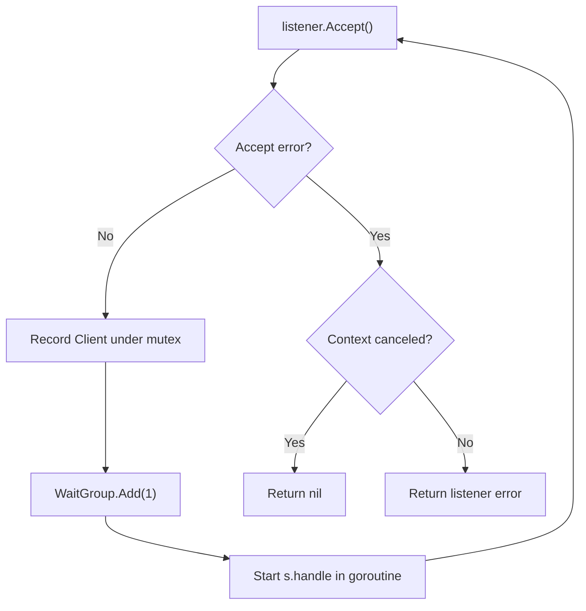

After accepting, the code rechecks cancellation before registering the connection. Each handler defers `wg.Done`; `Serve` waits for all registered handlers before fully returning.

### `handle`: connection lifecycle (lines 103–112)

The deferred cleanup closes the TCP connection and removes it from the server client map. Per-connection state includes:

```text
writeMu      serialize all writes on this TCP stream
negotiated   whether a valid Reset/Serial Query occurred
seen         serial last sent in response/notification
lastNotify   time of last Serial Notify
closed       tells this connection's ticker to stop
```

`writeMu` also protects these notification-related variables because both the handler and notification goroutine use them while holding that lock.

### `handle`: notification goroutine (lines 113–139)

Once per second, the goroutine reads the Store's current session/serial. If `notificationDue` is true, it sets a ten-second write deadline and sends `Serial Notify(session, serial)`.

On write failure it closes the connection, causing the main handler's read to terminate. On success it records notification time and serial. The goroutine exits when the whole server context is canceled or this handler closes `closed`.

The ticker is a local check interval, not the RTR refresh timer advertised to routers.

### `handle`: read one PDU (lines 140–153)

Each loop gives the connection a two-hour read deadline and calls codec `Read`.

On a decode/read error, it may send Corrupt Data Error Report code 0 when enough nonzero header identity exists and the incoming type was not already Error Report. It then closes the session. Avoiding a response to Error Report prevents error-report loops.

A clean EOF produces a zero PDU and simply closes without trying to report an error.

### `handle`: establish exclusive write period (lines 154–159)

After a complete read, the handler locks `writeMu` and sets a ten-second write deadline. Holding the lock across the complete response prevents a ticker notification from appearing between Cache Response, Prefix PDUs, and End of Data.

Receiving an Error Report causes the server to close without replying.

### `handle`: protocol version (lines 160–168)

Only version 1 is accepted:

- before negotiation, unsupported version produces error code 4;
- after a valid query, a version change produces error code 8.

The Error Report is attempted, then the connection closes.

### `handle`: query type and length (lines 169–178)

Only Reset Query and Serial Query are accepted from the router.

- unexpected PDU type produces error code 5;
- Reset Query must have an empty body;
- Serial Query must have exactly four body bytes;
- invalid query length produces error code 0 in this implementation.

After these checks, `negotiated` becomes true.

### `handle`: snapshot and Serial Query delta (lines 179–193)

The handler initially reads the complete current state. For Serial Query, it first compares the requested Session ID with the current Store Session ID. A mismatch receives Error Report code 0 and closes the connection. With a matching Session ID, it replaces the values with `Store.Delta(requested session, requested serial)`.

If that matching-session delta is unavailable, it sends Cache Reset, releases the write lock, and continues waiting. The connection remains open so the router can follow with Reset Query.

### `handle`: write successful response (lines 194–217)

Response order is:

```text
Cache Response(current session)
zero or more Prefix withdrawals
zero or more Prefix announcements
End of Data(current session, current serial, refresh, retry, expire)
```

Each later write happens only if prior writes succeeded. Successful End of Data updates `seen` to the response serial. Then the lock is released. A write error ends the connection.

For Reset Query, `records` means all current records. For Serial Query, `records` contains only announcements returned by `Delta`.

### Per-connection state machine

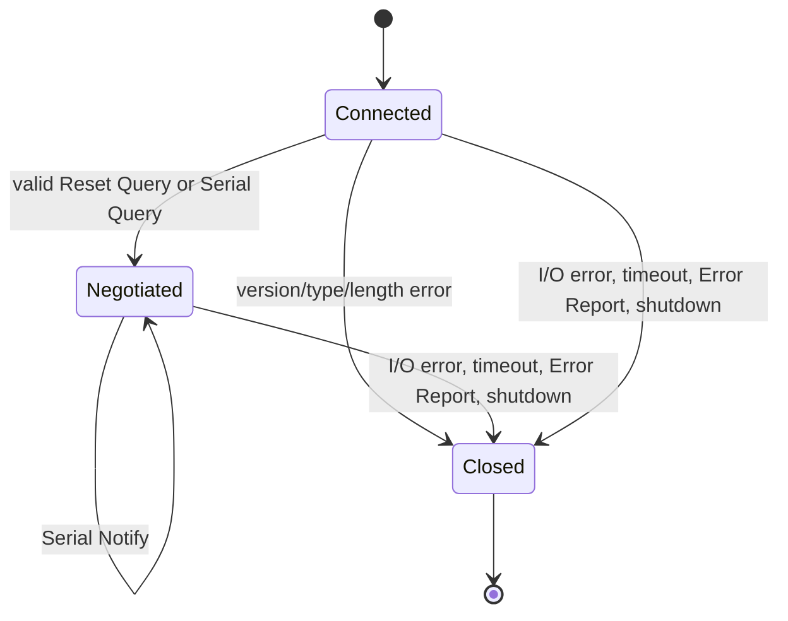

### Concurrency and consistency details

- Many router handlers can run simultaneously.
- Store reads/deltas are protected by the Store's `RWMutex`.
- The server's client registry has its own mutex.
- Each connection has its own write mutex.
- A response uses one Store snapshot or one calculated delta, so its session/serial/records are internally aligned.
- A mutation can occur after that snapshot while the response is being written. The router receives the earlier consistent serial and can learn the later one through Notify or its next query.

### Important limitations and risks

Confirmed behavior:

- No connection-count limit exists.
- No RTR TLS or SSH transport exists.
- Idle connections can remain for up to two hours without a query.
- The server supports only RTR version 1.
- Router Key PDUs are not supported.
- Notify checks every second but is rate-limited to once per minute per connection.

Possible cleanup risk from code ordering: if `Accept` fails unexpectedly while the context is still active and client handlers remain connected, deferred `wg.Wait()` runs before deferred `close(done)`. The shutdown watcher therefore has not been told to close clients, and `Serve` could wait for those clients to finish naturally. Context-driven shutdown follows the intended close-and-wait path.

---

# Part 7 — Every test file explained

Tests are executable specifications: they encode examples and assertions about expected behavior. They do not prove every possible case. The descriptions below do not claim a current test run.

## 7.1 `cmd/mini-rpki/main_test.go`

### `TestInvalidCLI`

Calls `run` with invalid commands that fail before a socket connection: unknown command, extra argument, bad prefix, ASN above uint32, negative ASN, bad max length, missing ASN, and removed scenario command. Each must return an error.

### `TestInvalidRefreshCLI`

Checks that `0`, `600`, `-1`, and `abc` are rejected as refresh values before the long-running server starts.

## 7.2 `cmd/mini-rpki/commands_test.go`

### `TestSimpleCommands`

Checks IPv4/IPv6 default max lengths, explicit max length, add/remove parsing, hidden `vrp` compatibility, ASN value, and standalone control actions.

### `TestRemovedCommands`

Checks rejection of scenario commands, add without ASN, max length below an IPv4 prefix, and IPv6 max length above 128. The name covers only part of the cases; some are ordinary invalid input.

## 7.3 `cmd/mini-rpki/output_test.go`

### `TestReadableOutput`

Builds fixed JSON responses for interface, list, empty list, status, add, remove, and clear. It renders each and checks important text fragments, not exact spacing or full output equality.

### `TestJSONOutput`

Pretty-prints a JSON fixture, parses before and after, and compares normalized JSON. The intended guarantee is that presentation whitespace changes while data meaning remains the same.

### `TestBadResponse`

Supplies malformed JSON to every renderer branch and expects an error.

## 7.4 `internal/control/control_test.go`

### `TestControl`

Calls `API.ServeHTTP` directly for `add → list → status → remove → clear` and requires HTTP 200. It checks dispatch success, but does not deeply validate each response body or intermediate state.

## 7.5 `internal/control/socket_test.go`

### `TestUnixControl`

Creates a temporary Unix socket, real HTTP server, Store, and real `Call` client. It adds one record, checks valid JSON, then lists and confirms one record. This is the strongest control-path integration test in the Go source, although it does not involve RTR or FRR.

## 7.6 `internal/control/address_test.go`

### `TestAddressUsesRunningListener`

Starts a real loopback TCP listener and `rtr.Server`, waits for listener publication, invokes the address API in memory, and checks listener, loopback IP, and actual ephemeral port.

### `TestAddressNotReady`

Checks that an RTR server not yet serving does not report a listener.

### `TestAddressWildcard`

Examines IPv4 and IPv6 wildcard descriptions and ensures returned endpoints are not unspecified, use port 8282, and are IPv4 for the IPv4 wildcard. It does not require the endpoint list to be nonempty.

## 7.7 `internal/vrp/store_test.go`

### `rec`

A small test helper that turns prefix text, max length, and ASN into a Record.

### `TestStore`

Exercises add, duplicate add no-op, announcement delta, persistence/reopen, remove, withdrawal delta, missing deletion failure, canceled net change, wrong session, and unavailable serial.

### `TestHistory`

Performs enough replacements to ensure the initial snapshot is pruned. It proves pruning exists but does not assert every exact retention boundary.

### `TestValidation`

Rejects invalid maximum lengths, noncanonical prefix, and zero Record; accepts IPv4/IPv6 boundary lengths, AS0, and maximum uint32 ASN.

### `TestConcurrent`

Runs 20 goroutines repeatedly editing, reading, calculating delta, and removing. It exercises locking/completion. Returned edit errors are ignored, final state is not asserted, and ordinary `go test` alone does not establish race freedom; that requires `go test -race`.

### `TestPersistenceFailure`

Forces a save failure and verifies the serial and in-memory records do not change.

## 7.8 `internal/vrp/edge_test.go`

### `TestSerialWrap`

Forces serial 4294967295, performs one edit, and checks wrap to 0 plus a valid delta across that transition.

### `TestEmptyPersistence`

Saves an empty set, reopens with nonempty defaults, and verifies the saved empty state wins.

## 7.9 `internal/scenario/scenario_test.go`

### `TestScenarios`

For every private fixture, validates its records and compares `ValidateRoute` with the expected state. It separately checks the IPv6 valid example. This does not exercise RTR, BGP, or FRR.

## 7.10 `internal/rtr/codec_test.go`

### `TestPrefixEncoding`

Constructs one IPv4 and one IPv6 announcement and compares every encoded byte with a fixed hexadecimal value. It then decodes and re-encodes each PDU and checks that withdrawals use flag zero.

The fixed independent hex vectors are valuable because a symmetric mistake in both encoder and decoder could otherwise pass a round-trip test.

### `slowReader.Read`

Wraps another reader but allows at most one byte per call. This simulates TCP fragmentation.

### `slowWriter.Write`

Wraps a byte buffer but accepts at most one byte per call. This simulates partial stream writes.

### `TestPartialIO`

Passes a Serial Query through the slow reader and writer. It checks that codec `Read` and `Write` handle stream fragmentation rather than assuming one call equals one PDU.

### `TestMalformed`

Requires rejection of empty input, partial header, length below 8, length above 4096, and truncated body.

### `TestErrorEncoding`

Constructs an Error Report and checks error code, encapsulated-PDU length, and text length. It does not compare the complete encoded report.

## 7.11 `internal/rtr/error_test.go`

### `TestMalformedEncapsulation`

Feeds malformed length and truncated-body examples into `Read`, constructs Error Reports, and verifies the encapsulated bytes exactly equal the input bytes. This protects the private `raw` preservation behavior.

## 7.12 `internal/rtr/server_test.go`

### Test helpers: `start`, `startWithRefresh`, `connect`, `receive`

`startWithRefresh` creates an in-memory Store with one IPv4 and one IPv6 record, binds loopback port 0 so Linux selects a free port, starts `Server.Serve` in a goroutine, and registers cancellation cleanup with a five-second timeout. `start` selects default refresh.

`connect` opens a TCP client and sets a five-second deadline. `receive` skips asynchronous Notify PDUs until the expected response type arrives.

These helpers use MiniRPKI's own codec on the client side; fixed wire-vector tests remain necessary to catch symmetric codec errors.

### `TestExchange`

Exercises:

1. full Reset Query exchange with IPv4 and IPv6;
2. End of Data timers;
3. deletion followed by incremental withdrawal;
4. query at the current serial producing no prefix PDUs;
5. wrong session producing Error Report code 0 and connection close;
6. unavailable serial producing Cache Reset.

It does not involve FRR or BGP route validation.

### `TestVersions`

On new connections, versions 0, 2, and 255 must receive Error Report code 4 using version 1. After a successful version-1 exchange, changing to version 0 must receive code 8.

### `TestConcurrentClients`

Starts 20 client goroutines. Each performs a Reset exchange and requires Cache Response, IPv4, IPv6, and End of Data in order. It exercises independent concurrent handlers. Race freedom requires a separate race-detector execution.

### `TestRestart`

Creates stale session/serial values from one Store, starts a server with another Store, and expects Error Report code 0 followed by connection close for the stale Serial Query. It models restart identity, but does not actually stop/restart a persisted process.

## 7.13 `internal/rtr/timers_test.go`

### `TestCustomRefresh`

Starts with refresh 1 and verifies End of Data carries refresh 1, retry 10, and expire 600.

### `TestInvalidRefresh`

Calls `Serve` with 600, 86400, and maximum uint32; each must fail before accepting clients. It does not directly test valid boundary 599 or zero-to-default behavior.

## 7.14 `internal/rtr/updates_test.go`

### `TestNotificationRateLimit`

Tests the pure time decision without waiting a real minute: no notification before negotiation, immediate first notification for a change, suppression before one minute, delivery at exactly one minute, and no notification when serials match.

### `TestBadQueries`

Sends a Reset Query with a body, a Serial Query without its serial, and an IPv4 PDU from the router side; each must get some Error Report. It then sends an Error Report and checks that the server closes rather than creating an error loop. The test does not assert exact codes.

### `TestLiveAnnouncement`

Adds `198.51.100.0/24` AS65002 to the live Store, sends a Serial Query from the previous version, and checks announcement flag, ASN, and End of Data. It proves a Store change can be served without restarting. It does not exercise an actual asynchronous Notify message.

---

# Part 8 — One complete example, end to end

Consider:

```sh
mini-rpki add 192.0.2.0/24 --asn 65001
```

## 8.1 CLI process

1. Linux starts the executable and Go calls `main()`.
2. `main()` passes `os.Args[1:]` to `run`.
3. `run` sees this is neither help nor `serve`.
4. `parseRequest` parses the prefix, defaults max length to 24, parses ASN into uint32, creates a Record, and validates it.
5. `run` calls `control.Call` with action `add`.

Request model:

```text
Action = add
Record = { Prefix: 192.0.2.0/24, MaxLen: 24, ASN: 65001 }
```

## 8.2 Control connection

`control.Call` JSON-encodes that model and sends an HTTP POST through the Unix socket. Linux connects the short-lived CLI process to the long-running server process. No TCP port is involved.

`API.ServeHTTP` strictly decodes the request and dispatches:

```go
a.Store.Edit(q.Record, true)
```

## 8.3 Store transaction

`Edit` validates again at the authoritative boundary, locks the Store, copies the current records, checks for an exact duplicate, and appends the new record when absent.

`replace` normalizes the candidate set. If the set changed, it safely rewrites `vrps.json`, increments the serial, installs the records, and appends a history snapshot.

If the record was already present, the add succeeds as a no-op and serial does not advance.

## 8.4 CLI response

The API reads the resulting Store state and sends JSON back. `renderResponse` prints a readable confirmation and serial. The short-lived CLI process exits. The server continues running.

## 8.5 Router update

Each negotiated RTR handler checks the Store once per second. A changed serial becomes eligible for Serial Notify, subject to the one-minute per-connection limit.

FRR then sends a Serial Query with its session and old serial. `Store.Delta` returns the new record as an announcement. MiniRPKI sends:

```text
Cache Response
IPv4 Prefix: announce 192.0.2.0/24, maxLength 24, AS65001
End of Data: new serial and timers
```

## 8.6 What FRR decides

For a BGP route `192.0.2.0/24` originated by AS65001:

```text
covering VRP?              yes
origin ASN authorized?     yes
route length ≤ maxLength?  24 ≤ 24
result calculated by FRR:  Valid
```

For the same route originated by AS65002:

```text
covering VRP?              yes
origin ASN authorized?     no
result calculated by FRR:  Invalid
```

For `198.51.100.0/24` with no covering VRP:

```text
result calculated by FRR: Not Found
```

MiniRPKI never receives those BGP paths. It sends only VRPs; FRR combines them with its BGP RIB.

---

# Part 9 — What each layer does

| Layer | Responsibilities |
| --- | --- |
| MiniRPKI application | Parse commands, validate records, manage serial/session/history, choose RTR responses, persist JSON |
| Go standard library | HTTP parsing, JSON conversion, cryptographic random bytes, synchronization primitives, time, signal handling |
| Go runtime | Schedule goroutines, manage memory, garbage collection |
| Linux kernel | TCP and Unix sockets, byte delivery, interface list, permissions, process signals, file operations |
| Docker | Filesystem/process/network namespace and mounted `/data` |
| Containerlab | Create containers and data links, attach `eth1`/`eth2` |
| FRRouting | Act as RTR client, receive BGP, calculate validation state |

Go's standard library does not understand RTR. `internal/rtr` supplies that protocol logic. Conversely, MiniRPKI does not implement TCP retransmission or packet ordering; Linux does.

---

# Part 10 — Confirmed limitations and review notes

These observations come from reading the implementation. They are not reports of failures observed in a current test run.

## 10.1 Confirmed design limits

- The application is explicitly a laboratory cache, not a production relying-party validator.
- Only RTR version 1 is supported.
- Router Key PDUs, RTR version 0, TLS, SSH, and cryptographic repository validation are absent.
- Plain RTR TCP has no application-level peer authentication or integrity.
- There is no connection-count limit; each router uses a handler and notification goroutine.
- Only records persist. Session, serial, client list, and history reset at restart.
- A random 16-bit session ID has a finite collision probability.
- Incremental history covers at most 128 retained transitions.
- Every mutation rewrites the full JSON dataset and stores another full snapshot.
- A Store write lock remains held during disk write and sync, so slow storage can delay readers.
- There is no file lock for two processes sharing one data path and no live reload of external file edits.
- The response-wide write deadline is ten seconds, which limits very large/slow transfers.
- The 4096-byte input cap can reject a large Error Report or future variable-size PDU even though normal queries are small.
- `internal/scenario` and `ValidateRoute` are test aids, not runtime validation features.

## 10.2 Confirmed implementation details worth future review

- `replace` ignores the error returned by `json.MarshalIndent`; current Record fields are expected to encode, but explicit handling would be clearer.
- The data file is synced, but the parent directory is not synced after rename, so the strongest power-loss durability depends on filesystem behavior.
- Control mutation responses include the complete VRP set even though readable output does not need it.
- Control response reading stops at 16 MiB without a dedicated “too large” diagnostic.
- Several output and JSON write errors are ignored.
- Status and post-mutation response data can combine thread-safe observations from slightly different moments.
- `--json` is removed globally and therefore has no effect but is accepted with `serve`.
- Client display order is nondeterministic because it comes from a map.

## 10.3 Protocol behavior requiring expert review before a production claim

The current code separates a mismatched Session ID from unavailable serial history. A Session ID mismatch receives Error Report code 0 and closes the connection, while unavailable history with a matching Session ID receives Cache Reset. This follows RFC 8210's Session ID rule.

The server uses Error Report code 5 for every inbound type other than Reset Query or Serial Query. Code 5 clearly fits an unknown/unsupported PDU type; a known PDU sent in the wrong direction may be better represented as Invalid Request. Query length errors currently use code 0; the most precise code deserves protocol review.

These are review findings, not claims of demonstrated interoperability failure.

## 10.4 Possible shutdown edge case

If `Accept` returns an unexpected non-context error while active clients remain, deferred handler waiting occurs before the `done` channel closes. The cancellation watcher may therefore not close those clients, and `Serve` could wait for them to finish naturally. Normal context-driven shutdown closes listener and clients first.

---

# Part 11 — How to study and maintain the code

Do not read the repository strictly line by line. Use these routes.

## 11.1 To understand startup

```text
cmd/mini-rpki/main.go
    → vrp.Open in internal/vrp/store.go
    → control.Listen in internal/control/control.go
    → rtr.Server.Serve in internal/rtr/server.go
```

## 11.2 To understand an operator command

```text
commands.go: parseRequest
    → control.go: Call
    → control.go: API.ServeHTTP
    → store.go: Edit / Replace / State
    → output.go: renderResponse
```

## 11.3 To understand an RTR exchange

```text
rtr/server.go: Serve
    → rtr/server.go: handle
    → rtr/codec.go: Read
    → vrp/store.go: State or Delta
    → rtr/codec.go: New / Prefix / Write
```

## 11.4 To fix a bug

1. Reproduce and identify which path owns the behavior.
2. Read the nearest existing test before changing code.
3. Add or strengthen a focused test that would fail for the bug.
4. Make the smallest source change.
5. Run relevant tests, then the wider suite and race detector when concurrency is involved.
6. For RTR changes, verify PDU bytes/message sequence, not only TCP connectivity.
7. For live Containerlab tests, protect the operator's VRPs and router configuration first.

## 11.5 To change the CLI

Review together:

```text
main.go       command mode and help
commands.go   grammar and validation
control.go    wire action and server dispatch
output.go     presentation
*_test.go     accepted/rejected examples
```

Remember that public `interface` maps to internal `address`.

## 11.6 To add an RTR feature

Review together:

```text
codec.go      type numbers and exact bytes
server.go     state machine and message order
store.go      any new historical/state requirement
codec tests   independent wire vectors
server tests  sequence and error behavior
RFC 8210      authoritative protocol requirement
```

## 11.7 Questions you should eventually answer

After using this guide, aim to explain these in your own words:

1. Why are the CLI and server separate processes even though they use the same executable?
2. Why does the control path use a Unix socket while RTR uses TCP?
3. Why do the control API and RTR server share one Store pointer?
4. Why does persistence complete before the in-memory serial advances?
5. What is the difference between RTR session ID and serial number?
6. When does a router receive Cache Reset instead of an incremental response?
7. Why must one connection serialize Notify and response writes?
8. Why do `Read` and `Write` loop even though TCP is reliable?
9. Which state survives a restart?
10. Why does FRR, rather than MiniRPKI, label a BGP route Valid or Invalid?

---

# Part 12 — Viewing and exporting this handbook

In VS Code, open this file and use **Markdown: Open Preview** (`Ctrl+Shift+V`). Mermaid diagrams render in the preview when Mermaid support is enabled in the Markdown renderer.

For a PDF, open the rendered preview in a browser-capable Markdown extension and use **Print → Save as PDF**. Keep this Markdown file as the maintainable source because links and diagrams remain easy to update when the Go code changes.
