# MiniRPKI Deep Execution Guide

## Every non-test Go block, followed through one real VRP

This guide explains the current MiniRPKI Go source as one connected system. It follows this operator command from the terminal to FRRouting:

```sh
mini-rpki add 192.0.2.0/24 --asn 65001
```

It is the execution-focused companion to the broader [MiniRPKI Code Walkthrough](MINIRPKI_CODE_WALKTHROUGH.md).

The record used throughout the guide is:

```text
Prefix:            192.0.2.0/24
Maximum length:    24
Authorized origin: AS65001
```

The guide covers every function and logical block in every non-test `.go` file. It intentionally does not cover `_test.go` files. [`internal/scenario/scenario.go`](../internal/scenario/scenario.go) and `ValidateRoute` in [`internal/vrp/store.go`](../internal/vrp/store.go) are included because they are Go source, but they are clearly marked as developer support code that the running application does not call.

No application code was changed to create this document. The source files remain the authority if this guide and a later version of the code ever disagree.

## Contents

1. [The example's duplicate/no-op caveat](#1-the-most-important-fact-before-following-the-example)
2. [One executable, three participants](#2-one-executable-three-participants)
3. [Complete execution timeline](#3-complete-execution-timeline)
4. [Source map](#4-source-map-and-runtime-status)
5. [Part I — Server startup and `main.go`](#part-i--starting-the-long-running-server)
6. [Part II — Defaults and the VRP Store](#part-ii--the-authoritative-vrp-store)
7. [Part III — CLI parsing](#part-iii--parsing-the-operator-command)
8. [Part IV — HTTP/JSON over the Unix socket](#part-iv--the-local-control-protocol)
9. [Part V — Output and listener/interface reporting](#part-v--presenting-results-and-describing-the-listener)
10. [Part VI — RTR codec and exact bytes](#part-vi--rtr-binary-encoding-and-decoding)
11. [Part VII — RTR server, FRR, and RFC comparison](#part-vii--rtr-sessions-changes-and-frrouting)
12. [Part VIII — Developer-only scenario source](#part-viii--developer-only-scenario-source)
13. [Part IX — Complete example checkpoints](#part-ix--the-complete-example-as-state-snapshots)
14. [Part X — Other command and failure paths](#part-x--other-commands-through-the-same-blocks)
15. [Part XI — Every file/function coverage ledger](#part-xi--complete-source-coverage-ledger)
16. [Part XII — Go concept index](#part-xii--go-concepts-seen-in-this-execution)
17. [Part XIII — Layer responsibilities](#part-xiii--what-each-layer-does)
18. [Part XIV — Practical reading route](#part-xiv--a-practical-reading-route)

---

## 1. The most important fact before following the example

The exact example record is already one of MiniRPKI's first-start demonstration records:

```go
{Prefix: netip.MustParsePrefix("192.0.2.0/24"), MaxLen: 24, ASN: 65001},
```

That creates two possible outcomes for the same command.

| Store state before the command | What `add` does | Serial | RTR update |
| --- | --- | --- | --- |
| The exact record already exists | Successful duplicate/no-op | Unchanged | None |
| The exact record is absent | Installs the record; persists first when a path is configured | Advances by one | Announcement becomes available |

On a brand-new data path, `DemoRecords()` supplies this exact record, so the first row is the literal outcome. The CLI still prints `Saved`, because the current control response does not contain a separate `changed` field.

To teach the complete mutation and RTR flow, the main trace assumes the exact tuple is absent before the command. That can be true when an existing persistence file contains different data, or after the exact record was previously removed. The duplicate path is shown separately whenever it differs.

Throughout the guide:

- **R** means `{192.0.2.0/24, maxLength 24, AS65001}`;
- **SID** means the current 16-bit RTR session ID;
- **S** means the Store serial before a real change;
- **S+1** means the serial after that change.

---

## 2. One executable, three participants

There is only one compiled program named `mini-rpki`, but the example involves two separate copies of that program plus FRR.

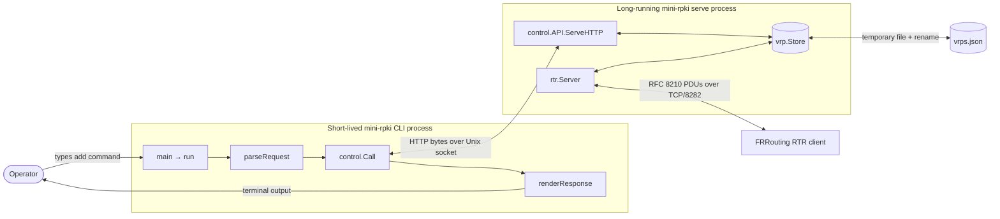

Think of the long-running server like a router daemon. The short-lived CLI resembles a management command that connects to that daemon, asks it to change state, prints the reply, and exits. FRR uses a separate router-facing control-plane synchronization connection: RTR over TCP.

The control socket and the RTR socket have different jobs:

| Endpoint | Peers | Transport | Content | Intended reach |
| --- | --- | --- | --- | --- |
| `control.sock` | MiniRPKI CLI ↔ MiniRPKI server | Unix domain stream socket | HTTP carrying JSON | Processes that can see the same socket path/inode and have permission, normally in one container or a shared mount |
| TCP `8282` | FRR ↔ MiniRPKI server | TCP | Binary RTR v1 PDUs | Routed network between router and cache |

The Unix socket is a filesystem-named meeting point. The server listens at the path; each CLI invocation connects to that path. They do not have to arrive at exactly the same instant: Linux keeps the listening socket open and accepts connections as CLI processes arrive.

---

## 3. Complete execution timeline

This diagram is the whole example before we inspect individual blocks.

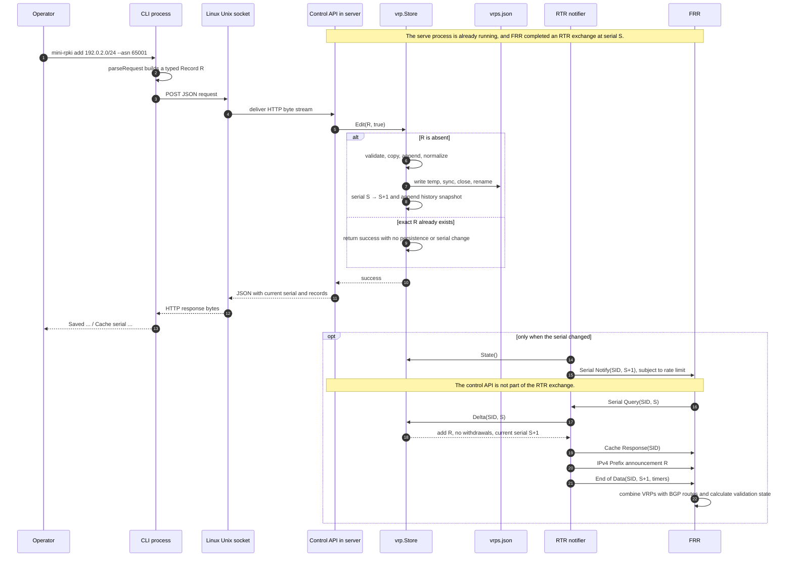

`A` and `N` are shown separately to make the two protocols clear. In the code, `A` is `control.API`, while `N` is the per-connection work performed by `rtr.Server.handle`.

---

## 4. Source map and runtime status

The module declaration is:

```go
module github.com/minirpki/mini-rpki

go 1.24
```

The project has no external Go module dependencies. The imported Go libraries such as `net`, `net/http`, `encoding/json`, `sync`, and `crypto/rand` are from the Go standard library. Imports beginning with `github.com/minirpki/mini-rpki/` refer to packages inside this repository.

| File | Package | Runs in normal operation? | Main responsibility |
| --- | --- | --- | --- |
| [`cmd/mini-rpki/main.go`](../cmd/mini-rpki/main.go) | `main` | Yes | Process entry, mode choice, listeners, component wiring, shutdown |
| [`cmd/mini-rpki/commands.go`](../cmd/mini-rpki/commands.go) | `main` | CLI commands | Convert argument strings into a typed control request |
| [`cmd/mini-rpki/output.go`](../cmd/mini-rpki/output.go) | `main` | CLI commands | Convert JSON replies into readable or pretty JSON output |
| [`internal/control/control.go`](../internal/control/control.go) | `control` | Yes | HTTP/JSON management protocol over a Unix socket |
| [`internal/control/address.go`](../internal/control/address.go) | `control` | `interface` command | Describe the active RTR listener and local interfaces |
| [`internal/vrp/defaults.go`](../internal/vrp/defaults.go) | `vrp` | Called on every server startup; its returned records are selected only when persistence is disabled or the file is absent | Supply two demonstration records |
| [`internal/vrp/store.go`](../internal/vrp/store.go) | `vrp` | Yes | Validate, store, persist, version, and diff VRPs |
| [`internal/rtr/codec.go`](../internal/rtr/codec.go) | `rtr` | RTR connections | Encode and decode binary RTR PDUs |
| [`internal/rtr/server.go`](../internal/rtr/server.go) | `rtr` | Yes | Accept routers, implement the RTR conversation, send updates |
| [`internal/scenario/scenario.go`](../internal/scenario/scenario.go) | `scenario` | No | Private developer fixtures for validation examples |

Go's `internal` directory rule prevents unrelated external modules from importing these implementation packages directly. It is similar to marking internal control-plane details as private to this application.

The source divides into four layers:

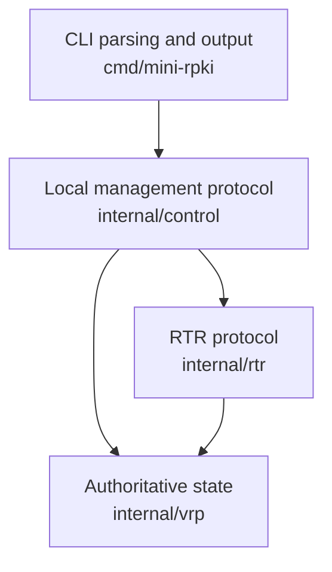

The Store is the shared point between management changes and router delivery. Both `control.API` and `rtr.Server` hold a pointer to the same Store object.

---

# Part I — Starting the long-running server

## 5. `cmd/mini-rpki/main.go`: entry and composition root

This file is the **composition root**: the place that constructs the major objects and connects them. It does not contain the detailed VRP or RTR algorithms.

### 5.1 Package and imports

```go
package main

import (
    "context"
    "flag"
    "fmt"
    // local packages and other standard-library packages
)
```

`package main` tells Go that this package builds an executable. Its imports fall into these roles:

| Role | Imports | Why they are here |
| --- | --- | --- |
| Process configuration | `flag`, `os`, `strconv` | Read flags, arguments, environment variables, and numeric settings |
| Lifetime | `context`, `os/signal`, `syscall`, `time` | Cancel work and place time limits on shutdown |
| I/O and networking | `net`, `net/http`, `filepath` | Open RTR TCP and control Unix listeners |
| User/error output | `fmt`, `log` | Help text, startup messages, final errors |
| MiniRPKI components | `control`, `rtr`, `vrp` | Assemble the three internal packages |

An import makes names from another package available. It does not start that package as a process or service.

### 5.2 `env`: environment value with a default

```go
func env(k, d string) string {
    if v := os.Getenv(k); v != "" {
        return v
    }
    return d
}
```

**Purpose:** centralize the rule “use a nonempty environment value; otherwise use this default.”

For example:

```text
env("MINIRPKI_LISTEN", ":8282")
```

- returns `10.82.0.1:8282` if that nonempty value is in the environment;
- returns `:8282` if the variable is absent or explicitly empty.

`if v := ...; condition` declares `v` only for this `if` statement. This is a common Go pattern for a short-lived value.

### 5.3 `main`: operating-system entry and final error boundary

```go
func main() {
    if err := run(os.Args[1:]); err != nil {
        log.Print(err)
        os.Exit(1)
    }
}
```

The Go runtime calls `main()` when the process starts. For the example command, Linux provides approximately:

```text
os.Args[0] = "mini-rpki"
os.Args[1] = "add"
os.Args[2] = "192.0.2.0/24"
os.Args[3] = "--asn"
os.Args[4] = "65001"
```

`os.Args[1:]` is a slice view that starts at index 1, so `run` receives:

```text
["add", "192.0.2.0/24", "--asn", "65001"]
```

The executable name was “removed” only from the view passed to `run`; Go did not erase the original `os.Args` array.

`run` returns one value of type `error`. `err := run(...)` stores it. `err != nil` means something failed. On failure, `main` logs the message and asks the OS to terminate the process with exit status 1. On success, `run` returns `nil`, `main` reaches its end, and the process exits successfully.

Keeping most work in `run` rather than `main` makes the flow easier to call and reason about.

### 5.4 `run`: choose the control socket and extract global `--json`

```go
func run(args []string) error {
    socket := env("MINIRPKI_SOCKET", "/data/control.sock")
    jsonOutput := false
    filtered := make([]string, 0, len(args))
    for _, arg := range args {
        if arg == "--json" {
            jsonOutput = true
        } else {
            filtered = append(filtered, arg)
        }
    }
    args = filtered
```

**Purpose of `socket`:** both the server and later CLI processes must choose the same Unix socket path. The path names the rendezvous point. It is not a directory of stored VRPs and it does not itself process commands.

**Purpose of the filtering loop:** `--json` is a presentation option for control-client commands. The loop recognizes it wherever it appears and removes it before command-specific parsing. `help` still prints plain text, and `serve` does not render a response, so supplying `--json` with either of those modes is accepted by this filter but has no output-format effect.

Example:

```text
Input args:     ["list", "--json"]
jsonOutput:     true
Filtered args:  ["list"]
```

`make([]string, 0, len(args))` creates an empty string slice with reserved capacity equal to the input length. Capacity is preallocated storage; length remains zero until `append` adds entries.

Our add example has no `--json`, so all four arguments are appended unchanged and `jsonOutput` remains false.

### 5.5 Help block

```go
if len(args) == 0 || args[0] == "--help" || args[0] == "help" {
    fmt.Println(`MiniRPKI: laboratory RTR cache, never a production validator.
    ...`)
    return nil
}
```

This block prints the supported interface and finishes successfully. The order of the conditions is deliberate. Go evaluates `||` from left to right and stops after a true expression. If `args` is empty, `len(args) == 0` is true and Go never attempts unsafe access to `args[0]`.

The multi-line backtick string preserves line breaks. `return nil` says that asking for help is a successful operation.

### 5.6 Enter server mode

```go
if args[0] == "serve" {
    f := flag.NewFlagSet("serve", flag.ContinueOnError)
```

Only `mini-rpki serve ...` enters this large branch. The short-lived `add` process skips it. A separate already-running process previously entered it and remains here serving both protocols.

`f` contains a pointer to a new `flag.FlagSet` object. Initially it knows its name (`serve`) and error policy (`ContinueOnError`), but it has not parsed anything. Think of it as a fresh command grammar table.

`ContinueOnError` means parsing returns an error to this code instead of terminating the whole process itself.

### 5.7 Register server flags

```go
addr := f.String("listen", env("MINIRPKI_LISTEN", ":8282"), "RTR TCP address")
data := f.String("data", env("MINIRPKI_DATA", "/data/vrps.json"), "JSON persistence path")
sock := f.String("socket", socket, "local Unix control socket")
refreshFlag := f.String("refresh", env("MINIRPKI_REFRESH", "5"), "RTR refresh interval in seconds (1..599)")
```

Each `f.String` does two things:

1. registers a recognized flag in `f`;
2. returns a `*string` pointing to the value storage that `f.Parse` will update.

Before parsing, the pointed-to values contain their defaults. After parsing, they contain either the defaults or user-supplied values.

```text
Variable       Meaning                       Default
*addr          RTR TCP bind address          :8282
*data          persistent VRP JSON file       /data/vrps.json
*sock          local control socket path      /data/control.sock
*refreshFlag   RTR refresh seconds as text    5
```

The `*` in `*addr` means “read the string stored at the address held by this pointer.” The pointer lets `flag.Parse` update storage that later code reads.

### 5.8 Parse server flags and reject positional leftovers

```go
if err := f.Parse(args[1:]); err != nil {
    return err
}
if f.NArg() != 0 {
    return fmt.Errorf("unexpected arguments")
}
```

`args[0]` is `serve`, so only `args[1:]` belongs to the `serve` flag parser.

Parsing does not repeatedly remove registered definitions from `f`. It compares command-line tokens with the registered flag names, converts their values, and records any non-flag positional tokens as leftover arguments. `NArg()` counts only those leftovers.

```text
mini-rpki serve --listen :8282
registered flag consumed: --listen :8282
NArg():                  0

mini-rpki serve extra
leftover positional arg: extra
NArg():                  1  → rejected
```

### 5.9 Convert and validate the refresh timer

```go
refresh, err := strconv.ParseUint(*refreshFlag, 10, 32)
if err != nil || refresh < 1 || refresh >= uint64(rtr.ExpireInterval) {
    return fmt.Errorf("--refresh / MINIRPKI_REFRESH must be 1..599 seconds")
}
```

Flags were registered as strings so the same validation applies to both an environment value and a CLI value. `ParseUint` means:

```text
input:    *refreshFlag
base:     10 (decimal)
bit size: 32
output:   uint64 value constrained to a 32-bit range, plus error
```

The second check applies the protocol relationship: refresh must be at least 1 and less than the 600-second expire interval. The code later converts the validated value to `uint32` safely.

### 5.10 Open the authoritative Store

```go
s, err := vrp.Open(*data, vrp.DemoRecords())
if err != nil {
    return err
}
```

`vrp.DemoRecords()` builds the fallback dataset. `vrp.Open` creates the session and serial, reads an existing persistence file when present, validates and normalizes the chosen records, and seeds history. Its details are covered in Part II.

`s` has type `*vrp.Store`: a pointer to one shared Store object. Startup stops before opening any listener if the Store cannot be initialized. That prevents the service from accepting routers while its authoritative data is invalid or unreadable.

### 5.11 Create the Unix control listener

```go
if err = os.MkdirAll(filepath.Dir(*sock), 0700); err != nil {
    return err
}
cl, err := control.Listen(*sock)
if err != nil {
    return fmt.Errorf("control socket (remove stale socket only after confirming server stopped): %w", err)
}
defer os.Remove(*sock)
defer cl.Close()
```

This block prepares the management path:

1. `filepath.Dir` obtains the parent directory.
2. `MkdirAll` creates missing directories with requested owner-only permissions.
3. `control.Listen` asks Linux to bind a Unix listener at the path.
4. `defer` schedules cleanup when `run` eventually returns.

Deferred calls execute in reverse order, so the listener is closed and then the socket pathname is removed. If binding fails because the pathname already exists, the error warns the operator not to delete it until confirming that another server is not active.

The container image sets `MINIRPKI_SOCKET=/run/minirpki/control.sock`, keeping the control socket out of persistent data. Native execution still uses the `/data/control.sock` default unless `mini-rpki serve --socket ...` or `MINIRPKI_SOCKET` selects another path. Client commands do not define a `--socket` flag; each client must receive a matching `MINIRPKI_SOCKET` value.

### 5.12 Create the RTR TCP listener

```go
l, err := net.Listen("tcp", *addr)
if err != nil {
    return err
}
defer l.Close()
```

Linux binds the selected IP address and TCP port. It handles SYN/SYN-ACK/ACK, retransmission, ordering, and stream delivery. MiniRPKI handles the RTR PDU boundaries and meanings inside that stream.

If TCP binding fails, `run` returns and the previously registered Unix-listener cleanup still runs.

### 5.13 Build shared cancellation and wire the objects together

```go
ctx, stop := signal.NotifyContext(context.Background(), os.Interrupt, syscall.SIGTERM)
defer stop()
server := &rtr.Server{Store: s, Refresh: uint32(refresh)}
api := &http.Server{
    Handler: control.API{Store: s, RTR: server},
    ReadHeaderTimeout: 5 * time.Second,
    ReadTimeout:       10 * time.Second,
    WriteTimeout:      10 * time.Second,
    IdleTimeout:       30 * time.Second,
    MaxHeaderBytes:    4096,
}
```

`signal.NotifyContext` creates a context whose `Done` channel closes after Ctrl+C/SIGINT or SIGTERM. A context is comparable to a shared “administratively down” signal propagated to multiple workers.

The object graph is:

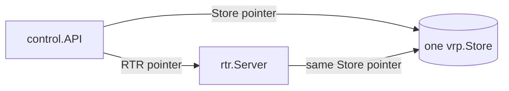

Because both components refer to the same Store, an API edit is memory-visible to RTR as soon as the Store transaction unlocks. There is no separate database or cross-component copy: RTR reads the shared Store directly while answering a query or on its one-second notification tick. Notification to a router is therefore not instantaneous.

The HTTP timeouts and header limit constrain the local management connection. They are not RTR timers; RTR has its own deadlines and advertised refresh/retry/expire values.

### 5.14 Run the control service concurrently

```go
go func() {
    if e := api.Serve(cl); e != nil && e != http.ErrServerClosed {
        log.Print(e)
        stop()
    }
}()
```

`go func() { ... }()` starts an anonymous function as a goroutine. It lets the HTTP control server run while the current goroutine continues to the RTR server.

`api.Serve(cl)` is ordinary HTTP serving attached to a Unix listener rather than a TCP listener. If it stops for an unexpected reason, the goroutine logs the error and calls `stop()`, canceling the shared context so the RTR side also shuts down. `http.ErrServerClosed` is the normal result of planned HTTP shutdown and is therefore ignored.

### 5.15 Arrange graceful HTTP shutdown

```go
go func() {
    <-ctx.Done()
    c, cancel := context.WithTimeout(context.Background(), 5*time.Second)
    defer cancel()
    api.Shutdown(c)
}()
```

This second goroutine waits at `<-ctx.Done()` until the cancellation signal arrives. It then creates a new five-second context and asks the HTTP server to stop accepting new requests and finish active ones.

It uses a fresh background context because the original `ctx` is already canceled. Passing the canceled context to `Shutdown` would give it no grace period. The current implementation does not inspect the error returned by `api.Shutdown`.

### 5.16 Run RTR in the foreground

```go
log.Printf("LAB ONLY RTR listening=%s control=%s", *addr, *sock)
return server.Serve(ctx, l)
```

The startup message records both endpoints. `server.Serve` owns the RTR accept loop and blocks for the normal lifetime of the process. When it returns, its error becomes `run`'s result, and all deferred cleanup executes.

Using the RTR server as the foreground lifetime gives the process a clear primary wait point. The Go runtime schedules the two control goroutines and all later connection goroutines around it.

### 5.17 The other branch: short-lived client mode

The remainder of `run` is skipped by `serve` but used by our `add` process:

```go
q, err := parseRequest(args)
if err != nil {
    return err
}
action := q.Action
if action == "interface" {
    q.Action = "address"
}
b, err := control.Call(context.Background(), socket, q)
if err != nil {
    return err
}
return renderResponse(os.Stdout, action, b, jsonOutput)
```

The steps are:

1. parse text into a typed `control.Request`;
2. remember the public action name;
3. map public `interface` to the older internal action name `address`;
4. send the request to the already-running server;
5. render the returned JSON to stdout.

Our action is `add`, so no mapping occurs. `context.Background()` has no cancellation signal, but `control.Call` uses an HTTP client with a ten-second timeout.

The `action` copy matters only for `interface`: the server receives `address`, while the output formatter still selects its user-facing `interface` block.

---

## 6. What this file delegates

At this point `main.go` has established the application skeleton, but other files own the details:

```text
vrp.DemoRecords / vrp.Open     → defaults.go and store.go
parseRequest                   → commands.go
control.Listen / Call / API    → control.go
rtr.Server.Serve               → server.go
renderResponse                 → output.go
```

The next parts follow those calls in execution order.

---

# Part II — The authoritative VRP Store

## 7. `internal/vrp/defaults.go`: first-start data

This small file belongs to `package vrp` and imports only `net/netip`, Go's typed IP address and prefix library.

### 7.1 `DemoRecords`

```go
// DemoRecords is the small documentation-only dataset used on first startup.
func DemoRecords() []Record {
    return []Record{
        {Prefix: netip.MustParsePrefix("192.0.2.0/24"), MaxLen: 24, ASN: 65001},
        {Prefix: netip.MustParsePrefix("2001:db8:100::/48"), MaxLen: 48, ASN: 65001},
    }
}
```

**Purpose:** return a fresh two-record slice that `Open` may use when the configured persistence file does not exist.

`run` evaluates `DemoRecords()` on every `serve` startup before calling `Open`. `Open` decides whether to use that returned slice or replace it with records decoded from the persistence file.

```text
192.0.2.0/24       max length /24  AS65001
2001:db8:100::/48  max length /48  AS65001
```

`MustParsePrefix` differs from `ParsePrefix`:

- `ParsePrefix` returns a value and an error for untrusted operator input;
- `MustParsePrefix` panics if the programmer wrote an invalid constant.

These strings are fixed source constants, so a panic would reveal a coding mistake during startup rather than an operator mistake.

Each function call builds a new slice. There is no package-global mutable default table.

The defaults are **fallback input**, not data that is always merged with the saved file. `Open` uses them when persistence is disabled with an empty path or when the configured file is absent. An existing file containing `[]` intentionally produces an empty Store.

---

## 8. `internal/vrp/store.go`: model, transaction, and history

This file is the core state component.

### 8.1 Imports and their jobs

| Import | Job in this file |
| --- | --- |
| `crypto/rand` | Generate a new random cache session ID |
| `encoding/binary` | Interpret two random bytes as big-endian `uint16` |
| `encoding/json` | Load and save the record list |
| `fmt` | Construct validation and lookup errors |
| `log` | Record additions, removals, and serial changes |
| `net/netip` | Represent and compare IPv4/IPv6 prefixes |
| `os`, `filepath` | Read files and perform the temp-file/rename transaction |
| `sort` | Put records into stable order |
| `sync` | Protect Store state from concurrent goroutines |

The networking analogy for the complete object is:

| Store field or operation | Networking analogy |
| --- | --- |
| `records` | Current authorized-origin table |
| `serial` | Database or configuration revision |
| `session` | Cache boot epoch that makes its serials meaningful |
| `history` | Bounded update journal |
| `Normalize` | Canonicalize, deduplicate, and order a table |
| `RWMutex` | Several read operations, one exclusive configuration transaction |
| `Delta` | Calculate the net changes since an older revision |
| temp file + rename | Build a complete candidate configuration, then commit it |

### 8.2 `Record`: one VRP

```go
type Record struct {
    Prefix netip.Prefix `json:"prefix"`
    MaxLen uint8        `json:"maxLength"`
    ASN    uint32       `json:"asn"`
}
```

A `Record` contains the data that eventually becomes one IPv4 or IPv6 RTR Prefix PDU.

The JSON tags define field names in both persistence and the control protocol:

```json
{
  "prefix": "192.0.2.0/24",
  "maxLength": 24,
  "asn": 65001
}
```

The three fields together form the record's identity. These are three different records:

```text
192.0.2.0/24  maxlen 24  AS65001
192.0.2.0/24  maxlen 25  AS65001
192.0.2.0/24  maxlen 24  AS65002
```

All fields are values that Go can copy and compare. This is why later code can use `r == v` and can use a `Record` as a map key.

`uint8` and `uint32` specify unsigned widths:

```text
MaxLen: 0..255 at the Go type level
ASN:    0..4,294,967,295
```

The validation method narrows maximum length further according to IPv4 or IPv6.

### 8.3 `Record.Validate`: enforce record invariants

First block:

```go
func (r Record) Validate() error {
    if !r.Prefix.IsValid() ||
        r.Prefix.Addr().Is4In6() ||
        r.Prefix != r.Prefix.Masked() {
        return fmt.Errorf("prefix must be a canonical IPv4 or IPv6 network")
    }
```

It rejects:

1. an invalid or zero-value prefix;
2. an IPv4 address represented as IPv4-mapped IPv6;
3. a prefix with host bits set.

```text
192.0.2.0/24   canonical network: accepted
192.0.2.7/24   host bits set: rejected
```

Requiring one canonical representation prevents logically equal networks from appearing as different Store keys. This resembles requiring route prefixes to be stored in network form.

Second block:

```go
    if int(r.MaxLen) < r.Prefix.Bits() ||
        int(r.MaxLen) > r.Prefix.Addr().BitLen() {
        return fmt.Errorf("invalid maximum prefix length")
    }
    return nil
}
```

It enforces:

```text
VRP prefix length <= maximum length <= address-family width
```

For R:

```text
24 <= 24 <= 32  → valid
```

Examples:

```text
192.0.2.0/24 maxlen 23   rejected: shorter than the VRP prefix
192.0.2.0/24 maxlen 33   rejected: beyond IPv4 width
2001:db8::/48 maxlen 64  accepted
```

The method returns `nil` when all invariants hold. It does not reject ASN 0. The special treatment of AS0 appears only in the non-runtime `ValidateRoute` helper discussed later.

### 8.4 `Normalize`: validate and deduplicate

```go
func Normalize(rs []Record) ([]Record, error) {
    set := map[Record]bool{}
    out := make([]Record, 0, len(rs))
    for _, r := range rs {
        if err := r.Validate(); err != nil {
            return nil, err
        }
        if !set[r] {
            out = append(out, r)
            set[r] = true
        }
    }
```

This block creates a new output slice rather than editing the input in place. For every input record it:

1. validates the record;
2. checks whether the exact tuple is already in `set`;
3. appends only the first occurrence.

`map[Record]bool` is an exact membership set. A map lookup for a missing key returns the zero Boolean value `false`, so `!set[r]` means “not seen yet.”

If any record is invalid, `Normalize` returns an error and no partial table.

The next block sorts the unique records:

```go
    sort.Slice(out, func(i, j int) bool {
        a, b := out[i], out[j]
        if a.Prefix.String() != b.Prefix.String() {
            return a.Prefix.String() < b.Prefix.String()
        }
        if a.MaxLen != b.MaxLen {
            return a.MaxLen < b.MaxLen
        }
        return a.ASN < b.ASN
    })
    return out, nil
}
```

Ordering keys are:

1. prefix text;
2. maximum length;
3. ASN.

The prefix ordering is lexical text ordering, not a longest-prefix-match or numeric routing-table order. The purpose is deterministic state and JSON. Equivalent sets get the same slice ordering, which makes the later equality comparison reliable.

Example input:

```text
2001:db8:100::/48 maxlen 48 AS65001
192.0.2.0/24      maxlen 24 AS65001
192.0.2.0/24      maxlen 24 AS65001   duplicate
```

Output:

```text
192.0.2.0/24       maxlen 24 AS65001
2001:db8:100::/48  maxlen 48 AS65001
```

### 8.5 `Snapshot` and `Store`

```go
type Snapshot struct {
    Serial  uint32
    Records []Record
}

type Store struct {
    mu      sync.RWMutex
    session uint16
    serial  uint32
    records []Record
    history []Snapshot
    path    string
}
```

One `Snapshot` associates a full record set with one serial. The Store retains recent snapshots so it can calculate a net delta from a router's older serial.

The lowercase Store fields are private to `package vrp`. Callers must use methods, which lets the methods consistently apply locking and copying.

`sync.RWMutex` provides:

```text
RLock/RUnlock  several readers may coexist
Lock/Unlock    one writer excludes readers and other writers
```

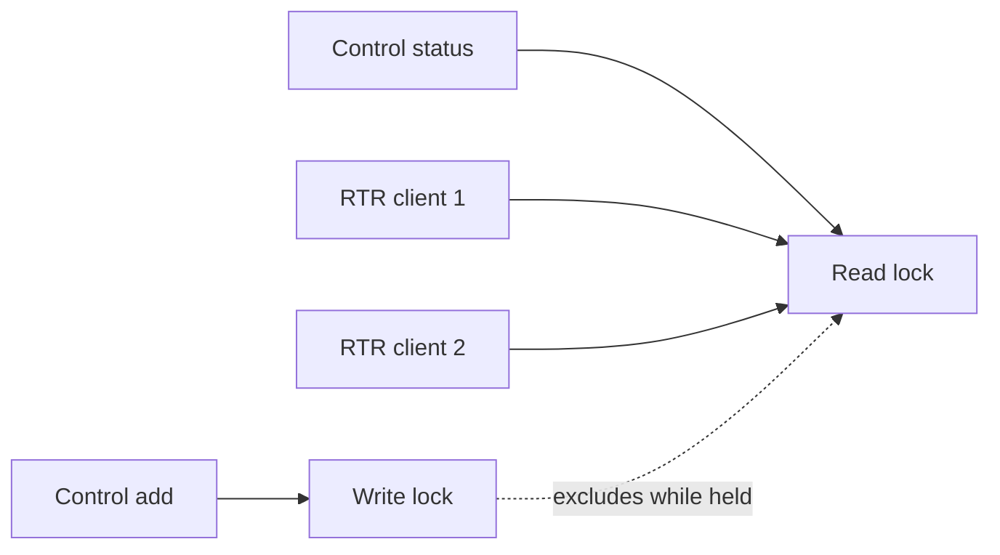

The mutex protects session, serial, current records, and history as one logical state. A reader sees a complete old or complete new revision.

### 8.6 `Open`: generate a cache session

```go
func Open(path string, defaults []Record) (*Store, error) {
    var seed [2]byte
    if _, err := rand.Read(seed[:]); err != nil {
        return nil, err
    }
    s := &Store{
        session: binary.BigEndian.Uint16(seed[:]),
        serial:  1,
        path:    path,
    }
```

`seed` is an array of exactly two bytes. `rand.Read` accepts `[]byte`, so `seed[:]` creates a slice view over the same array storage:

```text
array:       [ byte 0 ][ byte 1 ]
slice view:  └──────── both bytes ────────┘
```

Passing `seed` without `[:]` would not compile because `[2]byte` and `[]byte` are different Go types.

`crypto/rand.Read` asks the operating system for random bytes. `_` discards the returned count; `err` is checked. `binary.BigEndian.Uint16` interprets the bytes in network order and creates the 16-bit session ID.

Illustrative values:

```text
seed bytes:  4a 2c
session:     0x4a2c = 18988
serial:      1
```

Every call to `Open` creates a new session and starts serial at 1. Session, serial, and history are not loaded from the JSON file.

### 8.7 `Open`: choose saved records or defaults

```go
    rs := defaults
    if path != "" {
        b, err := os.ReadFile(path)
        if err == nil {
            if err = json.Unmarshal(b, &rs); err != nil {
                return nil, err
            }
        } else if !os.IsNotExist(err) {
            return nil, err
        }
    }
```

The decision table is:

| Condition | Candidate `rs` |
| --- | --- |
| Empty path | Defaults; Store is memory-only |
| File does not exist | Defaults |
| File exists and valid JSON | File records replace defaults |
| File exists as `[]` | Empty dataset replaces defaults |
| Permission/read error | Startup fails |
| Malformed JSON | Startup fails |

`rs := defaults` initially copies the slice descriptor, not every record. That is safe here because the next stage constructs a normalized output slice instead of modifying `defaults` in place.

Persistence decoding uses plain `json.Unmarshal`, unlike the control API's strict decoder. Unknown object fields are ignored, and omitted fields receive Go zero values before `Normalize`/`Validate` checks record invariants. A top-level JSON `null` is accepted as a nil, effectively empty dataset. Therefore “valid JSON” here does not mean every field name was schema-checked.

The file stores only the JSON record list. Defaults are not merged into an existing file.

### 8.8 `Open`: normalize and seed history

```go
    var err error
    s.records, err = Normalize(rs)
    if err != nil {
        return nil, err
    }
    s.history = []Snapshot{
        {s.serial, append([]Record(nil), s.records...)},
    }
    return s, nil
}
```

Loaded data passes through the same validation, duplicate removal, and sorting rules as live edits.

This expression copies the record slice:

```go
append([]Record(nil), s.records...)
```

- `[]Record(nil)` starts as a nil slice;
- `...` expands every record as an argument to `append`;
- the result has its own backing array.

The copy prevents later record changes from rewriting the initial historical snapshot.

On first startup with no file:

```text
session = random 16-bit SID
serial  = 1
records = the two normalized demo records
history = [ serial 1 → independent copy of those records ]
```

The defaults are not immediately written to disk. An effective later mutation causes the first persistence write.

### 8.9 What survives restart

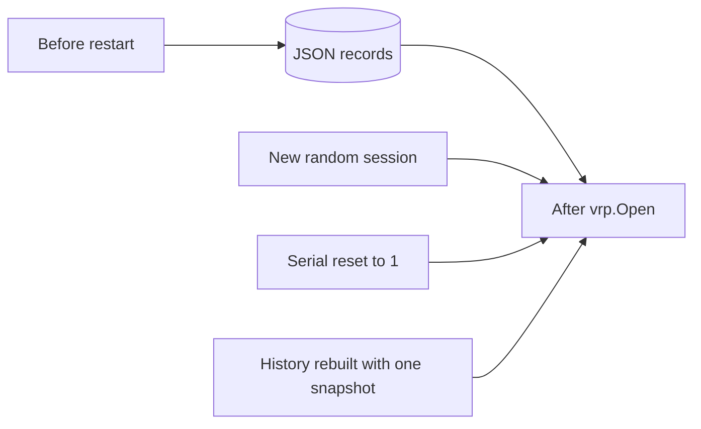

| State | Survives through JSON? |
| --- | --- |
| VRP records | Yes |
| Session ID | No; regenerated |
| Serial | No; reset to 1 |
| Delta history | No; rebuilt from loaded records |

The session identifies the serial-number generation. A serial from the old session must not be compared as though it belonged to the new process.

### 8.10 `State`: return a consistent safe copy

```go
func (s *Store) State() (uint16, uint32, []Record) {
    s.mu.RLock()
    defer s.mu.RUnlock()
    return s.session, s.serial, append([]Record(nil), s.records...)
}
```

`State` is used by the control API and RTR handlers. It:

1. acquires a read lock;
2. reads session, serial, and records from one consistent revision;
3. returns a copy of the record slice;
4. releases the lock when the function returns.

The `defer` is registered immediately after locking, reducing the risk that a later return path forgets to unlock.

The copy means a caller may sort or modify its returned slice without corrupting the Store. It resembles receiving a RIB snapshot instead of a pointer that allows direct modification of the authoritative table.

### 8.11 `Replace`: public whole-table operation

```go
func (s *Store) Replace(rs []Record) error {
    s.mu.Lock()
    defer s.mu.Unlock()
    return s.replace(rs)
}
```

The actual source expresses this on one line, but it performs three distinct actions: acquire the exclusive lock, guarantee unlock on return, and call the private transaction function.

The control `clear` action calls:

```go
Store.Replace([]vrp.Record{})
```

The lowercase `replace` method assumes its caller already holds the write lock. Keeping the lock acquisition in the public method avoids accidentally exposing an unlocked full-table mutation.

### 8.12 `Edit`: validate before locking

```go
func (s *Store) Edit(r Record, add bool) error {
    if err := r.Validate(); err != nil {
        return err
    }
    s.mu.Lock()
    defer s.mu.Unlock()
```

`add` selects the operation:

```text
true   add the exact record
false  remove the exact record
```

Validation does not need Store state, so it happens before the lock. The exclusive lock then covers the complete copy, decision, persistence, serial, and history transaction.

The CLI already validated R, but the Store validates again because it is the authoritative boundary. A custom local client cannot bypass this rule by sending JSON directly.

### 8.13 `Edit`: copy current state and find an exact tuple

```go
    rs := append([]Record(nil), s.records...)
    found := -1
    for i, v := range rs {
        if v == r {
            found = i
            break
        }
    }
```

`rs` is a working copy. `found = -1` is a sentinel meaning “no matching index.” The loop compares all three fields because `Record` equality is field-by-field.

For R, these do not match:

```text
same prefix, maxlen 25, AS65001
same prefix, maxlen 24, AS65002
```

The search stops after the first exact match. `Normalize` guarantees the Store itself has no exact duplicates.

### 8.14 `Edit`: add branch and the default-data no-op

```go
    if add {
        if found >= 0 {
            return nil
        }
        rs = append(rs, r)
```

If R is already present, `Edit` reports success immediately. This makes add **idempotent**: asking twice for the same desired state is safe.

The early return means:

```text
no call to replace
no disk write
no serial increment
no new snapshot
no RTR change
```

This is the exact first-start path for our command because `DemoRecords()` already supplied R.

If R is absent, it is appended to the working copy. The authoritative Store is still unchanged at that moment.

### 8.15 `Edit`: remove branch

```go
    } else {
        if found < 0 {
            return fmt.Errorf("exact VRP not found")
        }
        rs = append(rs[:found], rs[found+1:]...)
    }
    return s.replace(rs)
}
```

A remove must find the exact tuple. The slice expression joins the records before and after the matching index:

```text
before: [ A, R, B ]
after:  [ A, B ]
```

Because `rs` is the working copy, the current Store remains intact until `replace` commits.

Both a real add and a real remove finish by calling `s.replace(rs)` while the write lock remains held.

### 8.16 `replace`: normalize the candidate

```go
func (s *Store) replace(rs []Record) error {
    rs, err := Normalize(rs)
    if err != nil {
        return err
    }
```

`Edit` validates one record, but `Replace` can supply a complete list. The private transaction therefore validates and normalizes the entire candidate every time.

For the real-change version of our example, assume before the command:

```text
SID     = 18988
serial  = 7
records = [ 2001:db8:100::/48 maxlen 48 AS65001 ]
```

After append and normalization, the candidate is:

```text
192.0.2.0/24       maxlen 24 AS65001
2001:db8:100::/48  maxlen 48 AS65001
```

### 8.17 `replace`: detect an equivalent set

```go
    equal := len(rs) == len(s.records)
    if equal {
        for i := range rs {
            if rs[i] != s.records[i] {
                equal = false
                break
            }
        }
    }
    if equal {
        return nil
    }
```

First the lengths must match. If they do, every normalized element is compared at the same index.

This catches no-op whole-table replacements even if their input originally used a different order or included duplicate copies. An equivalent set returns before persistence and serial advancement.

### 8.18 `replace`: prepare persistence

```go
    if s.path != "" {
        if err = os.MkdirAll(filepath.Dir(s.path), 0700); err != nil {
            return err
        }
        b, _ := json.MarshalIndent(rs, "", "  ")
```

An empty path selects a memory-only Store. Otherwise the parent directory is created if needed.

`MarshalIndent` creates human-readable JSON. For a one-record table:

```json
[
  {
    "prefix": "192.0.2.0/24",
    "maxLength": 24,
    "asn": 65001
  }
]
```

The current source discards the `MarshalIndent` error with `_`. Encoding these current validated field types is expected to succeed, but ignoring the error is still an engineering weakness: a future field type could introduce a real encoding failure that this code would miss.

### 8.19 `replace`: create a same-directory temporary file

```go
        f, e := os.CreateTemp(filepath.Dir(s.path), ".vrps-*")
        if e != nil {
            return e
        }
        name := f.Name()
        defer os.Remove(name)
```

The temporary file is created in the destination directory. That matters because a rename within one filesystem can replace the destination atomically.

`name` might resemble:

```text
/data/.vrps-1842358712
```

`defer os.Remove(name)` cleans up the temporary pathname after an error. After a successful rename, the old temporary name no longer exists, so the cleanup attempt is harmless.

`CreateTemp` normally creates the file with owner-only permissions (`0600`).

### 8.20 `replace`: write, synchronize, and close

```go
        if _, e = f.Write(b); e == nil {
            e = f.Sync()
        }
        ce := f.Close()
        if e != nil {
            return e
        }
        if ce != nil {
            return ce
        }
```

The order is deliberate:

1. write all encoded bytes;
2. if writing succeeded, request a file sync;
3. close the descriptor;
4. check both the operation error and the close error.

If the write fails, `Sync` is skipped but the file is still closed. Any error returns while the Store's in-memory records and serial remain unchanged.

### 8.21 `replace`: atomically select the new file

```go
        if e = os.Rename(name, s.path); e != nil {
            return e
        }
    }
```

The rename changes the target pathname from the old complete file to the new complete file in one filesystem operation. Normal readers should not observe a half-written JSON document.

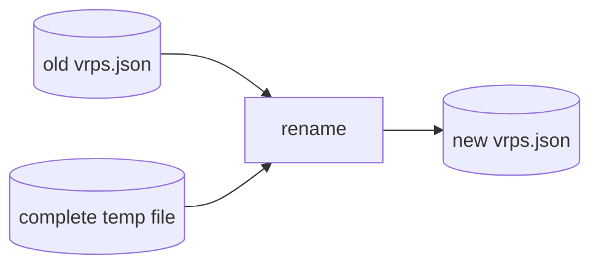

Persistence finishes before the memory/serial commit. This ordering preserves a strong application invariant:

```text
If the API reports the new serial, the persistence rename already succeeded.
```

The file itself is synced, but the containing directory is not explicitly synced after rename. That leaves a narrow crash/power-loss durability risk at the filesystem level.

### 8.22 `replace`: calculate log differences

```go
    old := make(map[Record]bool, len(s.records))
    next := make(map[Record]bool, len(rs))
    for _, r := range s.records {
        old[r] = true
    }
    for _, r := range rs {
        next[r] = true
    }
```

These exact-record sets are used to decide which record-specific log messages to produce. They are separate from history and are not used later to answer router deltas.

### 8.23 `replace`: advance one serial per transaction and log

```go
    s.serial++
    for _, r := range s.records {
        if !next[r] {
            log.Printf("VRP removed prefix=%s maxlen=%d asn=%d serial=%d",
                r.Prefix, r.MaxLen, r.ASN, s.serial)
        }
    }
    for _, r := range rs {
        if !old[r] {
            log.Printf("VRP added prefix=%s maxlen=%d asn=%d serial=%d",
                r.Prefix, r.MaxLen, r.ASN, s.serial)
        }
    }
    log.Printf("cache serial advanced serial=%d records=%d", s.serial, len(rs))
```

One effective transaction advances the serial once, even if a whole-table replacement adds or removes many records.

For the real-change example:

```text
old serial: 7
new serial: 8

VRP added prefix=192.0.2.0/24 maxlen=24 asn=65001 serial=8
cache serial advanced serial=8 records=2
```

The increment is a normal `uint32` increment, so it wraps from its maximum to zero. The code does not use RFC 1982 arithmetic when comparing history; it looks for exact retained serial identity.

### 8.24 `replace`: commit memory and bounded history

```go
    s.records = rs
    s.history = append(s.history,
        Snapshot{s.serial, append([]Record(nil), rs...)})
    if len(s.history) > 129 {
        s.history = s.history[1:]
    }
    return nil
}
```

The normalized candidate becomes current state. A copied snapshot is appended for the new serial.

The Store retains at most 129 snapshots: current plus up to 128 previous transitions. Once the limit is exceeded, it drops the oldest snapshot. A router requesting a serial older than retained history cannot receive an incremental answer.

Example:

```text
before:
  serial 7 → [ IPv6 record ]

after:
  serial 7 → [ IPv6 record ]
  serial 8 → [ R, IPv6 record ]
```

The write lock remains held during persistence and this commit. A concurrent RTR `State` or `Delta` waits and then observes either the whole serial-7 state or the whole serial-8 state.

### 8.25 The complete transaction for R

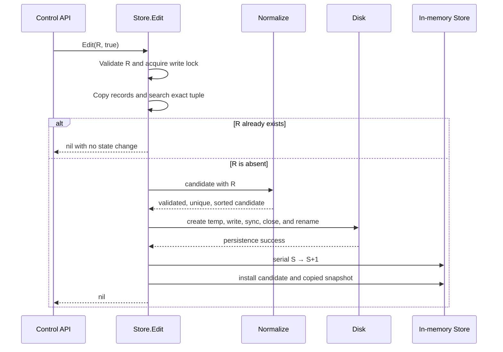

### 8.26 `Delta`: signature and lock

```go
// Delta compares snapshots so add/remove cycles never emit duplicate announcements.
func (s *Store) Delta(session uint16, serial uint32) (
    uint16, uint32, []Record, []Record, bool,
) {
    s.mu.RLock()
    defer s.mu.RUnlock()
```

Inputs are the session and serial reported by the router. Outputs, in order, are:

```text
current session
current serial
records to announce
records to withdraw
incremental answer available (true/false)
```

The actual source keeps the signature on one line; it is wrapped here only for readability.

### 8.27 `Delta`: require the current session

```go
    if session != s.session {
        return s.session, s.serial, nil, nil, false
    }
```

A serial is meaningful only inside its session. After restart, persisted records may be identical, but the new random session declares a new serial-number generation.

The Store returns `false`; the RTR server chooses the wire response. The current server turns every `false` into Cache Reset. A protocol-compliance note about a mismatched session appears in the RTR section.

### 8.28 `Delta`: locate the exact retained serial

```go
    for _, h := range s.history {
        if h.Serial == serial {
```

The method scans at most 129 snapshots. If it finds the router's exact serial, `h.Records` represents the data the router should currently hold from this cache.

### 8.29 `Delta`: create old and current membership sets

```go
            old, now := map[Record]bool{}, map[Record]bool{}
            for _, r := range h.Records {
                old[r] = true
            }
            for _, r := range s.records {
                now[r] = true
            }
```

`old` is the historical set. `now` is the current set.

### 8.30 `Delta`: withdrawals, then announcements

```go
            var adds, dels []Record
            for _, r := range h.Records {
                if !now[r] {
                    dels = append(dels, r)
                }
            }
            for _, r := range s.records {
                if !old[r] {
                    adds = append(adds, r)
                }
            }
            return s.session, s.serial, adds, dels, true
```

The first loop finds records the router had that no longer exist. The second finds current records the router did not have.

For the real-change example:

```text
Delta(SID, 7)

returns:
session      SID
serial       8
adds         [ R ]
withdrawals  []
ok           true
```

This calculates a **net delta**, rather than replaying every intermediate operation. If a record is added at serial 8 and removed again at serial 9, a router querying from serial 7 receives neither operation because the record is absent in both snapshots. That behavior gives the router the minimum change set.

A query from the current serial also succeeds; both lists are empty and the RTR server still sends Cache Response and End of Data.

### 8.31 `Delta`: history miss

```go
        }
    }
    return s.session, s.serial, nil, nil, false
}
```

`false` can mean:

- wrong session;
- requested serial is older than retained history;
- serial never existed in this session;
- history restarted with the process.

For an unavailable serial, the RTR server sends Cache Reset so the router can issue Reset Query and obtain a full dataset.

### 8.32 `ValidateRoute`: developer-side state model

```go
func ValidateRoute(rs []Record, p netip.Prefix, asn uint32) string {
    state := "Not Found"
    for _, r := range rs {
        if r.Prefix.Addr().BitLen() == p.Addr().BitLen() &&
            r.Prefix.Bits() <= p.Bits() &&
            r.Prefix.Contains(p.Addr()) {
            state = "Invalid"
            if r.ASN != 0 && r.ASN == asn && p.Bits() <= int(r.MaxLen) {
                return "Valid"
            }
        }
    }
    return state
}
```

This function is present in a runtime source file, but the running CLI, control API, and RTR server do not call it. It is a local model used with developer validation scenarios. FRR calculates the real validation state.

Its algorithm is:

1. start at `Not Found`;
2. if any same-family VRP covers the route, provisional state becomes `Invalid`;
3. if one covering VRP also matches the nonzero ASN and permits the route length, return `Valid`;
4. otherwise return the provisional state.

For R:

| Route | Result from this helper | Reason |
| --- | --- | --- |
| `192.0.2.0/24`, AS65001 | Valid | Covered, ASN matches, `/24 <= /24` |
| `192.0.2.0/24`, AS65002 | Invalid | Covered, ASN mismatch |
| `192.0.2.0/25`, AS65001 | Invalid | Covered, route exceeds MaxLen |
| `198.51.100.0/24`, AS65001 | Not Found | No covering record |

One fully matching VRP is enough for `Valid`, even if another covering VRP does not match. The explicit `r.ASN != 0` condition means an AS0 record never produces `Valid` in this helper.

### 8.33 Store design limits visible in this file

- JSON persists only records; session, serial, and history restart.
- Initial defaults are not written merely by opening a missing file.
- History retains 129 full snapshots.
- Disk I/O occurs while the exclusive Store lock is held, so a slow filesystem can delay readers.
- The code assumes one server process owns the persistence file; it has no cross-process file lock.
- It does not watch for external edits. Changing `vrps.json` while the process runs does not reload memory.
- The JSON marshal error is ignored.
- The temporary file is synced; the containing directory is not synced after rename.

These are observations from the implementation. They do not prevent the intended small laboratory use, but they matter when judging production behavior.

---

# Part III — Parsing the operator command

## 9. How the three command files become one executable

These files all declare `package main`:

```text
cmd/mini-rpki/main.go
cmd/mini-rpki/commands.go
cmd/mini-rpki/output.go
```

Go compiles the files in one directory and package together. That is why `main.go` can call `parseRequest` and `renderResponse` without importing filenames. Imports name packages, not neighboring source files.

Capitalization controls visibility across packages:

```text
parseRequest       lowercase: private to package main
control.Request    uppercase: exported by package control
vrp.Record         uppercase: exported by package vrp
```

---

## 10. `cmd/mini-rpki/commands.go`: text to typed request

This file is the CLI grammar and its first validation boundary.

### 10.1 Imports

| Import | Purpose |
| --- | --- |
| `flag` | Parse `--asn` and `--maxlen` |
| `fmt` | Construct usage and command errors |
| `net/netip` | Parse typed IPv4/IPv6 prefixes |
| `strconv` | Convert decimal ASN/max-length strings |
| `control` | Construct the cross-process request model |
| `vrp` | Construct and validate a Record |

### 10.2 `parseRequest`: signature

```go
func parseRequest(args []string) (control.Request, error) {
```

The function accepts the already-filtered argument slice and returns two values:

```text
control.Request  typed action and record, possibly zero-valued on error
error            nil on success, explanation on failure
```

This is similar to decoding a received protocol message into a typed internal structure before acting on it.

### 10.3 Hidden compatibility prefix

```go
// Preserve the old vrp prefix for existing scripts without advertising it.
if len(args) > 0 && args[0] == "vrp" {
    args = args[1:]
}
```

An older spelling still works:

```sh
mini-rpki vrp add 192.0.2.0/24 --asn 65001
```

The slice view becomes:

```text
before: ["vrp", "add", "192.0.2.0/24", "--asn", "65001"]
after:  ["add", "192.0.2.0/24", "--asn", "65001"]
```

`len(args) > 0` must be checked before reading `args[0]`. The compatibility word is accepted but omitted from help, preserving scripts without bringing back a second public command style.

### 10.4 Create a zero-value request and require an action

```go
q := control.Request{}
if len(args) == 0 {
    return q, fmt.Errorf("use add, remove, list, clear, status, or interface")
}
q.Action = args[0]
```

Before assigning the action:

```text
q.Action = ""
q.Record = zero-value Record
```

For our command:

```text
q.Action = "add"
```

Returning `q` together with an error is conventional Go. Callers must check the error before using the value.

### 10.5 Select a command grammar

```go
switch q.Action {
case "status", "list", "clear", "interface":
    if len(args) != 1 {
        return q, fmt.Errorf("usage: mini-rpki %s", q.Action)
    }
```

These four actions accept no positional value or action-specific flag. Exact length checking rejects ambiguous extra input:

```text
["list"]          accepted
["list", "extra"] rejected
```

The `add` and `remove` actions enter the next case.

### 10.6 Require a prefix for add/remove

```go
case "add", "remove":
    if len(args) < 2 {
        return q, fmt.Errorf(
            "usage: mini-rpki %s PREFIX --asn ASN [--maxlen LENGTH]",
            q.Action,
        )
    }
```

The grammar is intentionally explicit:

```text
position 0  action
position 1  prefix
position 2+ flags and values
```

For our command:

```text
0  add
1  192.0.2.0/24
2  --asn
3  65001
```

### 10.7 Parse the prefix

```go
prefix, err := netip.ParsePrefix(args[1])
if err != nil {
    return q, err
}
```

`ParsePrefix` turns untrusted text into a `netip.Prefix` value. A string like `not-a-prefix` fails here before the Unix socket is contacted.

For R:

```text
input string:  "192.0.2.0/24"
typed value:   address 192.0.2.0, prefix length 24
```

This parses syntax. `Record.Validate` later checks that it is a canonical network and that MaxLen is legal.

### 10.8 Register record flags

```go
flags := flag.NewFlagSet(q.Action, flag.ContinueOnError)
asn := flags.String("asn", "", "origin ASN (0..4294967295)")
maxlen := flags.String(
    "maxlen",
    strconv.Itoa(prefix.Bits()),
    "maximum length (defaults to prefix length)",
)
```

This is a second `FlagSet`, separate from the `serve` parser. Its recognized names are `asn` and `maxlen`.

The empty ASN default makes ASN effectively required: parsing may leave it empty, but numeric conversion will fail.

The maximum length default is the parsed prefix length converted to text:

```text
192.0.2.0/24   → default "24"
2001:db8::/48  → default "48"
```

At this checkpoint for our command:

```text
*asn    = ""
*maxlen = "24"
```

### 10.9 Parse flags after the action and prefix

```go
if err := flags.Parse(args[2:]); err != nil {
    return q, err
}
if flags.NArg() != 0 {
    return q, fmt.Errorf("unexpected arguments")
}
```

The parser receives:

```text
["--asn", "65001"]
```

After parsing:

```text
*asn    = "65001"
*maxlen = "24"       unchanged default
NArg()  = 0
```

`NArg` counts leftover positional values, not registered flags or their consumed values.

An explicit maximum length would override the default:

```sh
mini-rpki add 192.0.2.0/24 --asn 65001 --maxlen 25
```

### 10.10 Convert the ASN

```go
a, err := strconv.ParseUint(*asn, 10, 32)
if err != nil {
    return q, fmt.Errorf("invalid or missing --asn")
}
```

Arguments arrive as strings. `ParseUint` converts decimal text and enforces the unsigned 32-bit range.

```text
"65001"       → 65001
"-1"          → error
"AS65001"     → error
"4294967296"  → error: exceeds uint32
""            → error: missing ASN
```

ASN 0 is accepted by this syntax and by `Record.Validate`.

### 10.11 Convert maximum length

```go
m, err := strconv.ParseUint(*maxlen, 10, 8)
if err != nil {
    return q, fmt.Errorf("invalid --maxlen")
}
```

This first enforces an unsigned eight-bit number. It does not yet know whether the prefix is IPv4 or IPv6; the Record validation performs that family-specific check.

For R:

```text
a = uint64(65001)
m = uint64(24)
```

### 10.12 Build the typed record and validate it

```go
q.Record = vrp.Record{
    Prefix: prefix,
    ASN:    uint32(a),
    MaxLen: uint8(m),
}
if err := q.Record.Validate(); err != nil {
    return q, err
}
```

The conversions to `uint32` and `uint8` are safe because `ParseUint` already checked those widths.

The request now contains:

```text
Action = add
Record.Prefix = 192.0.2.0/24
Record.MaxLen = 24
Record.ASN    = 65001
```

Validation at the CLI gives fast feedback. Validation later inside the Store preserves the invariant even when the request comes from a custom Unix-socket client.

### 10.13 Unknown action and successful return

```go
default:
    return q, fmt.Errorf("unknown command %q; use --help", q.Action)
}
return q, nil
```

Only listed actions can reach success. The final `nil` says the typed request is ready to send.

### 10.14 Complete parser flow for R

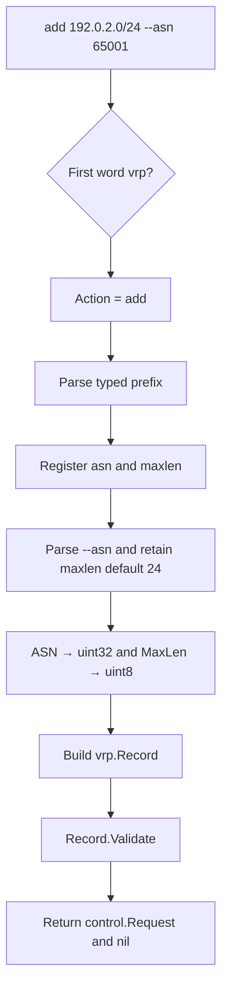

At no point in this file does the program open a socket, write a file, change the Store, or talk to FRR.

---

# Part IV — The local control protocol

## 11. What “HTTP over a Unix socket” means

MiniRPKI reuses Go's HTTP parser and JSON encoder for structured local management messages. It replaces HTTP's usual TCP dialing step with a Unix-domain connection.

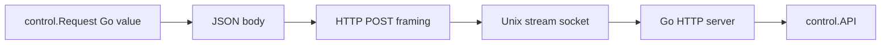

HTTP describes the bytes. The Unix socket chooses the local transport endpoint. The URL `http://localhost/control` does not create a management TCP connection because the client installs a custom dial function.

---

## 12. `internal/control/control.go`: both sides of management

### 12.1 Imports

| Import | Purpose |
| --- | --- |
| `bytes` | Hold encoded request JSON in memory |
| `context` | Carry request cancellation into dialing/HTTP |
| `encoding/json` | Encode and strictly decode messages |
| `fmt` | Build action and response errors |
| `io` | Check EOF and bound response reading |
| `net` | Unix listeners and connections |
| `net/http` | Parse and serve HTTP, run client transport |
| `os` | Apply socket file permissions |
| `time` | Set the CLI-side request timeout |
| `rtr`, `vrp` | Read live server and Store state |

### 12.2 `Request`: control wire model

```go
type Request struct {
    Action string     `json:"action"`
    Record vrp.Record `json:"record"`
}
```

For R, `json.Encoder` produces a compact form equivalent to:

```json
{"action":"add","record":{"prefix":"192.0.2.0/24","maxLength":24,"asn":65001}}
```

The encoder appends a newline after the JSON value. Actions such as `list` ignore the zero-value Record, although the current struct has no `omitempty` tag and therefore still encodes a `record` field.

### 12.3 `Status`: combined operational response

```go
type Status struct {
    Session uint16       `json:"session"`
    Serial  uint32       `json:"serial"`
    Records int          `json:"records"`
    Clients []rtr.Client `json:"clients"`
    Refresh uint32       `json:"refreshSeconds"`
    Retry   uint32       `json:"retrySeconds"`
    Expire  uint32       `json:"expireSeconds"`
}
```

Status combines two components:

```text
Store       session, serial, number of records
RTR server  connected clients, refresh setting
RTR package retry and expire constants
```

### 12.4 `API`: dependencies, not copied state

```go
type API struct {
    Store *vrp.Store
    RTR   *rtr.Server
}
```

These pointers refer to the actual objects assembled in `run`. The API does not maintain its own VRP table or client list.

The method receiver below is an `API` value copy, but the two pointer values inside it still point to the shared Store and server.

### 12.5 `ServeHTTP`: response type and method gate

```go
func (a API) ServeHTTP(w http.ResponseWriter, r *http.Request) {
    w.Header().Set("Content-Type", "application/json")
    if r.Method != "POST" {
        http.Error(w, "POST required", 405)
        return
    }
```

Because `API` implements `ServeHTTP`, it satisfies Go's `http.Handler` interface and can be installed in `http.Server.Handler`.

Only POST is accepted. A different method receives status 405 and returns before decoding a body.

### 12.6 Limit the request and reject unknown fields

```go
    var q Request
    r.Body = http.MaxBytesReader(w, r.Body, 4096)
    dec := json.NewDecoder(r.Body)
    dec.DisallowUnknownFields()
    if err := dec.Decode(&q); err != nil {
        http.Error(w, err.Error(), 400)
        return
    }
```

`MaxBytesReader` prevents a local client from sending an unbounded body. A legitimate command is much smaller than 4096 bytes.

`DisallowUnknownFields` rejects misspelled or unsupported fields rather than silently ignoring them. For example, `"recrod"` does not become an empty `Record` by accident.

The decoder converts the JSON value into typed `q`. Any syntax, type, size, or unknown-field error becomes HTTP 400.

### 12.7 Require exactly one JSON value

```go
    if err := dec.Decode(new(any)); err != io.EOF {
        http.Error(w, "expected one JSON request", 400)
        return
    }
```

After decoding the first request, the decoder tries to read another value into a temporary `any`. The expected result is `io.EOF`, meaning only whitespace and end-of-stream remain.

```text
{ one request }                 accepted
{ first request }{ second }    rejected
```

This prevents one HTTP body from smuggling multiple application requests.

### 12.8 Prepare varying result shapes

```go
    var result any
    var err error
    switch q.Action {
```

`result` must hold several possible Go types:

```text
AddressInfo
Status
[]vrp.Record
map[string]any
```

`any` is Go's name for an interface that can hold a value of any type. The action switch decides what concrete value it contains.

### 12.9 Address action

```go
case "address":
    result, err = a.address()
```

The public CLI action `interface` was mapped to internal `address` in `run`. Details are in the `address.go` section.

### 12.10 Status action

```go
case "status":
    session, serial, rs := a.Store.State()
    result = Status{
        Session: session,
        Serial:  serial,
        Records: len(rs),
        Clients: a.RTR.Clients(),
        Refresh: a.RTR.RefreshInterval(),
        Retry:   rtr.RetryInterval,
        Expire:  rtr.ExpireInterval,
    }
```

This is a snapshot assembled from several method calls. The Store's session/serial/record count come from one internally consistent `State` call. Client state is read separately and can naturally change a moment later as routers connect or disconnect.

### 12.11 List action

```go
case "list":
    _, _, result = a.Store.State()
```

`State` returns three values. `_` discards session and serial; the copied record slice is assigned directly to `result`. A nonempty slice encodes as a JSON array. For an empty Store, `State`'s `append([]Record(nil), ...)` copy is a typed nil slice, so `encoding/json` emits `null` rather than `[]`.

### 12.12 Add, remove, and clear

```go
case "add":
    err = a.Store.Edit(q.Record, true)
case "remove":
    err = a.Store.Edit(q.Record, false)
case "clear":
    err = a.Store.Replace([]vrp.Record{})
```

The Boolean to `Edit` is a small operation selector:

```text
true   add exact tuple
false  remove exact tuple
```

`clear` supplies an empty, non-nil slice as the desired complete dataset.

For our example, the exact call is:

```go
a.Store.Edit(
    vrp.Record{
        Prefix: netip.MustParsePrefix("192.0.2.0/24"),
        MaxLen: 24,
        ASN:    65001,
    },
    true,
)
```

The source does not reconstruct the literal like this; it uses `q.Record`. The expanded form shows the values entering the Store.

### 12.13 Unknown action defense

```go
default:
    err = fmt.Errorf("unknown action")
}
```

The normal CLI parser prevents unknown actions. The API still checks because a different local process can connect directly to the socket and send JSON.

### 12.14 Turn operation failures into HTTP failures

```go
if err != nil {
    http.Error(w, err.Error(), 400)
    return
}
```

Examples include invalid Store data, exact record not found, persistence failure, and listener-not-ready errors. The request stops; no success body is generated.

On the client side, `Call` converts any non-200 status back into a Go error, and `main` exits with status 1.

### 12.15 Build a mutation result

```go
if result == nil {
    _, serial, rs := a.Store.State()
    result = map[string]any{
        "serial": serial,
        "vrps":   rs,
    }
    if q.Action == "add" || q.Action == "remove" {
        result.(map[string]any)["record"] = q.Record
    }
}
```

Read actions already assigned `result`. Store mutation methods return only an error, so successful mutation actions reach this block with `result == nil`.

The second `State` call reads current Store state after `Edit` has released its lock. With no concurrent mutation, our change from serial 7 to 8 produces:

```json
{
  "serial": 8,
  "vrps": [
    {
      "prefix": "192.0.2.0/24",
      "maxLength": 24,
      "asn": 65001
    },
    {
      "prefix": "2001:db8:100::/48",
      "maxLength": 48,
      "asn": 65001
    }
  ],
  "record": {
    "prefix": "192.0.2.0/24",
    "maxLength": 24,
    "asn": 65001
  }
}
```

The `vrps` list contains every record current at response-building time, not merely R. Because another control request can run after `Edit` unlocks and before this `State` call, a concurrent mutation could make the reported serial/table later than the revision created by this request. The response is a fresh current snapshot, not a transaction-coupled receipt.

For duplicate R, the same success shape is returned with the unchanged serial. There is no `changed` Boolean, which is why readable output still says `Saved`.

After clearing the last record, the same typed-nil-slice behavior can make the mutation response contain `"vrps": null`. Human output and later list decoding still treat that as zero records.

The type assertion:

```go
result.(map[string]any)
```

is safe in this block because the code itself just assigned that concrete map type.

### 12.16 Encode the response

```go
json.NewEncoder(w).Encode(result)
```

The encoder writes JSON and a trailing newline. Because no failure status was written, `net/http` uses status 200.

The current code does not inspect the encode error. A client disconnect during response writing can therefore fail silently at this final API layer.

### 12.17 `Listen`: bind the Unix path

```go
func Listen(path string) (net.Listener, error) {
    l, err := net.Listen("unix", path)
    if err != nil {
        return nil, err
    }
```

Linux creates a listening Unix-domain socket at the path. The path acts as an address; it is not a regular file containing request data.

The next block restricts it:

```go
    if err = os.Chmod(path, 0600); err != nil {
        l.Close()
        return nil, err
    }
    return l, nil
}
```

Mode `0600` grants read/write permission to the owning user and none to group/others. If permission setup fails, the listener is closed and startup fails rather than leaving an unexpectedly accessible endpoint.

For a Unix listener created by `net.Listen`, `l.Close()` also triggers Go's default unlink-on-close behavior for the socket pathname. The explicit `os.Remove` deferred by `main` is additional cleanup during normal shutdown. A forced process termination can still leave a stale pathname because the listener never gets a chance to close.

`main.go` created the parent directory before calling this function and later removes the path during shutdown.

### 12.18 `Call`: replace TCP dialing with Unix dialing

```go
func Call(ctx context.Context, path string, q Request) ([]byte, error) {
    t := &http.Transport{
        DialContext: func(ctx context.Context, _, _ string) (net.Conn, error) {
            return (&net.Dialer{}).DialContext(ctx, "unix", path)
        },
    }
    defer t.CloseIdleConnections()
```

An HTTP transport normally receives a network and `host:port` to dial. The underscore parameters deliberately ignore both. This closure always dials the captured Unix socket `path`.

The transport may manage reusable idle connections, but this CLI sends one command. `CloseIdleConnections` releases any such connection when the call ends.

### 12.19 Encode the typed request in a buffer

```go
    buff := new(bytes.Buffer)
    if err := json.NewEncoder(buff).Encode(q); err != nil {
        return nil, err
    }
```

`new(bytes.Buffer)` returns a pointer to an empty in-memory byte buffer. After encoding R, it contains the compact JSON request plus newline.

No connection has been made yet.

### 12.20 Construct the HTTP request

```go
    req, err := http.NewRequestWithContext(
        ctx,
        "POST",
        "http://localhost/control",
        buff,
    )
    if err != nil {
        return nil, err
    }
```

The URL supplies valid HTTP metadata:

```text
method: POST
Host:   localhost
path:   /control
```

`localhost` is not resolved or dialed. The custom transport ignores the URL address and connects to the Unix path.

The API currently does not branch on `/control`; its handler is installed for the whole server. The path is still a clear description of the request's purpose.

### 12.21 Send with an overall timeout

```go
    res, err := (&http.Client{
        Transport: t,
        Timeout:   10 * time.Second,
    }).Do(req)
    if err != nil {
        return nil, err
    }
```

This step connects, sends the request, waits for the server, and obtains parsed response headers.

Possible errors include:

```text
socket path absent
permission denied
no listening server
connection closed
ten-second timeout
```

There is no automatic retry. A mutating request could theoretically have reached the server before a response-path failure, so a caller seeing a transport error should inspect current state before assuming the mutation did not occur. Duplicate adds help make retrying an add idempotent.

### 12.22 Read a bounded response

```go
    defer res.Body.Close()
    b, err := io.ReadAll(io.LimitReader(res.Body, 16<<20))
```

The response body is closed on function return. `16 << 20` is 16 MiB. `LimitReader` prevents unlimited allocation from an abnormal server.

The limit truncates at 16 MiB rather than explicitly returning a “too large” error. Normal MiniRPKI responses are far smaller.

### 12.23 Convert HTTP status and return JSON

```go
    if res.StatusCode != 200 {
        return nil, fmt.Errorf("%s", b)
    }
    return b, err
}
```

A non-200 body becomes an error string and bypasses normal rendering. A status-200 body is returned together with any read error.

### 12.24 Complete local exchange for R

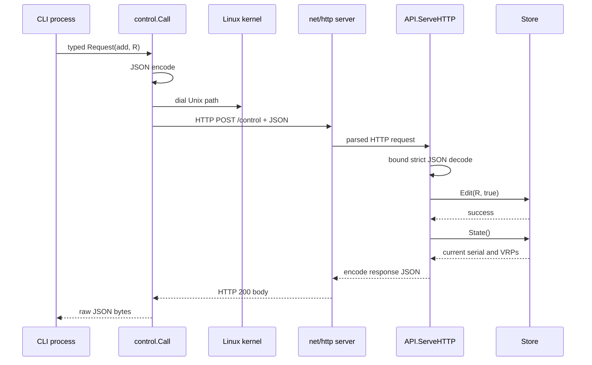

The Linux kernel transports bytes between two processes. `net/http` handles HTTP syntax. `encoding/json` translates Go values. The Store performs the authoritative mutation.

---

# Part V — Presenting results and describing the listener

## 13. `cmd/mini-rpki/output.go`: JSON to operator output

This file is presentation only. It does not change state or contact FRR.

### 13.1 Imports

| Import | Purpose |
| --- | --- |
| `bytes` | Hold indented JSON |
| `encoding/json` | Decode action-specific replies or pretty-print JSON |
| `fmt` | Write labels, rows, and messages |
| `io` | Accept any output destination implementing `io.Writer` |
| `text/tabwriter` | Align terminal columns |
| `time` | Format connected-client timestamps |
| `control`, `vrp` | Decode the repository's response models |

An `io.Writer` is an interface with a byte-writing method. In normal operation the supplied writer is `os.Stdout`, but the function does not have to know whether the destination is a terminal, file, or memory buffer.

### 13.2 `printRecords`: count and empty case

```go
func printRecords(w io.Writer, records []vrp.Record) {
    fmt.Fprintf(w, "Records served: %d\n", len(records))
    if len(records) == 0 {
        fmt.Fprintln(w, "No records configured.")
        return
    }
```

The record count is always printed. Empty input gets a clear message and returns before building table headers.

### 13.3 `printRecords`: aligned table

```go
    table := tabwriter.NewWriter(w, 0, 4, 2, ' ', 0)
    fmt.Fprintln(table, "PREFIX\tMAXLEN\tORIGIN")
    for _, r := range records {
        fmt.Fprintf(table, "%s\t%d\tAS%d\n", r.Prefix, r.MaxLen, r.ASN)
    }
    table.Flush()
}
```

The `\t` characters identify columns. `tabwriter` buffers rows, calculates widths, and writes spaces so the terminal lines align.

Example:

```text
Records served: 2
PREFIX              MAXLEN  ORIGIN
192.0.2.0/24        24      AS65001
2001:db8:100::/48   48      AS65001
```

The current code does not inspect errors returned by the `fmt` calls or `table.Flush()` in this helper. Terminal writes normally succeed, but a broken output destination could go unreported.

### 13.4 `renderResponse`: inputs

```go
func renderResponse(
    w io.Writer,
    action string,
    data []byte,
    jsonOutput bool,
) error {
```

The actual signature is on one source line. Its inputs are:

```text
w           destination, normally stdout
action      public CLI action name
data        raw JSON bytes returned by control.Call
jsonOutput  whether the operator supplied --json
```

### 13.5 Global JSON output path

```go
if jsonOutput {
    var pretty bytes.Buffer
    if err := json.Indent(&pretty, data, "", "  "); err != nil {
        return err
    }
    _, err := fmt.Fprintln(w, pretty.String())
    return err
}
```

`json.Indent` validates the response and copies it with two-space indentation. This mode does not decode an action-specific struct, so it preserves fields the human view may omit, such as the complete `vrps` array in a mutation response.

If the server returned malformed JSON, rendering fails rather than presenting misleading output.

### 13.6 Select human-readable format

```go
switch action {
case "interface":
```

The public action name is used. Recall that the request sent to the API was internally changed from `interface` to `address`; `run` retained the original name for this switch.

### 13.7 Interface response: decode and print listener

```go
    var info control.AddressInfo
    if err := json.Unmarshal(data, &info); err != nil {
        return err
    }
    fmt.Fprintf(w, "RTR listener: %s\n", info.Listener)
```

The raw JSON becomes a typed `AddressInfo`. The literal address recorded by the running RTR listener is printed first.

### 13.8 Interface response: endpoint table

```go
    table := tabwriter.NewWriter(w, 0, 4, 2, ' ', 0)
    fmt.Fprintln(table, "IP ADDRESS\tTCP PORT\tINTERFACE")
    for _, endpoint := range info.Endpoints {
        iface := endpoint.Interface
        if iface == "" {
            iface = "-"
        }
        fmt.Fprintf(table, "%s\t%s\t%s\n",
            endpoint.IP, endpoint.Port, iface)
    }
    table.Flush()
    fmt.Fprintln(w,
        "Addresses are inside this container; other networks need routing or port forwarding.")
```

An endpoint without a resolved local interface is shown with `-`. The final sentence sets the correct boundary: enumerating a container address does not prove remote routing, NAT, firewall, or published-port behavior.

### 13.9 List response

```go
case "list":
    var records []vrp.Record
    if err := json.Unmarshal(data, &records); err != nil {
        return err
    }
    printRecords(w, records)
```

The API's JSON record list becomes a slice and is passed to the table helper. JSON `null` from an empty Store also unmarshals to a nil slice, whose length is zero, so `printRecords` displays the empty message correctly.

### 13.10 Status response: summary

```go
case "status":
    var status control.Status
    if err := json.Unmarshal(data, &status); err != nil {
        return err
    }
    fmt.Fprintf(w,
        "MiniRPKI laboratory RTR cache\n"+
            "Session ID: %d\n"+
            "Serial: %d\n"+
            "Records served: %d\n"+
            "Connected routers: %d\n"+
            "RTR timers: refresh %ds, retry %ds, expire %ds\n"+
            "Serial Notify limit: once per minute per connection\n",
        status.Session, status.Serial, status.Records,
        len(status.Clients), status.Refresh, status.Retry, status.Expire)
```

The actual source uses one long format string on one line. It is wrapped here to expose the fields.

This output reports cache-side state. “Connected” means a TCP connection is registered; it does not by itself prove that FRR has successfully installed current VRPs or validated BGP routes.

### 13.11 Status response: no-client and client-table branches

```go
    if len(status.Clients) == 0 {
        fmt.Fprintln(w, "No routers connected.")
        break
    }
```

`break` leaves the `switch`, after which the function returns `nil`. It does not terminate the server.

When clients exist:

```go
    table := tabwriter.NewWriter(w, 0, 4, 2, ' ', 0)
    fmt.Fprintln(table, "\nROUTER\tCONNECTED SINCE (UTC)")
    for _, client := range status.Clients {
        fmt.Fprintf(table, "%s\t%s\n",
            client.Address,
            client.Since.UTC().Format(time.RFC3339))
    }
    table.Flush()
```

The remote TCP address and connection time are shown. Times are converted to UTC and rendered in the standard RFC3339 timestamp format.

The server's client map does not preserve ordering, so rows may appear in a different order across calls.

### 13.12 Mutation response: decode only needed fields

```go
default:
    var result struct {
        Serial uint32     `json:"serial"`
        Record vrp.Record `json:"record"`
    }
    if err := json.Unmarshal(data, &result); err != nil {
        return err
    }
```

This anonymous struct intentionally lists only fields needed by human output. Go's JSON decoder ignores the response's `vrps` field.

The `default` branch is used for `add`, `remove`, and `clear` in the current caller. It would also try this shape for any unexpected action passed directly to `renderResponse`.

### 13.13 Mutation response: choose text

```go
    if action == "clear" {
        fmt.Fprintln(w, "All records cleared.")
    } else {
        verb := "Saved"
        if action == "remove" {
            verb = "Removed"
        }
        fmt.Fprintf(w, "%s: %s maxlen %d AS%d\n",
            verb, result.Record.Prefix, result.Record.MaxLen, result.Record.ASN)
    }
```

For our real-change example:

```text
Saved: 192.0.2.0/24 maxlen 24 AS65001
```

For the first-start duplicate path, this line is identical even though the Store made no change. “Saved” currently means the request succeeded and the record exists, not necessarily that a new revision was created.

### 13.14 Mutation response: serial and router reminder

```go
    fmt.Fprintf(w, "Cache serial: %d\n", result.Serial)
    fmt.Fprintln(w, "Routers update after their next successful RTR query.")
}
return nil
```

For a real change from 7 to 8:

```text
Cache serial: 8
```

For a duplicate at serial 7:

```text
Cache serial: 7
```

The final sentence is precise: a successful control transaction does not prove that FRR has already completed its RTR update.

Most human-format `fmt` writes and `tabwriter.Flush` calls in this file do not check their returned errors, so a failing output destination may still lead `renderResponse` to return `nil`. JSON mode does return the final `Fprintln` error. This normally does not matter for an interactive terminal, but it is part of the exact implementation.

### 13.15 Full CLI result path

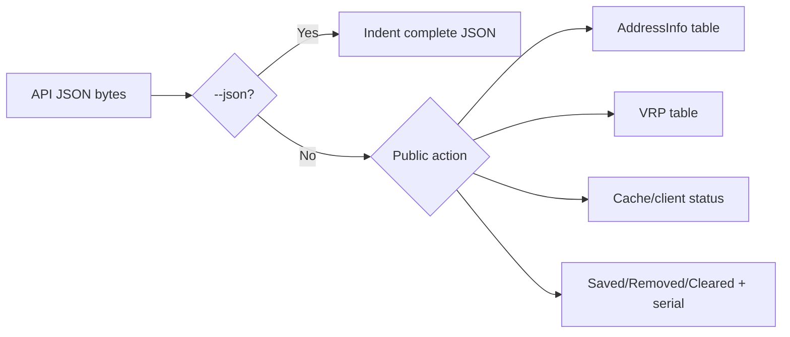

---

## 14. `internal/control/address.go`: explain the active RTR bind

This file is used by `mini-rpki interface`. It reports information from the server's network namespace. It does not probe FRR or perform a TCP connectivity test.

### 14.1 Imports

| Import | Purpose |
| --- | --- |
| `fmt` | Listener-not-ready error |
| `net` | Split listener text and enumerate interfaces |
| `net/netip` | Parse and compare IP addresses correctly |
| `sort` | Order endpoints lexically by IP |

### 14.2 Response data types

```go
type Endpoint struct {
    IP        string `json:"ip"`
    Port      string `json:"port"`
    Interface string `json:"interface"`
}

type AddressInfo struct {
    Listener  string     `json:"listener"`
    Endpoints []Endpoint `json:"endpoints"`
}
```

`Listener` preserves the actual address string from `net.Listener`. `Endpoints` adds local interface context.

Example:

```text
Listener:  10.82.0.1:8282
Endpoint:  IP=10.82.0.1, Port=8282, Interface=eth1
```

### 14.3 Scope comment and `describeAddress` initialization

```go
// describeAddress reports bindings in the server's network namespace.
// Host NAT and remote-router routes cannot be inferred from these addresses.
func describeAddress(listener string) (AddressInfo, error) {
    info := AddressInfo{
        Listener:  listener,
        Endpoints: []Endpoint{},
    }
```

The explicit empty slice tends to encode as `[]` rather than `null`, which is clearer for a list response.

The comments define the operational limit: the function can see local interfaces, not the whole end-to-end path.

### 14.4 Split host and port safely

```go
host, port, err := net.SplitHostPort(listener)
if err != nil {
    return info, err
}
```

Examples:

```text
"10.82.0.1:8282"      → host "10.82.0.1", port "8282"
"[2001:db8::1]:8282"  → host "2001:db8::1", port "8282"
```

Using `SplitHostPort` avoids breaking IPv6 addresses at their internal colons.

### 14.5 Parse the bound IP

```go
bound, err := netip.ParseAddr(host)
if err != nil {
    return info, err
}
```

This function expects the listener's host to be an IP address. The listener address comes from the live `net.Listener`, so normal binds such as `:8282` are represented as an unspecified IP plus port rather than the original empty host text.

Typed addresses let the code distinguish IPv4, IPv6, wildcard, loopback, and link-local forms.

### 14.6 Enumerate interfaces

```go
interfaces, err := net.Interfaces()
if err != nil {
    return info, err
}
for _, iface := range interfaces {
    if iface.Flags&net.FlagUp == 0 {
        continue
    }
```

Inside a container, `net.Interfaces()` reports interfaces in that container's network namespace. `iface.Flags & net.FlagUp` is a bit-mask check; interfaces without the UP flag are skipped.

### 14.7 Read each interface address

```go
    addresses, err := iface.Addrs()
    if err != nil {
        return info, err
    }
    for _, address := range addresses {
        prefix, err := netip.ParsePrefix(address.String())
        if err != nil {
            continue
        }
        ip := prefix.Addr().Unmap()
```

Interface addresses arrive with prefix lengths, such as `10.82.0.1/30`. The code parses them and keeps only the host address.

`Unmap` converts an IPv4-mapped IPv6 address to ordinary IPv4 form. An individual unparsable address is skipped; an error retrieving the interface's complete address list aborts the command.

### 14.8 Match a specific listener

```go
        match := ip == bound.WithZone("").Unmap()
```

For `10.82.0.1:8282`, only a local interface owning `10.82.0.1` matches.

`WithZone("")` removes an IPv6 zone identifier for comparison, and `Unmap` normalizes mapped IPv4 on the listener side too.

### 14.9 Expand a wildcard listener

```go
        if bound.IsUnspecified() {
            match = !ip.IsLoopback() &&
                !ip.IsLinkLocalUnicast() &&
                !ip.IsUnspecified() &&
                (!bound.Is4() || ip.Is4())
        }
```

For a wildcard listener, the function selects usable-looking local addresses and excludes loopback, link-local, and unspecified addresses.

```text
0.0.0.0 wildcard  → only IPv4 addresses pass final family test
:: wildcard       → current logic may list IPv4 and IPv6 addresses
```

This is descriptive logic. Actual dual-stack listener behavior also depends on the operating system socket configuration.

### 14.10 Append a matched endpoint

```go
        if match {
            info.Endpoints = append(info.Endpoints, Endpoint{
                IP:        ip.String(),
                Port:      port,
                Interface: iface.Name,
            })
        }
    }
}
```

For the primary lab link, the intended result is:

```text
IP          10.82.0.1
Port        8282
Interface   eth1
```

### 14.11 Fallback for a specific bind

```go
if !bound.IsUnspecified() && len(info.Endpoints) == 0 {
    info.Endpoints = append(info.Endpoints, Endpoint{
        IP:   host,
        Port: port,
    })
}
```

If the listener uses a specific address but interface enumeration did not match it, the function still reports the bound IP and port. `Interface` remains empty, and `renderResponse` displays `-`.

There is no equivalent fallback for a wildcard because a wildcard is not a remotely usable destination address by itself.

### 14.12 Stable sorting and return

```go
sort.Slice(info.Endpoints, func(i, j int) bool {
    return info.Endpoints[i].IP < info.Endpoints[j].IP
})
return info, nil
```

Operating-system enumeration order is not guaranteed. The function orders endpoints lexically by IP string, although that is not numeric subnet ordering. `sort.Slice` is unstable and compares only IP, so two entries with the same IP but different interfaces may still appear in either tie order.

### 14.13 `API.address`: require a live RTR server

```go
func (a API) address() (AddressInfo, error) {
    listener := a.RTR.ListenerAddress()
    if listener == "" {
        return AddressInfo{}, fmt.Errorf("RTR listener is not ready")
    }
    return describeAddress(listener)
}
```

`rtr.Server.Serve` publishes `listenerAddress` while it is active and clears it when it exits. The empty string therefore means the server has not become ready or has stopped.

The function refuses to invent an address from configuration. It reports the actual listener string recorded by the running RTR server.

### 14.14 Interface command path

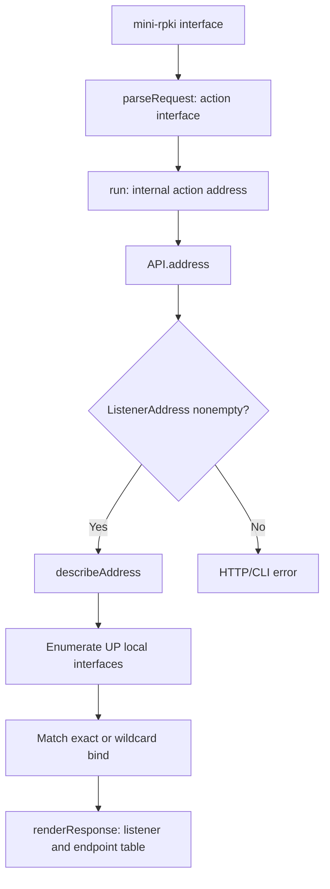

The command answers “what did this process bind, and which local interfaces correspond?” A successful answer is useful evidence, but reachability still depends on links, routes, namespaces, firewall rules, and any port publishing.

---

# Part VI — RTR binary encoding and decoding

## 15. Where RTR begins

The control transaction ends after it changes the shared Store and returns JSON to the CLI. It does not call FRR.

The RTR server independently observes the same Store:

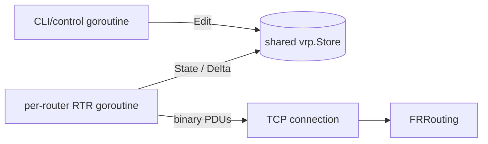

[`internal/rtr/codec.go`](../internal/rtr/codec.go) knows byte layouts. [`internal/rtr/server.go`](../internal/rtr/server.go) knows which messages are legal and in what order.

---

## 16. `internal/rtr/codec.go`: Go values to network bytes

### 16.1 Imports

| Import | Purpose |
| --- | --- |
| `encoding/binary` | Read/write multi-byte integers in network order |
| `fmt` | Report invalid PDU lengths |
| `io` | Work with streams and guarantee complete reads/writes |
| `vrp` | Encode a Store Record as a Prefix PDU |

The codec accepts `io.Reader` and `io.Writer`, which are interfaces. A TCP connection implements both, but the codec itself does not depend specifically on TCP.

### 16.2 PDU type constants and local size limit

```go
const (
    Notify        = 0
    SerialQuery   = 1
    ResetQuery    = 2
    CacheResponse = 3
    IPv4          = 4
    IPv6          = 6
    EndOfData     = 7
    CacheReset    = 8
    ErrorReport   = 10
    MaxPDU        = 4096
)
```

Named constants make the state machine readable while preserving the exact RFC 8210 numeric values.

Type 9, Router Key, is intentionally absent from the implemented model. MiniRPKI serves prefix VRPs only.

`MaxPDU` is a local defensive input limit. RTR's length field is 32 bits, but this implementation rejects an incoming PDU whose total declared length exceeds 4096 bytes. The largest accepted body is therefore 4088 bytes after the common header. Normal Reset and Serial Queries are 8 and 12 bytes total.

### 16.3 Network byte order alias

```go
var be = binary.BigEndian
```

Big-endian is network byte order, the same high-byte-first convention used in IP, TCP, and BGP numeric fields.

The package variable shortens later calls such as `be.PutUint32`.

### 16.4 `PDU`: decoded/common model

```go
type PDU struct {
    Version, Type uint8
    Field         uint16
    Body          []byte
    raw           []byte // Preserve malformed input verbatim for Error Report encapsulation.
}
```

Every implemented RTR message has an eight-byte common header:

```text
byte 0       Protocol Version
byte 1       PDU Type
bytes 2-3    type-dependent Field
bytes 4-7    total PDU length, including this header
bytes 8...   type-dependent Body
```

`Field` means different things in different PDU types:

| PDU | `Field` meaning |
| --- | --- |
| Serial Notify | Session ID |
| Serial Query | Session ID |
| Reset Query | Reserved zero |
| Cache Response | Session ID |
| IPv4/IPv6 Prefix | Reserved zero |
| End of Data | Session ID |
| Cache Reset | Reserved zero |
| Error Report | Error code |

`raw` is private. It stores bytes actually received when decoding fails partway through. Reconstructing a malformed PDU could add zero bytes or a different length, so Error Report needs this preserved input.

### 16.5 Common header picture

```text
  0                   1                   2                   3
  0 1 2 3 4 5 6 7 8 9 0 1 2 3 4 5 6 7 8 9 0 1 2 3 4 5 6 7 8 9 0 1
 +---------------+---------------+-------------------------------+
 |    Version    |     Type      |             Field             |
 +---------------+---------------+-------------------------------+
 |                     Total Length                              |
 +---------------------------------------------------------------+
 |                     Body, when present ...                    |
```

This is application-level framing on top of TCP's unstructured byte stream.

### 16.6 `PDU.Bytes`: allocate and fill a complete PDU

```go
func (p PDU) Bytes() []byte {
    b := make([]byte, 8+len(p.Body))
    b[0] = p.Version
    b[1] = p.Type
    be.PutUint16(b[2:], p.Field)
    be.PutUint32(b[4:], uint32(len(b)))
    copy(b[8:], p.Body)
    return b
}
```

Step by step:

1. allocate exactly eight header bytes plus body length;
2. set one-byte version and type;
3. encode the 16-bit field in network order;
4. encode the total length, including the header;
5. copy the body after byte 7.

`make` initializes all bytes to zero. Fields the code does not explicitly set therefore begin as reserved zero.

This resembles adding an RTR header around a prepared payload.

### 16.7 `Read`: obtain exactly one complete header

```go
func Read(r io.Reader) (PDU, error) {
    var h [8]byte
    _, err := io.ReadFull(r, h[:])
    if err != nil {
        return PDU{}, err
    }
```

TCP preserves byte order but not application message boundaries. One socket read may return fewer than eight bytes even when more are on the way. `io.ReadFull` repeatedly reads until the header array is full or the stream fails.

If the stream ends before a complete header, this block returns a zero PDU and the error. Partial header bytes are not preserved by the current code.

### 16.8 `Read`: decode the header

```go
    p := PDU{
        Version: h[0],
        Type:    h[1],
        Field:   be.Uint16(h[2:]),
    }
    n := be.Uint32(h[4:])
```

`n` is the sender's declared total length. At this point only the header has been consumed.

### 16.9 `Read`: validate total length and preserve bad header

```go
    if n < 8 || n > MaxPDU {
        p.raw = append([]byte(nil), h[:]...)
        return p, fmt.Errorf("invalid PDU length %d", n)
    }
```

A PDU cannot be shorter than its own header. The local maximum prevents large allocations.

The append creates independently owned storage in `p.raw` and preserves the received eight bytes. Go could safely move an escaping local array to longer-lived storage, but an explicit copy makes ownership unambiguous and prevents later buffer reuse from changing the preserved input.

### 16.10 `Read`: allocate and fill the declared body

```go
    p.Body = make([]byte, int(n)-8)
    read, err := io.ReadFull(r, p.Body)
    if err != nil {
        p.raw = append(
            append([]byte(nil), h[:]...),
            p.Body[:read]...,
        )
        return p, err
    }
    return p, nil
}
```

The actual nested `append` is on one source line. It copies:

```text
complete received header
+ only the body bytes actually received
```

The allocated but unfilled part of `p.Body` contains zeros and is deliberately excluded from `raw`.

On success, the method returns one fully decoded PDU. Any following PDU remains in the TCP stream for the next `Read` call.

### 16.11 `Write`: handle partial application writes

```go
func Write(w io.Writer, p PDU) error {
    b := p.Bytes()
    for len(b) > 0 {
        n, err := w.Write(b)
        if err != nil {
            return err
        }
        if n == 0 {
            return io.ErrShortWrite
        }
        b = b[n:]
    }
    return nil
}
```

An `io.Writer` is allowed to accept only part of the supplied slice. The loop removes the accepted prefix and tries the remainder until no bytes remain.

TCP reliability means the kernel retransmits lost segments and delivers an ordered stream. It does not promise that one application `Write` consumes the whole caller buffer.

If a writer reports success but accepts zero bytes, continuing would loop forever. `io.ErrShortWrite` stops that case.

### 16.12 `New`: constructor for control PDUs

```go
func New(t uint8, f uint16, values ...uint32) PDU {
    p := PDU{
        Version: 1,
        Type:    t,
        Field:   f,
        Body:    make([]byte, 4*len(values)),
    }
    for i, v := range values {
        be.PutUint32(p.Body[i*4:], v)
    }
    return p
}
```

`values ...uint32` is variadic: the caller may provide zero or several 32-bit body values. Each occupies four consecutive network-order bytes.

Examples:

```go
New(ResetQuery, 0)                                      // no body
New(Notify, session, serial)                            // one uint32 body value
New(SerialQuery, session, serial)                       // one uint32 body value
New(CacheResponse, session)                             // no body
New(EndOfData, session, serial, refresh, retry, expire) // four body values
New(CacheReset, 0)                                      // no body
```

The function fixes protocol version at 1. It assembles bytes but does not decide whether the message is legal in a conversation; `server.go` owns that decision.

### 16.13 `Prefix`: select IPv4 or IPv6 layout

```go
func Prefix(r vrp.Record, announce bool) PDU {
    n, t := 4, uint8(IPv4)
    if r.Prefix.Addr().Is6() {
        n, t = 16, IPv6
    }
```

`n` is address byte length and `t` is PDU type.

```text
IPv4  n=4,  type=4
IPv6  n=16, type=6
```

### 16.14 `Prefix`: allocate the zeroed body

```go
    p := PDU{
        Version: 1,
        Type:    t,
        Body:    make([]byte, 8+n),
    }
```

The prefix-specific body contains four leading control bytes, the address, and four ASN bytes:

```text
4 + n + 4 = 8 + n
```

The PDU's `Field` remains its zero value, satisfying the reserved header field. `make` also leaves the reserved body byte zero.

### 16.15 `Prefix`: fill announcement fields

```go
    if announce {
        p.Body[0] = 1
    }
    p.Body[1] = byte(r.Prefix.Bits())
    p.Body[2] = r.MaxLen
    copy(p.Body[4:], r.Prefix.Addr().AsSlice())
    be.PutUint32(p.Body[4+n:], r.ASN)
    return p
}
```

Body layout:

```text
body byte 0      flags: 1 announcement, 0 withdrawal
body byte 1      VRP prefix length
body byte 2      maximum authorized route length
body byte 3      reserved zero
body bytes 4...  4-byte IPv4 or 16-byte IPv6 address
last 4 bytes     ASN
```

`AsSlice` returns the address bytes in network order. The Store's validation ensures canonical prefix and length values before this encoder receives normal records.

### 16.16 R as an exact IPv4 Prefix PDU

R contains:

```text
192.0.2.0       = c0 00 02 00
prefix length 24 = 18 hexadecimal
maximum 24       = 18 hexadecimal
AS65001          = 00 00 fd e9
```

`Prefix(R, true).Bytes()` is:

```text
01 04 0000 00000014 01 18 18 00 c0000200 0000fde9
```

Continuous form:

```text
010400000000001401181800c00002000000fde9
```

| Bytes | Meaning |
| --- | --- |
| `01` | RTR protocol version 1 |
| `04` | IPv4 Prefix PDU |
| `0000` | Reserved common-header field |
| `00000014` | Total length 20 bytes |
| `01` | Announcement flag |
| `18` | Prefix length 24 |
| `18` | Maximum length 24 |
| `00` | Reserved byte |
| `c0000200` | 192.0.2.0 |
| `0000fde9` | ASN 65001 |

`Prefix(R, false)` changes only the flag byte at overall offset 8:

```text
010400000000001400181800c00002000000fde9
```

The exact tuple in a withdrawal tells FRR which authorization to remove.

### 16.17 IPv6 size difference

An IPv6 PDU uses the same fields but carries 16 address bytes:

```text
8-byte common header
+ 24-byte body
= 32 bytes total
```

The single `Prefix` function handles both families by changing `n` and type.

### 16.18 `Error`: choose reconstructed or received bytes

```go
func Error(code uint16, p PDU, message string) PDU {
    raw := p.Bytes()
    if p.raw != nil {
        raw = p.raw
    }
```

A normally decoded but semantically invalid PDU can be reconstructed with `Bytes`. A length-invalid or body-truncated input uses `p.raw` so the error report describes the actual received bytes.

### 16.19 `Error`: construct the Error Report body

```go
    b := make([]byte, 8+len(raw)+len(message))
    be.PutUint32(b, uint32(len(raw)))
    copy(b[4:], raw)
    be.PutUint32(b[4+len(raw):], uint32(len(message)))
    copy(b[8+len(raw):], message)
```

Body layout:

```text
4 bytes          length of encapsulated erroneous PDU
variable bytes   erroneous PDU
4 bytes          length of diagnostic text
variable bytes   diagnostic text
```

The `8` in the allocation is the sum of the two four-byte length fields, not the outer common header. `PDU.Bytes` adds that outer header later.

### 16.20 `Error`: return the PDU model

```go
    return PDU{
        Version: 1,
        Type:    ErrorReport,
        Field:   code,
        Body:    b,
    }
}
```

For Error Report, the 16-bit `Field` contains the error code. The codec does not decide which code applies; the server state machine supplies it.

### 16.21 Codec responsibility boundary

```text
codec.go does:
  byte order, lengths, framing, prefix layout, error body layout

codec.go does not:
  accept TCP clients, choose response sequence, validate sessions,
  update serials, persist VRPs, calculate BGP validation states
```

---

# Part VII — RTR sessions, changes, and FRRouting

## 17. `internal/rtr/server.go`: one state machine per router

The operating system and Go's `net` package provide TCP connections. This file implements the RTR conversation over each connection.

### 17.1 Imports

| Import | Purpose |
| --- | --- |
| `context` | Coordinate service shutdown |
| `encoding/binary` | Decode Serial Query's four-byte serial |
| `fmt` | Return invalid-refresh startup error |
| `log` | Record connections, queries, notifications, and completion |
| `net` | Listener and established TCP connections |
| `sync` | Protect server state, serialize writes, wait for handlers |
| `time` | Deadlines, notification ticker, connection timestamps |
| `vrp` | Read Store state and encode record lists |

### 17.2 `Client`: status metadata

```go
type Client struct {
    Address string    `json:"address"`
    Since   time.Time `json:"since"`
}
```

This structure supports `mini-rpki status`. It records the remote TCP endpoint and the time `Accept` completed.

It does not store the router's VRP table, negotiated session, or serial. Those are either in FRR or in variables local to the connection handler.

### 17.3 `notificationDue`: three required conditions

```go
// notificationDue leaves pending serials untouched until the one-minute boundary.
func notificationDue(
    negotiated bool,
    serial, seen uint32,
    last, now time.Time,
) bool {
    return negotiated &&
        serial != seen &&
        (last.IsZero() || now.Sub(last) >= time.Minute)
}
```

The actual signature and return expression occupy fewer source lines; they are expanded here.

A Notify is due only when:

1. a valid query negotiated version 1;
2. the Store serial differs from the last serial sent on this connection;
3. this connection has never received a Notify, or at least one minute has elapsed.

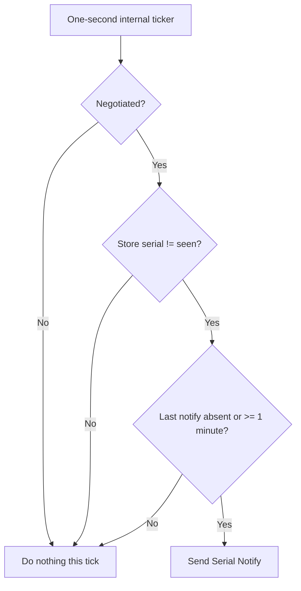

When the rate limit blocks a notification, `seen` remains old. The change stays pending for a later tick.

### 17.4 RTR timer constants

```go
const (
    DefaultRefresh uint32 = 5
    RetryInterval  uint32 = 10
    ExpireInterval uint32 = 600
)
```

These seconds appear in End of Data:

| Timer | Router meaning |
| --- | --- |
| Refresh | Normal interval before another query |
| Retry | Delay after a failed query |
| Expire | Maximum age of this cache's data without a successful refresh |

They are intentionally fast laboratory settings. The configured Refresh may replace 5, but Retry and Expire are fixed in this source.

### 17.5 `Server`: shared listener-level state

```go
type Server struct {
    Refresh         uint32
    Store           *vrp.Store
    mu              sync.Mutex
    clients         map[net.Conn]Client
    wg              sync.WaitGroup
    listenerAddress string
}
```

Ownership is divided deliberately:

```text
Store.mu            session, serial, records, history
Server.mu           client map, published listener address
per-handler writeMu one router's TCP writes and session-local variables
Server.wg           active handler goroutine count
```

`Refresh` and `Store` are configured before serving and then treated as stable.

### 17.6 `ListenerAddress`: synchronized accessor

```go
func (s *Server) ListenerAddress() string {
    s.mu.Lock()
    defer s.mu.Unlock()
    return s.listenerAddress
}
```

`Serve` writes this field while the control API may read it concurrently. The mutex makes that access safe.

An empty string means `Serve` has not published the listener or has already exited.

### 17.7 `RefreshInterval`: default when zero

```go
func (s *Server) RefreshInterval() uint32 {
    if s.Refresh == 0 {
        return DefaultRefresh
    }
    return s.Refresh
}
```

Zero is treated as “not explicitly configured.” Normal startup supplies a validated 1..599 value, but constructing `Server{Store: s}` directly still produces the five-second default.

No mutex is used because configuration is expected to be immutable after construction.

### 17.8 `Clients`: copy operational values

```go
func (s *Server) Clients() []Client {
    s.mu.Lock()
    defer s.mu.Unlock()
    out := []Client{}
    for _, c := range s.clients {
        out = append(out, c)
    }
    return out
}
```

The method copies `Client` values out of the protected map. The caller never receives the map itself.

Go map iteration order is unspecified, so the status table is not sorted. Ranging over a nil map is safe and produces an empty slice.

### 17.9 `Serve`: validate timer relationship

```go
func (s *Server) Serve(ctx context.Context, l net.Listener) error {
    if s.RefreshInterval() >= ExpireInterval {
        return fmt.Errorf(
            "refresh interval must be 1..599 seconds (expire is 600)",
        )
    }
```

Expire must be greater than Refresh. The CLI already validates the range, but the server also protects itself when called by another Go caller.

A zero field becomes default 5. Since the field is unsigned, negative values are impossible.

### 17.10 `Serve`: initialize client registry and publish listener

```go
    s.mu.Lock()
    s.clients = make(map[net.Conn]Client)
    s.listenerAddress = l.Addr().String()
    s.mu.Unlock()
```

`net.Listen` already bound the socket in `main.go`. `Serve` now records the kernel-reported address and creates an empty active-client map.

The listener string, rather than the original flag text, is what the `interface` command reports.

### 17.11 `Serve`: clear readiness on return

```go
    defer func() {
        s.mu.Lock()
        s.listenerAddress = ""
        s.mu.Unlock()
    }()
```

This cleanup runs on every `Serve` return path. Afterward, `API.address` reports that the RTR listener is not ready.

### 17.12 `Serve`: cancellation watcher

```go
    done := make(chan struct{})
    defer close(done)
    go func() {
        select {
        case <-ctx.Done():
            l.Close()
            s.mu.Lock()
            for c := range s.clients {
                c.Close()
            }
            s.mu.Unlock()
        case <-done:
        }
    }()
```

The goroutine waits for one of two events:

- shared context cancellation: close the listening socket and every registered client;
- `Serve` finishing for another reason: `done` closes and the watcher exits without closing them.

Closing the listener wakes an `Accept` blocked in the kernel. Closing clients wakes handlers blocked in `Read`. Socket closure is the concrete mechanism that turns context cancellation into interrupted network calls.

`l.Close()` and `c.Close()` errors are ignored during cleanup.

### 17.13 `Serve`: wait for handlers

```go
    defer s.wg.Wait()
```

`Wait` prevents `Serve` from returning until every registered connection handler has called `Done`.

Deferred operations execute last-in, first-out. A subtle consequence is discussed later: this `Wait` was registered after `defer close(done)`, so on an unexpected non-context Accept failure it runs before `done` is closed.

### 17.14 `Serve`: accept an established TCP connection

```go
    for {
        c, err := l.Accept()
        if err != nil {
            if ctx.Err() != nil {
                return nil
            }
            return err
        }
```

FRR initiates the TCP handshake. Linux completes it and places the connection in the accept queue. `Accept` returns a `net.Conn` for that ordered byte stream.

If context cancellation caused the listener closure, the resulting Accept error is treated as normal shutdown. Other Accept errors are returned.

### 17.15 `Serve`: handle cancellation racing with Accept

```go
        s.mu.Lock()
        if ctx.Err() != nil {
            c.Close()
            s.mu.Unlock()
            return nil
        }
```

Cancellation could occur just after `Accept` succeeded. This check prevents registering a fresh connection while shutdown is underway.

The lock coordinates with the cancellation watcher, which also locks while traversing the client map.

### 17.16 `Serve`: register the client

```go
        s.clients[c] = Client{
            c.RemoteAddr().String(),
            time.Now(),
        }
        s.mu.Unlock()
```

The source uses positional struct fields. They map in declaration order to `Address` and `Since`.

The client appears in `status` as soon as TCP is accepted, before RTR version negotiation or a successful data exchange. “Connected routers” is therefore a TCP connection count.

### 17.17 `Serve`: start one handler goroutine

```go
        s.wg.Add(1)
        go func() {
            defer s.wg.Done()
            s.handle(ctx, c)
        }()
    }
}
```

`Add(1)` occurs before the goroutine starts, so `Wait` cannot miss it. The goroutine guarantees `Done` when `handle` returns.

The accept loop immediately waits for another router. Each connection has an independent handler and notification worker.

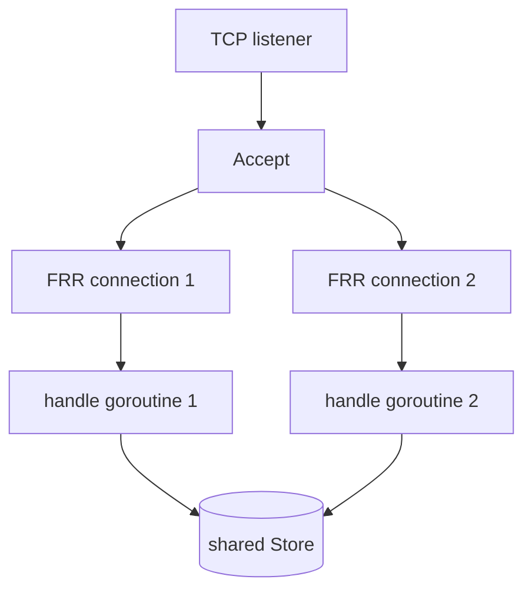

---

## 18. `handle`: one router connection

### 18.1 Guaranteed connection cleanup

```go
func (s *Server) handle(ctx context.Context, c net.Conn) {
    defer func() {
        c.Close()
        s.mu.Lock()
        delete(s.clients, c)
        s.mu.Unlock()
    }()
    log.Printf("RTR connected remote=%s", c.RemoteAddr())
```

Every return path closes the TCP connection and removes it from status. `delete` is safe even if the key is already absent.

The log confirms an accepted connection, not a completed RTR synchronization.

### 18.2 Per-connection state

```go
    // One writer serializes entire responses and notifications, preventing PDU interleaving.
    var writeMu sync.Mutex
    negotiated := false
    var seen uint32
    var lastNotify time.Time
    closed := make(chan struct{})
    defer close(closed)
```

| Variable | Meaning |
| --- | --- |
| `writeMu` | Exclusive ownership of this connection's output stream and related session variables |
| `negotiated` | At least one valid v1 Reset/Serial Query has passed checks |
| `seen` | Most recent serial successfully sent in a full response or Notify |
| `lastNotify` | Time of last successful Notify on this connection |
| `closed` | Signal for this connection's ticker goroutine to stop |

The zero `time.Time` makes `lastNotify.IsZero()` true until the first notification.

The `closed` defer was registered after the outer cleanup defer, so it executes first when `handle` returns. The notifier is signaled before the connection is closed and removed.

### 18.3 Why the writer mutex covers a whole response

Two goroutines can write to the same TCP stream:

```text
main handler:       Cache Response → withdrawals → announcements → End of Data
notification worker: Serial Notify
```

Without serialization, a Notify could appear inside a response transaction:

```text
Cache Response
IPv4 Prefix
Serial Notify       invalid placement inside response sequence
IPv6 Prefix
End of Data
```

Both paths take `writeMu`, and the main path holds it from before validation through the complete response. Therefore one sequence reaches the stream before the other begins.

The same mutex also synchronizes access to `negotiated`, `seen`, and `lastNotify` between the two goroutines.

### 18.4 Start the notification worker

```go
go func() {
    ticker := time.NewTicker(time.Second)
    defer ticker.Stop()
    for {
        select {
        case <-ctx.Done():
            return
        case <-closed:
            return
        case <-ticker.C:
```

The worker wakes every second to compare the Store serial with this connection's `seen` value.

This one-second ticker is internal observation frequency. It is different from:

- the advertised RTR Refresh timer, default 5 seconds;
- the one-minute Notify rate limit.

It exits when the whole server context is canceled or when this handler closes its `closed` channel.

### 18.5 Serialize a notification check

```go
            writeMu.Lock()
            session, serial, _ := s.Store.State()
            if notificationDue(
                negotiated,
                serial,
                seen,
                lastNotify,
                time.Now(),
            ) {
```

The actual call is on one line. It reads a consistent Store session/serial and ignores the copied record list.

The lock means this check waits until any active query response has completely finished. It also prevents the main handler from changing `seen` during the decision.

### 18.6 Apply write deadline and send Serial Notify

```go
                c.SetWriteDeadline(time.Now().Add(10 * time.Second))
                if Write(c, New(Notify, session, serial)) != nil {
                    c.Close()
                    writeMu.Unlock()
                    return
                }
```

The deadline prevents a non-reading peer from blocking this goroutine forever.

`New(Notify, session, serial)` creates:

```text
version  1
type     0
field    current session
body     current serial as uint32
length   12 bytes
```

A Notify contains no VRPs. It is a hint that the router should query.

On write failure, the worker closes the TCP connection, explicitly unlocks, and exits. Closing wakes the main handler if it is blocked in a read.

### 18.7 Record successful notification and unlock

```go
                lastNotify = time.Now()
                seen = serial
                log.Printf("RTR Serial Notify remote=%s serial=%d",
                    c.RemoteAddr(), serial)
            }
            writeMu.Unlock()
        }
    }
}()
```

After a successful Notify, the serial is considered sent on this connection. The worker does not resend the same serial every minute if the router ignores it. A later Store change makes `serial != seen` again.

If another change occurs during the one-minute limit, it remains pending because `seen` still contains the previously sent serial. Once the minute passes, the current latest serial is notified.

### 18.8 Main read loop and idle deadline

```go
for {
    c.SetReadDeadline(time.Now().Add(2 * time.Hour))
    p, err := Read(c)
```

Each loop expects one router-to-cache PDU. A connection that sends no complete PDU for two hours is closed when `Read` times out.

Every successfully received PDU returns to the loop later and resets the two-hour deadline.

FRR normally polls much sooner according to the advertised refresh timer.

### 18.9 Decoder error path

```go
    if err != nil {
        if p.Version != 0 || p.Type != 0 {
            if p.Type != ErrorReport {
                writeMu.Lock()
                c.SetWriteDeadline(time.Now().Add(10 * time.Second))
                _ = Write(c, Error(0, p, err.Error()))
                writeMu.Unlock()
            }
        }
        return
    }
```

Behavior depends on how much was decoded:

- clean EOF or incomplete common header returns the zero PDU, so the connection closes quietly;
- a full recognizable header followed by invalid length/truncated body generally receives Error Report code 0, then closes;
- an erroneous incoming Error Report never receives another Error Report, avoiding a loop.

One exact edge is hidden in the first condition: if a fully decoded bad header has both Version 0 and Type 0, the guard is false and the server closes silently even though header bytes were available for an Error Report.

The error-report write result is intentionally ignored because the handler will close immediately anyway.

### 18.10 Lock the output transaction

```go
    writeMu.Lock()
    c.SetWriteDeadline(time.Now().Add(10 * time.Second))
```

From this point until explicit unlock, the notification worker cannot write. The deadline applies to all writes in this query response.

The deadline is set once before validation and is not refreshed for each payload PDU. A slow or very large full-table response must therefore write Cache Response, every Prefix PDU, and End of Data within the same ten-second window.

Every return or continue path in the following blocks must unlock first. This is manual rather than deferred because the loop continues across requests.

### 18.11 Incoming Error Report

```go
    if p.Type == ErrorReport {
        writeMu.Unlock()
        return
    }
```

MiniRPKI ends the session without replying. Error Reports do not trigger Error Reports.

### 18.12 Protocol version checks

```go
    if p.Version != 1 {
        code := uint16(4)
        if negotiated {
            code = 8
        }
        _ = Write(c, Error(
            code,
            p,
            "only RTR version 1 is supported",
        ))
        writeMu.Unlock()
        return
    }
```

Before negotiation, an unsupported version receives code 4, **Unsupported Protocol Version**. Once version 1 was established, a different version receives code 8, **Unexpected Protocol Version**.

The connection terminates after either report. MiniRPKI does not downgrade to RTR version 0.

### 18.13 Accept only router query PDU types

```go
    if p.Type != ResetQuery && p.Type != SerialQuery {
        _ = Write(c, Error(
            5,
            p,
            "expected Reset Query or Serial Query",
        ))
        writeMu.Unlock()
        return
    }
```

The router may initiate a Reset Query or Serial Query. A different PDU receives code 5 and the connection closes.

Code 5 means Unsupported PDU Type and fits a numeric PDU type unknown to the receiver. For a known cache-to-router type sent by the router, MiniRPKI recognizes the type but rejects its direction; RFC error 3 (Invalid Request) is the stronger fit. This remains a protocol-review issue rather than a demonstrated FRR interoperability failure.

### 18.14 Validate query body lengths

```go
    if (p.Type == ResetQuery && len(p.Body) != 0) ||
        (p.Type == SerialQuery && len(p.Body) != 4) {
        _ = Write(c, Error(0, p, "invalid query length"))
        writeMu.Unlock()
        return
    }
```

Valid lengths are:

```text
Reset Query   8-byte common header + 0-byte body = 8 total
Serial Query  8-byte common header + 4-byte serial = 12 total
```

The server uses code 0, Corrupt Data, for a wrong length and terminates.

The Reset Query's reserved 16-bit `Field` is not checked for zero. RFC 8210 says reserved fields must be ignored on receipt, so ignoring it is intentional protocol behavior.

### 18.15 Mark version negotiation complete and snapshot the Store

```go
    negotiated = true
    session, serial, records := s.Store.State()
    var withdrawals []vrp.Record
```

Only a version-1 query of an allowed type and correct length reaches this point.

For Reset Query:

```text
records      every current Store record
withdrawals  empty
```

For Serial Query, the next block replaces these variables with delta results.

`State` returns copies, so the response remains a consistent snapshot even if the control API changes the Store while bytes are being sent. If a newer change occurs, the notifier can report it after this response completes.

### 18.16 Decode and answer Serial Query

```go
    if p.Type == SerialQuery {
        var ok bool
        session, serial, records, withdrawals, ok = s.Store.Delta(
            p.Field,
            binary.BigEndian.Uint32(p.Body),
        )
```

For Serial Query:

```text
p.Field                     router's expected Session ID
Uint32(p.Body)              router's current Serial Number
records after assignment    net announcements only
withdrawals                 net withdrawals only
```

The name `records` changes meaning from full snapshot to additions in this branch. This is legal Go assignment but is worth remembering while reading the response loops.

### 18.17 Delta unavailable: send Cache Reset

```go
        if !ok {
            err = Write(c, New(CacheReset, 0))
            writeMu.Unlock()
            if err != nil {
                return
            }
            continue
        }
    }
```

Cache Reset is an eight-byte response telling the router that an incremental answer is unavailable. It does not contain the full table.

On successful write, the TCP connection stays open and the loop waits for FRR's next query. FRR can send Reset Query to request all current data.

The Store uses `ok=false` for both an unavailable serial and a mismatched session. RFC 8210 distinguishes those cases; the compliance consequence is covered below.

### 18.18 Log the response plan

```go
    log.Printf(
        "RTR query remote=%s type=%d serial=%d announcements=%d withdrawals=%d",
        c.RemoteAddr(), p.Type, serial, len(records), len(withdrawals),
    )
```

For Reset Query, `announcements` is the full record count. For Serial Query, it is only the number of additions in the net delta.

This log is evidence that a query was processed, but router validation state still requires checking FRR.

### 18.19 Begin the successful response

```go
    err = Write(c, New(CacheResponse, session))
```

Cache Response contains the current Session ID and no body. It begins a transaction that must later end with End of Data.

### 18.20 Send withdrawals first

```go
    for _, r := range withdrawals {
        if err == nil {
            err = Write(c, Prefix(r, false))
        }
    }
```

If an earlier write failed, later writes are skipped. Each withdrawal has flag 0 and the exact old tuple to delete.

Sending withdrawals before announcements is particularly useful when one logical authorization changes fields: FRR removes the old exact record before receiving the new one.

### 18.21 Send full records or net additions

```go
    for _, r := range records {
        if err == nil {
            err = Write(c, Prefix(r, true))
        }
    }
```

For Reset Query, every current record is announced. For Serial Query, only records absent from the requested historical snapshot are announced.

Our real-change serial delta contains only R.

### 18.22 Finish with End of Data

```go
    if err == nil {
        err = Write(c, New(
            EndOfData,
            session,
            serial,
            s.RefreshInterval(),
            RetryInterval,
            ExpireInterval,
        ))
    }
```

The four 32-bit body values are:

```text
current serial
refresh seconds
retry seconds
expire seconds
```

End of Data is the transaction boundary from the router's perspective. FRR should adopt the new serial only after receiving the complete response through this PDU.

### 18.23 Advance `seen` only after complete success

```go
    if err == nil {
        seen = serial
        log.Printf("RTR End of Data remote=%s serial=%d",
            c.RemoteAddr(), serial)
    }
    writeMu.Unlock()
    if err != nil {
        return
    }
}
```

`seen` changes only after Cache Response, all payload PDUs, and End of Data were written without error.

If a write fails halfway through, the handler closes the connection. It does not mark the incomplete transfer as synchronized. A successful Go `Write` sequence means the bytes were accepted by the local socket/kernel without an error; it does not by itself prove that FRR received, installed, or acted on them.

The unlock allows a pending notification to proceed before the next query read, if the Store changed after the response snapshot.

---

## 19. Complete RTR state machine for one connection

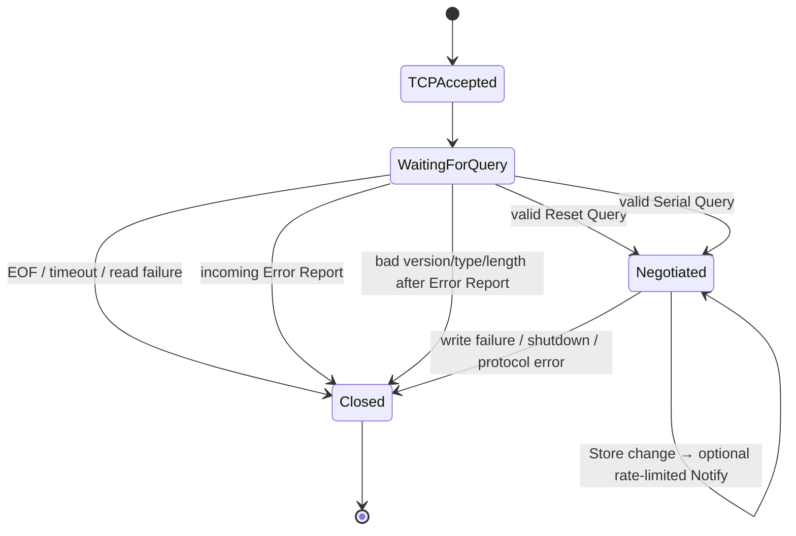

`negotiated` is a Boolean in code rather than a named state type, but this diagram shows its effect.

---

## 20. The real-change example on the wire

Remember the precondition: on untouched first-start defaults, adding R is a duplicate and this section does not occur. For this full trace, assume R is absent and FRR has already synchronized with:

```text
Session ID:   0x1234
FRR serial:   7
Store serial: 7
Refresh:      5 seconds
```

The control transaction persists R and moves Store serial 7 → 8.

### 20.1 How FRR learns that something changed

On the next one-second internal ticker, the notification worker sees:

```text
negotiated = true
Store serial = 8
seen = 7
last notification is absent or at least one minute old
```

It sends Serial Notify. If the same connection received another Notify less than a minute ago, this send is delayed by the rate limit. FRR still polls according to Refresh, so Notify is an optimization rather than the only update mechanism.

### 20.2 Serial Notify bytes

Code path:

```go
New(Notify, 0x1234, 8)
    → PDU.Bytes()
    → Write(c, pdu)
```

Bytes:

```text
01 00 1234 0000000c 00000008
```

Continuous:

```text
010012340000000c00000008
```

| Bytes | Meaning |
| --- | --- |
| `01` | Version 1 |
| `00` | Serial Notify type 0 |
| `1234` | Session ID |
| `0000000c` | 12-byte total length |
| `00000008` | Current serial 8 |

### 20.3 FRR's Serial Query bytes

FRR asks for net changes after its serial 7:

```text
01 01 1234 0000000c 00000007
```

Continuous:

```text
010112340000000c00000007
```

`Read` decodes:

```text
p.Version = 1
p.Type    = SerialQuery
p.Field   = 0x1234
p.Body    = 00 00 00 07
```

The handler calls:

```go
Store.Delta(0x1234, 7)
```

and receives:

```text
session      0x1234
serial       8
records      [ R ]       // announcements in this branch
withdrawals  []
ok           true
```

### 20.4 Cache Response bytes

Code:

```go
New(CacheResponse, 0x1234)
```

Bytes:

```text
01 03 1234 00000008
```

Continuous:

```text
0103123400000008
```

It announces the response's session and begins the payload sequence.

### 20.5 R's IPv4 announcement bytes

Code:

```go
Prefix(R, true)
```

Bytes:

```text
01 04 0000 00000014 01 18 18 00 c0000200 0000fde9
```

Continuous:

```text
010400000000001401181800c00002000000fde9
```

This PDU says only:

```text
192.0.2.0/24 may be originated by AS65001
routes may be no longer than /24
```

It does not contain a BGP path or a `Valid` label.

### 20.6 End of Data bytes

Code:

```go
New(EndOfData, 0x1234, 8, 5, 10, 600)
```

Bytes grouped by field:

```text
01 07 1234 00000018
00000008
00000005
0000000a
00000258
```

Continuous:

```text
010712340000001800000008000000050000000a00000258
```

| Value | Decimal meaning |
| --- | --- |
| `00000018` | 24 bytes total |
| `00000008` | serial 8 |
| `00000005` | refresh 5 seconds |
| `0000000a` | retry 10 seconds |
| `00000258` | expire 600 seconds |

After receiving the complete sequence, FRR can replace its cache serial 7 with serial 8.

### 20.7 Full message sequence

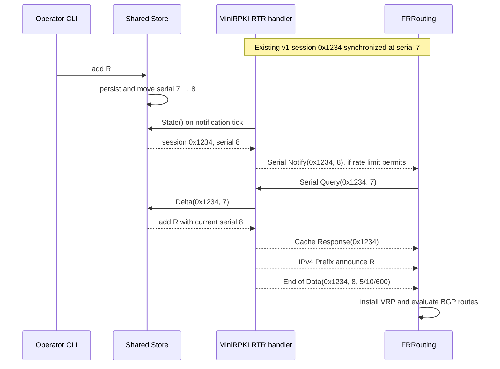

The same query can be triggered by FRR's normal refresh timer even when no Notify was sent.

---

## 21. What FRR calculates from R

MiniRPKI never receives the BGP routes in this application. FRR has two distinct inputs:

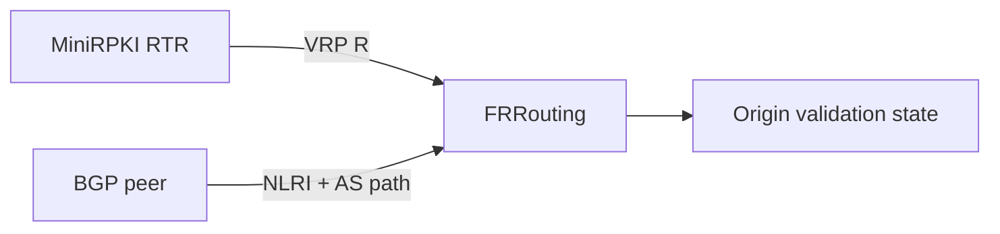

### 21.1 Route originated by AS65001

```text
BGP route:          192.0.2.0/24
BGP origin:         AS65001
covering VRP:       yes, R
origin authorized:  yes
length permitted:   /24 <= MaxLen /24

FRR result: Valid
```

### 21.2 Same route originated by AS65002

```text
BGP route:          192.0.2.0/24
BGP origin:         AS65002
covering VRP:       yes, R
origin authorized:  no

FRR result: Invalid
```

### 21.3 More-specific route from the authorized ASN

```text
BGP route:          192.0.2.0/25
BGP origin:         AS65001
covering VRP:       yes, R
origin authorized:  yes
length permitted:   /25 <= /24 is false

FRR result: Invalid
```

### 21.4 Uncovered route

```text
BGP route:          198.51.100.0/24
covering VRP:       none

FRR result: Not Found
```

The `ValidateRoute` helper produces the same teaching outcomes, but it is not in this live path. Operational proof requires inspecting FRR's validation-state output, not just seeing a connected TCP session.

---

## 22. First connection or full resynchronization: Reset Query

FRR can begin a new relationship with Reset Query:

```text
0102000000000008
```

Decoded:

```text
version 1
type 2
reserved field 0
length 8
no body
```

The server's `State` result remains the full record slice, so it sends:

```text
Cache Response(SID)
IPv4/IPv6 Prefix announcement for every current record
End of Data(SID, current serial, timers)
```

There are no withdrawals in a full load because the router is expected to construct the active dataset from the announcements.

An empty Store still produces a valid response:

```text
Cache Response
End of Data
```

---

## 23. Removing R

The command:

```sh
mini-rpki remove 192.0.2.0/24 --asn 65001
```

defaults MaxLen to 24, so it identifies the exact R tuple. If R exists:

1. `Store.Edit(R, false)` removes it from the candidate;
2. persistence succeeds;
3. serial advances once;
4. history records the new table;
5. `Delta` from the previous serial places R in `withdrawals`;
6. the server calls `Prefix(R, false)` before any announcements.

Withdrawal bytes:

```text
010400000000001400181800c00002000000fde9
```

FRR removes that authorization, then recalculates affected BGP routes. A route may become `Not Found` if no other covering VRP remains, or remain/turn `Invalid` if another covering VRP exists but does not authorize it.

A remove with a different `--maxlen` or ASN does not match and returns `exact VRP not found` through HTTP 400 to the CLI.

---

## 24. Unavailable history: Cache Reset

If the router's serial is not among the 129 retained snapshots, `Delta` returns `ok=false`.

MiniRPKI sends:

```text
0108000000000008
```

That is Cache Reset: version 1, type 8, reserved zero, length 8.

The recovery sequence is:

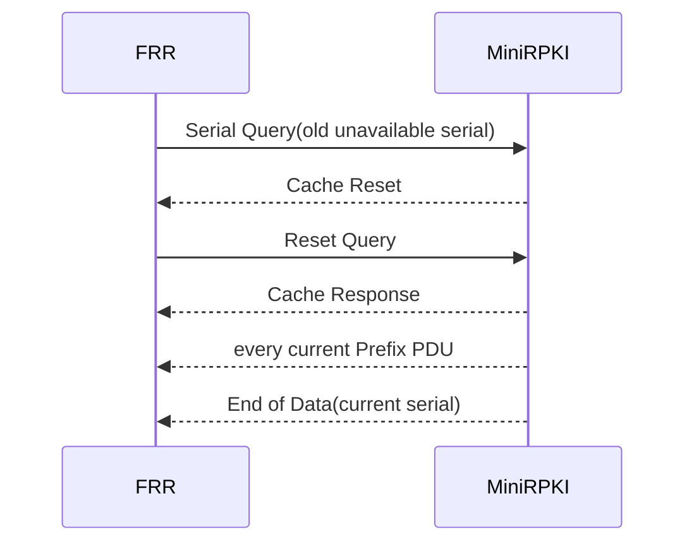

MiniRPKI keeps the TCP connection open after Cache Reset.

---

## 25. Disconnect, shutdown, and restart

### 25.1 FRR disconnects

When FRR closes TCP, the next codec `Read` returns an error such as EOF. The zero-PDU path returns quietly. Handler cleanup:

```text
signals the notification worker
closes the connection
removes it from Server.clients
calls WaitGroup.Done through the wrapper goroutine
```

MiniRPKI does not reconnect to FRR. The router is the RTR TCP client and owns reconnection.

### 25.2 MiniRPKI receives SIGTERM or Ctrl+C

```mermaid
flowchart TD
    Signal[SIGTERM / Ctrl+C]
    Context[ctx.Done closes]
    Listener[Close RTR listener]
    Clients[Close all registered clients]
    Accept[Accept wakes and returns]
    Reads[Handler Reads wake and return]
    Wait[WaitGroup waits]
    HTTP[HTTP Shutdown up to 5 seconds]
    Cleanup[Close/remove Unix socket and close TCP listener]

    Signal --> Context
    Context --> Listener --> Accept
    Context --> Clients --> Reads --> Wait
    Context --> HTTP
    Accept --> Wait --> Cleanup
```

This is coordinated application shutdown. The operating system performs the actual socket operations.

The HTTP shutdown is started concurrently with a five-second deadline, but `run` does not join or wait for that goroutine. After `server.Serve` returns, deferred listener cleanup and process exit can finish before the full five-second HTTP grace period. The code attempts graceful shutdown; it does not guarantee waiting for all five seconds.

### 25.3 MiniRPKI restarts

The old process's connections disappear. The new process loads saved VRPs but creates:

```text
new random 16-bit session
serial 1
one initial history snapshot
```

FRR reconnects. If it sends Reset Query, it receives the complete dataset. If it presents an old Session ID in a Serial Query, MiniRPKI sends Error Report code 0 and closes the connection. FRR must flush data learned from that cache, reconnect, and obtain a full dataset. A matching Session ID with a serial older than retained history receives Cache Reset instead.

Because the random Session ID is only 16 bits, a future restart can theoretically reuse an earlier numeric ID. Persisting a stronger generation identity is outside the current implementation.

---

## 26. Concurrency: what can happen at the same time

```mermaid
flowchart TB
    subgraph Control[Control side]
        API[One HTTP request goroutine<br/>possibly many concurrently]
        Edit[Store.Edit transaction]
        API --> Edit
    end

    subgraph Router1[FRR connection 1]
        Read1[query loop]
        Notify1[notification ticker]
        WM1[writeMu 1]
        Read1 --> WM1
        Notify1 --> WM1
    end

    subgraph Router2[FRR connection 2]
        Read2[query loop]
        Notify2[notification ticker]
        WM2[writeMu 2]
        Read2 --> WM2
        Notify2 --> WM2
    end

    Edit --> Store[(Store RWMutex)]
    WM1 --> Store
    WM2 --> Store
```

Important guarantees:

- Store readers see a complete old or new revision.
- Each router's response and Notify PDUs cannot interleave.
- Different routers can be served concurrently.
- A response uses copied records from one serial even if a later edit occurs during network writing.
- A later edit remains detectable and can produce a subsequent Notify/query.

The Store write lock includes disk I/O, so RTR reads may wait during persistence. The design favors atomic, easy-to-reason-about state over high write throughput, which fits a small lab cache.

---

## 27. RFC 8210 comparison

The authoritative reference is [RFC 8210](https://www.rfc-editor.org/rfc/rfc8210.html).

### 27.1 Behavior directly represented in the code

| RFC behavior | Implementation |
| --- | --- |
| Version-1 common PDU header | `PDU.Bytes` / `Read` |
| Network byte order | `binary.BigEndian` |
| Reset Query full load | `handle` uses `Store.State` and announces all records |
| Serial Query incremental load | `handle` uses `Store.Delta` |
| Minimum net delta | `Delta` compares historical/current sets |
| Cache Response → payloads → End of Data | serialized response block in `handle` |
| Announcement/withdrawal flag | `Prefix(r, true/false)` |
| Cache Reset when serial history is unavailable | `!ok` branch |
| Optional Serial Notify | one-second observer plus `notificationDue` |
| No more than one Notify per minute/connection | `lastNotify` test |
| Do not send Notify before negotiation | `negotiated` test |
| Do not answer Error Report with Error Report | both decoder and full-PDU checks |
| Version error code 4 before negotiation, 8 afterward | version block |

### 27.2 Session mismatch and unavailable history

`handle` first compares the Session ID in a Serial Query with the current Store Session ID. A mismatch receives Error Report code 0 and the handler returns, which closes the TCP connection. This implements RFC 8210's post-negotiation Session ID rule.

Only after Session IDs match does the server call `Store.Delta`. An unavailable serial/history result then receives Cache Reset and keeps the connection open so the router can issue Reset Query.

### 27.3 Error-code review points

- The code uses error 5 for every non-query PDU. That is accurate for an unsupported type; a known PDU used in the wrong direction may fit error 3, Invalid Request, more precisely.
- The code uses error 0 for wrong query body length. A protocol expert may prefer error 3 for some malformed requests, depending on interpretation.

These are review concerns. They should be tested against precise RFC sequences and actual clients before changing behavior.

### 27.4 Deliberately unsupported scope

The current code does not implement:

- RTR version 0;
- Router Key PDU type 9;
- TLS, SSH, TCP MD5, or TCP-AO transport;
- cryptographic ROA/repository validation;
- client authentication or authorization.

It is a plain-TCP laboratory server for operator-defined prefix VRPs. The startup log and help label it accordingly.

RFC 8210 assigns TCP port 323 to unprotected RTR. MiniRPKI defaults to port 8282 for this lab, while `--listen :323` can select the assigned port. This is a deployment default difference, not a different PDU encoding.

### 27.5 Resource and lifecycle limits visible in the code

- There is no connection-count limit. Each connection creates a handler goroutine and a notification goroutine.
- An idle connection can remain for two hours.
- The 4096-byte input limit safely covers supported queries but could reject a large valid Error Report or future variable-length PDU.
- One ten-second absolute write deadline covers an entire query response; it is not renewed for every PDU.
- Return values from `SetReadDeadline` and `SetWriteDeadline` are ignored.
- Client rows are not sorted.
- Notification workers are signaled by `closed` but are not individually included in the server WaitGroup.

### 27.6 Possible unexpected-Accept shutdown edge

The registered defers execute in reverse order:

```text
defer s.wg.Wait()     runs first
defer close(done)     runs afterward
```

If `Accept` returns an unexpected error while active handlers remain and the context is not canceled, `Serve` can wait for those handlers before `done` tells its watcher to exit. The watcher does not close clients on the `done` branch anyway, so handlers may remain until their own connection ends.

Normal context-cancel shutdown follows the safe path: the watcher closes the listener and clients before `Accept` returns and before `Wait` needs them to finish.

This is a possible edge found by code inspection; it was not reproduced during preparation of this document.

---

# Part VIII — Developer-only scenario source

## 28. Why `internal/scenario/scenario.go` is included

This is a non-test `.go` file, so it belongs in the requested source inventory. The running `mini-rpki` executable does not import this package. It does not provide a scenario CLI, modify the Store, configure FRR, or run automatically.

It is a set of private developer fixtures describing expected origin-validation examples.

```mermaid
flowchart LR
    subgraph DeveloperOnly[Separate developer aids]
        Scenario[internal/scenario fixtures]
        Helper[vrp.ValidateRoute helper]
    end
    subgraph RunningApplication[Running mini-rpki]
        Runtime[main/control]
        Store[vrp.Store]
        RTR[rtr.Server]
        Runtime --> Store
        Runtime --> RTR
    end
```

No non-test call connects the scenario package to `ValidateRoute`, and neither participates in the running path. They are separate aids that can be combined by developer verification code.

The old public scenario menu was removed. This package should not be mistaken for a hidden runtime feature.

---

## 29. `internal/scenario/scenario.go`: every block

### 29.1 Package and imports

```go
package scenario

import (
    "github.com/minirpki/mini-rpki/internal/vrp"
    "net/netip"
)
```

`vrp` supplies `Record`; `netip` parses the hard-coded prefixes.

### 29.2 `Scenario`: one complete teaching case

```go
type Scenario struct {
    Name        string       `json:"name"`
    Records     []vrp.Record `json:"vrps"`
    Route       string       `json:"advertisePrefix"`
    ASN         uint32       `json:"originASN"`
    Expected    string       `json:"expectedState"`
    Explanation string       `json:"explanation"`
}
```

A scenario combines:

```text
input VRPs
one BGP route prefix
one origin ASN
expected Valid / Invalid / Not Found result
human explanation
```

The Route is stored as a string while Records contain typed prefixes. These values are fixtures, not live router objects.

JSON tags describe an encodable representation, although the current public CLI does not expose it.

### 29.3 `record`: compact fixture builder

```go
func record(p string, m uint8, a uint32) vrp.Record {
    return vrp.Record{
        Prefix: netip.MustParsePrefix(p),
        MaxLen: m,
        ASN:    a,
    }
}
```

The actual return literal is written on one line. This helper keeps the scenario table shorter.

`MustParsePrefix` panics for an invalid developer-written literal. It is suitable for fixed fixture strings where invalid syntax is a programming error.

The helper itself does not call `Record.Validate`. Its current constants are canonical and use legal maximum lengths.

### 29.4 `All`: return fresh scenario data

```go
func All() []Scenario {
    return []Scenario{
```

Every call constructs a new outer slice and new nested record slices. There is no shared mutable global fixture table.

The source uses positional `Scenario` literals, so each value's position must remain aligned with struct field declaration order. Named fields would be more verbose but less sensitive to reordering.

### 29.5 `valid` scenario

Conceptually expanded from the compact source:

```go
Scenario{
    Name: "valid",
    Records: []vrp.Record{
        record("192.0.2.0/24", 24, 65001),
        record("2001:db8:100::/48", 48, 65001),
    },
    Route:       "192.0.2.0/24",
    ASN:         65001,
    Expected:    "Valid",
    Explanation: "A covering VRP authorizes this origin and prefix length.",
}
```

This uses R and matches the guide's AS65001 outcome.

### 29.6 `invalid-asn` scenario

```text
VRP:       192.0.2.0/24 maxlen 24 AS65002
BGP route: 192.0.2.0/24 origin AS65001
Expected:  Invalid
```

A covering authorization exists, so the route is not `Not Found`, but the origin does not match.

### 29.7 `invalid-length` scenario

```text
VRP:       192.0.2.0/24 maxlen 24 AS65001
BGP route: 192.0.2.0/25 origin AS65001
Expected:  Invalid
```

The origin matches, but `/25` exceeds MaxLen `/24`.

### 29.8 `not-found` scenario

```text
VRPs:      empty
BGP route: 192.0.2.0/24 origin AS65001
Expected:  Not Found
```

No authorization covers the route.

### 29.9 `multiple-origins` scenario

```text
VRPs:
  192.0.2.0/24 maxlen 24 AS65001
  192.0.2.0/24 maxlen 24 AS65002

BGP route: 192.0.2.0/24 origin AS65001
Expected:  Valid
```

Validation is existential: one covering VRP that matches both ASN and length is enough. Another covering VRP authorizing a different ASN does not turn the route Invalid.

### 29.10 `All` return

```go
    }
}
```

The five entries are returned in their source order:

```text
valid
invalid-asn
invalid-length
not-found
multiple-origins
```

This order has no routing meaning.

### 29.11 `Find`: value plus found Boolean

```go
func Find(name string) (Scenario, bool) {
    for _, s := range All() {
        if s.Name == name {
            return s, true
        }
    }
    return Scenario{}, false
}
```

The function constructs the list, searches linearly, and returns a common Go pair:

```text
value, true   match found
zero value, false  no match
```

Examples:

```text
Find("valid") → populated scenario, true
Find("VALID") → empty Scenario, false
Find("other") → empty Scenario, false
```

The comparison is exact and case-sensitive. The Boolean distinguishes a failed lookup from a hypothetical valid all-zero scenario.

---

# Part IX — The complete example as state snapshots

## 30. Checkpoint table

Assume R is absent and the Store begins at SID `0x1234`, serial 7.

| Checkpoint | Code | Important value |
| --- | --- | --- |
| Shell starts CLI | `main`, `os.Args[1:]` | `add 192.0.2.0/24 --asn 65001` |
| Global option pass | `run` | `jsonOutput=false`; args unchanged |
| Command grammar | `parseRequest` | action `add` |
| Prefix parse | `netip.ParsePrefix` | typed `192.0.2.0/24` |
| Flag parse | `flags.Parse` | ASN text `65001`; MaxLen text `24` |
| Number conversion | `strconv.ParseUint` | ASN `uint32(65001)`; MaxLen `uint8(24)` |
| CLI validation | `Record.Validate` | succeeds |
| Local encoding | `control.Call` | JSON Request(add, R) |
| Local transport | custom `DialContext` | Unix socket, not TCP |
| Server decoding | `API.ServeHTTP` | strict typed Request(add, R) |
| Dispatch | action switch | `Store.Edit(R, true)` |
| Store search | `Edit` | R absent |
| Candidate | `append` + `Normalize` | R included, unique, sorted |
| Persistence | temp/write/sync/close/rename | JSON file selected atomically |
| Commit | `replace` | serial 7 → 8; new snapshot |
| API reply | mutation result | serial 8, all VRPs, R |
| CLI display | `renderResponse` | `Saved... Cache serial: 8` |
| Change observation | notifier `State` | SID `0x1234`, serial 8 vs seen 7 |
| Router hint | `New(Notify...)` | Serial Notify, if rate allowed |
| Router request | codec `Read` | Serial Query SID `0x1234`, serial 7 |
| Delta | `Store.Delta` | additions `[R]`, withdrawals `[]` |
| Response start | `New(CacheResponse...)` | session `0x1234` |
| Payload | `Prefix(R, true)` | 20-byte IPv4 announcement |
| Commit marker | `New(EndOfData...)` | serial 8, timers 5/10/600 |
| Router calculation | FRR | BGP route becomes Valid or Invalid according to route origin/length |

---

## 31. Values as they cross each boundary

### 31.1 Shell strings

```text
["add", "192.0.2.0/24", "--asn", "65001"]
```

### 31.2 Typed in-memory request

```text
control.Request{
  Action: "add",
  Record: vrp.Record{
    Prefix: 192.0.2.0/24,
    MaxLen: 24,
    ASN: 65001,
  },
}
```

### 31.3 Local management bytes

```json
{"action":"add","record":{"prefix":"192.0.2.0/24","maxLength":24,"asn":65001}}
```

### 31.4 Persistent JSON record

```json
{
  "prefix": "192.0.2.0/24",
  "maxLength": 24,
  "asn": 65001
}
```

### 31.5 RTR binary payload

```text
010400000000001401181800c00002000000fde9
```

### 31.6 FRR's separate BGP input

```text
NLRI:       192.0.2.0/24
AS path:    ... 65001        or ... 65002
origin ASN: last relevant AS in the path according to router validation logic
```

The same information changes representation at each boundary. The typed Record is the central internal model.

---

## 32. Literal first-start duplicate path

On a missing persistence file:

```text
Open chooses DemoRecords
serial starts at 1
R is already in records
```

The command then follows:

```text
parse request normally
send control request normally
API calls Store.Edit normally
Edit finds exact R
Edit returns nil before replace
API returns current serial 1
CLI prints Saved and Cache serial 1
notifier sees no serial change
FRR receives no new RTR update for this command
```

This is not an error. It is idempotent add behavior. The only potentially confusing part is the human word `Saved`, which does not distinguish “already present” from “newly added.”

---

# Part X — Other commands through the same blocks

## 33. Command matrix

| Command | Parser result | Control API call | Store/RTR effect | Human renderer |
| --- | --- | --- | --- | --- |
| `mini-rpki help` | Local help branch | None | None | Printed in `run` |
| `mini-rpki serve ...` | `serve` FlagSet | Starts API/RTR | Opens Store/listeners | Startup log |
| `mini-rpki add ...` | Action + Record | `Edit(record, true)` | Real change or duplicate no-op | Saved + serial |
| `mini-rpki remove ...` | Action + exact Record | `Edit(record, false)` | Withdrawal or error | Removed + serial |
| `mini-rpki list` | Action only | `State` | Read-only | VRP table |
| `mini-rpki clear` | Action only | `Replace(empty)` | One transaction if nonempty | Cleared + serial |
| `mini-rpki status` | Action only | Store + RTR accessors | Read-only snapshots | IDs, counts, timers, clients |
| `mini-rpki interface` | Public action mapped to `address` | `API.address` | Read-only listener/interface view | Endpoint table |
| control command + `--json` | Option removed before parse | Same add/remove/list/clear/status/interface operation | Same operation | Complete pretty JSON |

### 33.1 `clear` when already empty

`Replace([]Record{})` normalizes an empty candidate and compares it with current records. If already empty, it returns without persistence or serial advancement. The CLI still prints `All records cleared.` with the unchanged serial.

### 33.2 `list` and `status` consistency

Each `State` call is internally consistent. Separate commands can naturally see different revisions if an edit happens between them.

### 33.3 `interface` is not a health test

It proves that the running server published a listener address and that the OS exposed matching interfaces. It does not prove FRR can route to it, that a firewall permits it, or that RTR synchronization completed.

---

## 34. Failure map

| Failure point | Example | Server contacted? | State consequence |
| --- | --- | ---: | --- |
| CLI grammar | missing `--asn` | No | None |
| Prefix syntax | `not-a-prefix` | No | None |
| Record invariant | IPv4 MaxLen 33 | No | None |
| Unix connect | server stopped or paths differ | Attempted | None from this request |
| JSON decode | unknown field from custom client | Yes | None |
| Exact remove | tuple absent | Yes | None |
| Persistence | directory/write/sync/rename error | Yes | memory and serial remain old |
| HTTP response path | client disconnects after server commit | Yes | mutation may have committed even though CLI sees an error |
| Output decode | malformed server JSON | Yes | Store operation may already have succeeded |
| TCP bind | port/address unavailable | Startup | Server fails before RTR serving |
| RTR malformed PDU | invalid length/body | RTR client | Error Report when enough header exists, then close |
| RTR delta unavailable | old serial | RTR client | Cache Reset; Store unchanged |
| RTR write failure | peer/network stops accepting | RTR client | Close connection; Store unchanged |

The control transaction is not an end-to-end distributed transaction with the CLI terminal. Persistence and Store commit can succeed before a response connection fails. Operators should inspect `list` or `status` after an ambiguous transport failure.

---

# Part XI — Complete source coverage ledger

## 35. Every non-test Go file and function

Use this as a checklist after reading the trace.

### 35.1 `cmd/mini-rpki/main.go`

| Source element | Purpose | Explained in |
| --- | --- | --- |
| package/import block | Executable plus process/network dependencies | 5.1 |
| `env` | Environment setting or fallback | 5.2 |
| `main` | Entry point and final error/exit handling | 5.3 |
| `run`: socket + `--json` filter | Common client/server configuration and output mode | 5.4 |
| `run`: help | Local command help | 5.5 |
| `run`: `serve` FlagSet | Register, parse, and validate server options | 5.6–5.9 |
| `run`: Store open | Construct authoritative state | 5.10, Part II |
| `run`: Unix listener | Local management endpoint and cleanup | 5.11 |
| `run`: TCP listener | RTR endpoint | 5.12 |
| `run`: context/object wiring | Shared shutdown and Store pointer | 5.13 |
| `run`: control goroutines | Concurrent HTTP serving and graceful shutdown | 5.14–5.15 |
| `run`: RTR foreground | Principal service lifetime | 5.16 |
| `run`: CLI branch | Parse, map, call, render | 5.17 |

### 35.2 `cmd/mini-rpki/commands.go`

| Source element | Purpose | Explained in |
| --- | --- | --- |
| package/import block | CLI grammar dependencies | 10.1 |
| `parseRequest`: compatibility | Remove hidden old `vrp` prefix | 10.3 |
| request/action block | Require and select a command | 10.4–10.5 |
| add/remove prefix block | Parse typed prefix | 10.6–10.7 |
| record FlagSet block | Define and parse ASN/MaxLen | 10.8–10.9 |
| numeric conversion | Enforce widths and decimal syntax | 10.10–10.11 |
| Record construction/validation | Produce safe typed request | 10.12 |
| default/success returns | Reject unknown action or return request | 10.13 |

### 35.3 `cmd/mini-rpki/output.go`

| Source element | Purpose | Explained in |
| --- | --- | --- |
| package/import block | JSON, writers, tables, timestamps | 13.1 |
| `printRecords`: count/empty | Clear empty and count output | 13.2 |
| `printRecords`: table | Aligned record rows | 13.3 |
| `renderResponse`: JSON | Preserve complete pretty JSON | 13.5 |
| `renderResponse`: interface | Listener/endpoint table | 13.6–13.8 |
| `renderResponse`: list | Decode and print records | 13.9 |
| `renderResponse`: status | Summary and client rows | 13.10–13.11 |
| `renderResponse`: mutation | Saved/Removed/Cleared and serial | 13.12–13.14 |

### 35.4 `internal/control/control.go`

| Source element | Purpose | Explained in |
| --- | --- | --- |
| imports | Local HTTP/JSON and component access | 12.1 |
| `Request` | Typed control request | 12.2 |
| `Status` | Combined Store/RTR response | 12.3 |
| `API` | Shared component pointers | 12.4 |
| `API.ServeHTTP`: method/body checks | Bound strict request decoding | 12.5–12.7 |
| action dispatch | Address/status/list/mutations | 12.8–12.13 |
| error/result encoding | HTTP error or JSON success | 12.14–12.16 |
| `Listen` | Unix listener plus mode 0600 | 12.17 |
| `Call`: transport | Force HTTP over Unix socket | 12.18 |
| `Call`: request | JSON buffer and HTTP POST | 12.19–12.21 |
| `Call`: response | Bounded read and status conversion | 12.22–12.23 |

### 35.5 `internal/control/address.go`

| Source element | Purpose | Explained in |
| --- | --- | --- |
| imports | Address parsing/interface enumeration | 14.1 |
| `Endpoint`, `AddressInfo` | Control response models | 14.2 |
| `describeAddress`: parse | Listener host/port/bound IP | 14.3–14.5 |
| interface loops | UP interfaces and parsed addresses | 14.6–14.7 |
| specific/wildcard matching | Find reportable local endpoints | 14.8–14.10 |
| fallback/sort | Stable best-effort report | 14.11–14.12 |
| `API.address` | Require and describe live listener | 14.13 |

### 35.6 `internal/vrp/defaults.go`

| Source element | Purpose | Explained in |
| --- | --- | --- |
| package/import | Prefix constants | 7 |
| `DemoRecords` | Fresh fallback demonstration slice | 7.1 |

### 35.7 `internal/vrp/store.go`

| Source element | Purpose | Explained in |
| --- | --- | --- |
| imports | Randomness, JSON, files, sorting, locking | 8.1 |
| `Record` | Exact VRP tuple | 8.2 |
| `Record.Validate` | Canonical prefix and MaxLen invariants | 8.3 |
| `Normalize` | Validate, deduplicate, sort | 8.4 |
| `Snapshot`, `Store` | Current state and bounded history | 8.5 |
| `Open`: session | Random SID and serial 1 | 8.6 |
| `Open`: load choice | Saved file versus defaults | 8.7 |
| `Open`: normalize/history | Safe initial state | 8.8–8.9 |
| `State` | Locked copied snapshot | 8.10 |
| `Replace` | Locked whole-table mutation | 8.11 |
| `Edit` | Exact add/remove and duplicate behavior | 8.12–8.15 |
| `replace`: candidate/equality | Normalize and suppress no-op | 8.16–8.17 |
| `replace`: persistence | Temp/write/sync/close/rename | 8.18–8.21 |
| `replace`: commit | Logs, serial, records, history limit | 8.22–8.24 |
| `Delta` | Net additions/withdrawals or unavailable | 8.26–8.31 |
| `ValidateRoute` | Developer-only state model | 8.32 |

### 35.8 `internal/rtr/codec.go`

| Source element | Purpose | Explained in |
| --- | --- | --- |
| imports/constants/`be` | Protocol IDs, size, byte order | 16.1–16.3 |
| `PDU` | Common decoded message | 16.4–16.5 |
| `PDU.Bytes` | Encode common header/body | 16.6 |
| `Read` | Full bounded PDU from stream | 16.7–16.10 |
| `Write` | Complete partial writes | 16.11 |
| `New` | Control PDU constructor | 16.12 |
| `Prefix` | IPv4/IPv6 announcement/withdrawal | 16.13–16.17 |
| `Error` | Error Report with offending bytes/text | 16.18–16.20 |

### 35.9 `internal/rtr/server.go`

| Source element | Purpose | Explained in |
| --- | --- | --- |
| imports | TCP, context, locking, timing | 17.1 |
| `Client` | Status metadata | 17.2 |
| `notificationDue` | Change/negotiation/rate decision | 17.3 |
| timer constants | End-of-Data timing values | 17.4 |
| `Server` | Listener-level shared state | 17.5 |
| `ListenerAddress` | Safe readiness/address read | 17.6 |
| `RefreshInterval` | Configured or default value | 17.7 |
| `Clients` | Safe copied client list | 17.8 |
| `Serve`: initialize | Validate, publish, cancellation | 17.9–17.13 |
| `Serve`: accept | Register and start handlers | 17.14–17.17 |
| `handle`: lifecycle/state | Cleanup and per-client variables | 18.1–18.3 |
| notification goroutine | Observe Store and send rate-limited hint | 18.4–18.7 |
| input/error blocks | Read deadlines and decoder errors | 18.8–18.10 |
| protocol checks | Error Report, version, type, lengths | 18.11–18.14 |
| Reset/Serial data choice | State versus Delta/Cache Reset | 18.15–18.17 |
| response sequence | Cache Response, withdrawals, adds, EOD | 18.18–18.23 |

### 35.10 `internal/scenario/scenario.go`

| Source element | Purpose | Explained in |
| --- | --- | --- |
| package/import | Developer fixture package | 28, 29.1 |
| `Scenario` | VRPs + BGP input + expected state | 29.2 |
| `record` | Compact fixed Record builder | 29.3 |
| `All` | Five fresh scenario fixtures | 29.4–29.10 |
| `Find` | Exact name lookup with found Boolean | 29.11 |

---

## 36. Repository-function call graph

```mermaid
flowchart TB
    OS[Go runtime] --> Main[main]
    Main --> Run[run]
    Run --> Env[env]

    Run -->|serve| Demo[vrp.DemoRecords]
    Run -->|serve| Open[vrp.Open]
    Demo -. defaults argument .-> Open
    Run --> Listen[control.Listen]
    Run --> StdHTTP[http.Server.Serve]
    Run --> RTRServe[rtr.Server.Serve]

    Run -->|client command| Parse[parseRequest]
    Run --> Call[control.Call]
    Run --> Render[renderResponse]
    Parse --> Validate[Record.Validate]
    Render --> Print[printRecords]
    Call -. HTTP over Unix socket .-> ServeHTTP[control.API.ServeHTTP]
    StdHTTP --> ServeHTTP

    ServeHTTP --> AddressAPI[API.address]
    AddressAPI --> ListenerAddress[Server.ListenerAddress]
    AddressAPI --> Describe[describeAddress]
    ServeHTTP --> State[Store.State]
    ServeHTTP --> Clients[Server.Clients]
    ServeHTTP --> Refresh[Server.RefreshInterval]
    ServeHTTP --> Edit[Store.Edit]
    ServeHTTP --> Replace[Store.Replace]

    Open --> Normalize[vrp.Normalize]
    Normalize --> Validate
    Edit --> Validate
    Edit --> PrivateReplace[Store.replace]
    Replace --> PrivateReplace
    PrivateReplace --> Normalize

    RTRServe --> Refresh
    RTRServe --> Handle[rtr.Server.handle]
    Handle --> NotificationDue[notificationDue]
    Handle --> State
    Handle --> Delta[Store.Delta]
    Handle --> Read[rtr.Read]
    Handle --> New[rtr.New]
    Handle --> Prefix[rtr.Prefix]
    Handle --> Error[rtr.Error]
    Handle --> Write[rtr.Write]
    Handle --> Refresh
    Error --> Bytes[PDU.Bytes]
    Write --> Bytes

    ScenarioFind[scenario.Find] --> ScenarioAll[scenario.All]
    ScenarioAll --> ScenarioRecord[scenario.record]
    ValidateRoute[vrp.ValidateRoute<br/>separate developer helper]
```

The dotted arrow from `control.Call` to `ServeHTTP` represents cross-process HTTP over the Unix socket, rather than a direct Go function call. Standard-library calls inside individual functions are omitted except for `http.Server.Serve`, which shows how the API handler is entered.

The disconnected scenario/`ValidateRoute` nodes are outside the runtime graph. No non-test source calls `ValidateRoute`; `scenario.Find` does call `scenario.All`, and `All` calls the private `record` helper.

---

# Part XII — Go concepts seen in this execution

## 37. Compact concept index

| Go concept | What it means here | Networking analogy |
| --- | --- | --- |
| Package | Files compiled as a named unit | Protocol/module boundary |
| Module | Repository-level import namespace from `go.mod` | Administrative namespace |
| Struct | Named group of fields, such as `Record` or `PDU` | Packet or RIB-entry data model |
| Method | Function attached to a type, such as `Store.Edit` | Operation supported by a component |
| Pointer | Reference to one shared object, such as `*Store` | Multiple control modules referencing one RIB |
| Array | Fixed-size value, such as `[2]byte` seed | Fixed protocol field buffer |
| Slice | Length-aware view/list, such as `[]Record` | Variable route list or packet buffer |
| Map | Key lookup, used as an exact-record set | Hash-indexed route membership |
| Interface | Required method set, such as `io.Reader` | Standard handoff contract between layers |
| Error | Explicit failure return checked by caller | Negative response/cause passed upstream |
| Goroutine | Concurrent Go function | Independent protocol/session worker |
| Channel | Typed event path, used here mainly as close signal | Event notification/control signal |
| Mutex | Exclusive/shared state lock | Serialized configuration ownership |
| Context | Cancellation/deadline propagation | Administrative shutdown signal |
| `defer` | Run cleanup when the function returns | Guaranteed teardown procedure |
| Variadic `...` | Zero or more arguments/elements | Variable list of PDU body fields |

### 37.1 Pointers in the most important object graph

```go
server := &rtr.Server{Store: s, Refresh: uint32(refresh)}
api := control.API{Store: s, RTR: server}
```

`s` is a `*vrp.Store`. Both components copy the pointer value, so both reach the same Store object. The objects are not duplicated.

### 37.2 Slices are views with length

```go
seed[:]              // view over every byte of a fixed array
os.Args[1:]          // view excluding executable name
args[2:]             // view containing add/remove flags
append(copy, r)      // construct a longer record list
```

A slice describes an underlying array with a start, length, and capacity. Creating a slice view usually does not copy elements. Explicit `append([]Record(nil), source...)` is used when an independent record array is required.

### 37.3 Error returns form an upward chain

```text
file/validation/socket error
    → Store or control method returns error
    → API converts to HTTP 400, or run returns directly
    → control.Call converts non-200 to error
    → run returns error
    → main logs and exits 1
```

Go uses explicit return values instead of automatic exceptions for these ordinary failures.

### 37.4 Goroutines are not automatically synchronized

Starting a goroutine only permits concurrent progress. Correct sharing still needs:

```text
Store RWMutex      for VRP state
Server mutex       for clients/listener
per-client mutex   for output ordering and local session fields
channels/context   for stop signals
WaitGroup          for handler completion
```

### 37.5 Interfaces separate logic from concrete transport

`Read(r io.Reader)` and `Write(w io.Writer, p PDU)` operate on method contracts. A `net.Conn` satisfies them, but the codec need not know about IP addresses, TCP handshakes, or connection acceptance.

---

# Part XIII — What each layer does

## 38. Application, library, runtime, and operating-system boundary

| Layer | Actual responsibilities in this flow |
| --- | --- |
| MiniRPKI code | CLI grammar, Record validation, Store transaction, session/serial/history, response choice, RTR layouts |
| Go standard library | Argument/environment access, flags, JSON, HTTP parsing, typed IPs, random bytes, file calls, time, locks |
| Go runtime | Schedule goroutines, allocate/manage memory, close process after `main`, garbage collection |
| Linux kernel | Processes, Unix/TCP sockets, TCP reliability, interface list, file permissions, signals, filesystem rename/sync operations |
| Docker | Process/filesystem/network namespace and mounted data path |
| Containerlab | Create containers and virtual links/interfaces for the lab topology |
| FRRouting | RTR client behavior, VRP table, BGP RIB, Valid/Invalid/Not Found calculation |

The standard library understands HTTP, JSON, TCP, and binary integers. It does not understand RFC 8210. MiniRPKI's `internal/rtr` package supplies that protocol meaning.

MiniRPKI does not implement TCP retransmission, veth creation, container namespaces, or BGP. Those belong to lower layers or FRR.

---

# Part XIV — A practical reading route

## 39. Read the source in this order

Do not try to memorize every line. Re-run one path mentally.

1. Open [`cmd/mini-rpki/main.go`](../cmd/mini-rpki/main.go) and identify the `serve` and client branches.
2. Follow our command through [`cmd/mini-rpki/commands.go`](../cmd/mini-rpki/commands.go) until `control.Request` is complete.
3. Follow the client half of [`internal/control/control.go`](../internal/control/control.go), `Call`, across the Unix socket.
4. Continue in `API.ServeHTTP` until `Store.Edit`.
5. Read [`internal/vrp/store.go`](../internal/vrp/store.go) from `Edit` through `replace`, then inspect `Delta`.
6. Return through [`cmd/mini-rpki/output.go`](../cmd/mini-rpki/output.go) to see what the operator learns.
7. Follow [`internal/rtr/server.go`](../internal/rtr/server.go) from notification tick to Serial Query response.
8. Use [`internal/rtr/codec.go`](../internal/rtr/codec.go) to translate each selected PDU into bytes.
9. Finish at FRR and keep the VRP data separate from the validation state FRR calculates.

### 39.1 Five checks for your own understanding

Try to answer these without looking back, then use the linked sections to verify yourself:

1. Why can the `add` CLI process exit while the RTR server continues running?
2. Why does a duplicate add return success without advancing serial?
3. Why must persistence rename succeed before the Store changes its in-memory serial?
4. Why does a Serial Query use both Session ID and Serial Number?
5. Which exact component labels `192.0.2.0/24` from AS65002 as Invalid?

### 39.2 Answers

1. They are separate operating-system processes using the same executable. The CLI sends one Unix-socket request to the long-running `serve` process.
2. `Edit` treats an already-present exact tuple as the desired state already being satisfied and returns before `replace`.
3. Otherwise the server could advertise a revision that it had failed to preserve for restart.
4. Serial values belong to one cache generation; Session ID identifies that generation.
5. FRRouting, after combining the VRP received from MiniRPKI with its separately learned BGP route.

---

## 40. Evidence and limits of this document

This guide was prepared by inspecting the current non-test Go source and the project knowledge base. No unit tests, containerlab integration suite, container restart, or live FRR operation was run while preparing it. The integration suite was deliberately not used because it changes the dataset.

Wire-format and sequence comparisons use [RFC 8210](https://www.rfc-editor.org/rfc/rfc8210.html). Statements about current code paths come from the source files linked throughout the guide. Historical verification recorded elsewhere in the repository is not presented here as a current test result.

For comfortable reading in VS Code, open this file and run **Markdown: Open Preview** (`Ctrl+Shift+V`). Mermaid support in the Markdown renderer displays the diagrams. Markdown remains the maintainable source; it can be printed to PDF later without losing the code links in the repository version.
